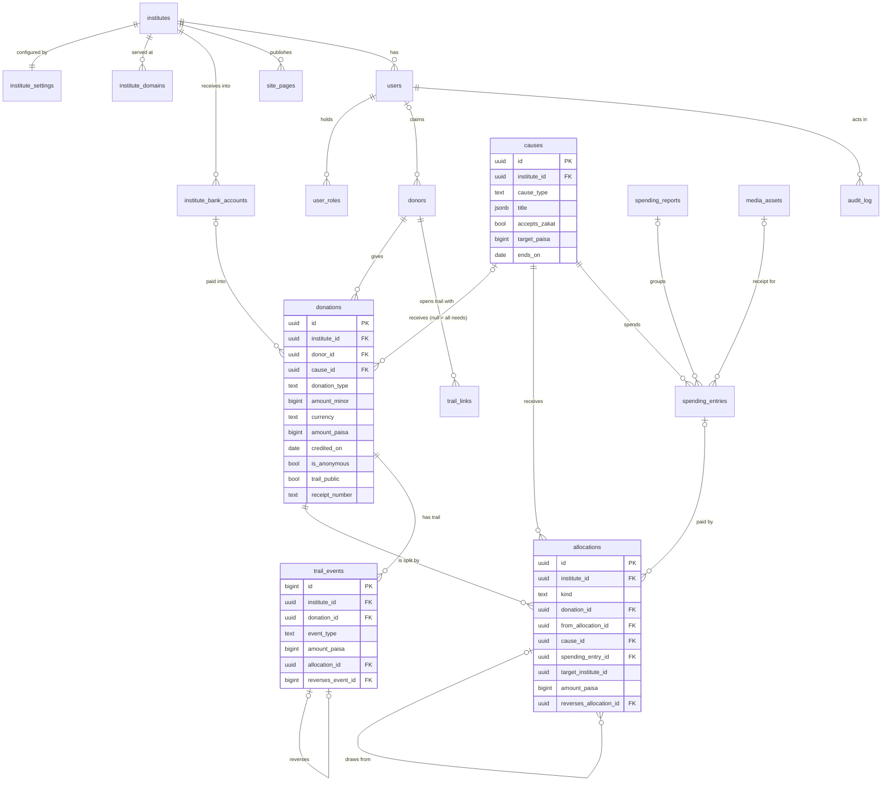
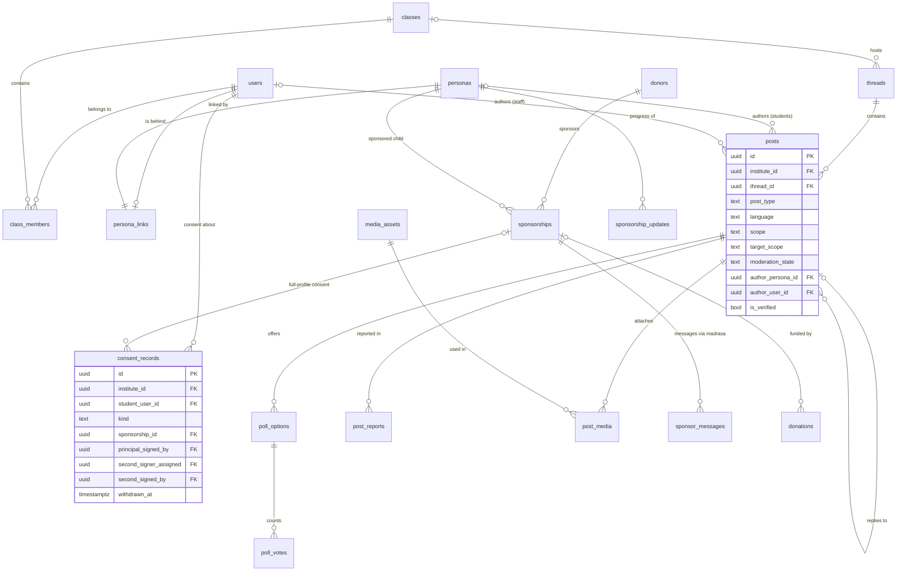
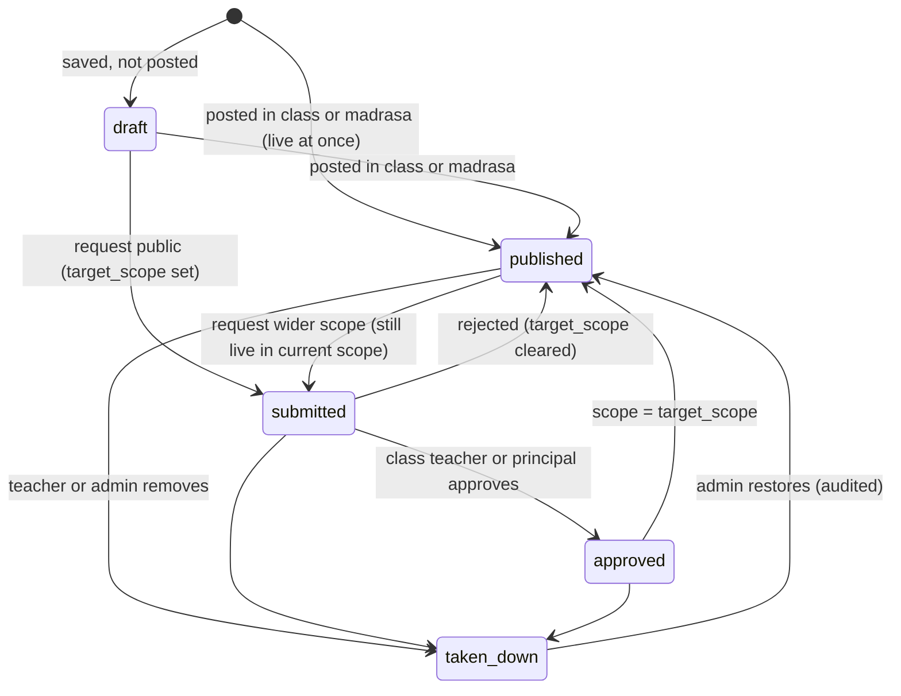

# 04 Database

**Status:** planning · **Last updated:** 2026-11-07 · **Owner:** Sami · **Epic owned:** P0-E2

Read [00-MASTER-PLAN.md](00-MASTER-PLAN.md) first. It wins over this document. Words in **bold** in the glossary ([00 §8](00-MASTER-PLAN.md#8-glossary)) mean exactly what the glossary says.

## 1. Purpose

This document defines how Tazkiyah stores its data in Postgres on Neon. It gives every table, its main fields, types and constraints, the row-level security (RLS) rules, the append-only donation trail, first-in-first-out (FIFO) allocations, consent records, content tables, the audit log, indexes, migrations and retention.

A developer or agent should be able to write the migrations from this document without asking questions. The SQL here is a sketch of shape and rules, not final code.

## 2. Scope and out of scope

**In scope**

- Every table for phases P0 to P4, with `institute_id` and RLS on each.
- How the request supplies the institute and user to the database (the contract with [03 §6](03-architecture.md)).
- Database-level guarantees: institute isolation, append-only trail and audit log, Zakat ring-fencing, donor anonymity in public views, persona privacy, two sign-off consent.
- A test approach that proves one institute cannot read or change another institute's rows.
- Indexes, the migration approach and retention rules.

**Out of scope (owned elsewhere)**

- Business rules for donations, FIFO edge cases, receipts and refunds: [06](06-donations-and-trail.md). This document gives the data shape that 06 needs.
- Moderation rules, consent wording and child-safety rules: [07](07-content-hub-student-teacher.md).
- Who may do what in screens: the permission matrix in [05 §7](05-public-pages-roles-admin.md). RLS here enforces the data side of that matrix.
- Login, password hashing, sessions, two-factor, the database driver and the ORM: [03 §6](03-architecture.md) and [03 §4](03-architecture.md).
- Media file storage and compression: [03 §8](03-architecture.md). This document stores only media metadata.
- Backups and point-in-time restore: [03 §13](03-architecture.md).
- Not planned at all (D-001, [00 §1](00-MASTER-PLAN.md#1-summary-goals-and-non-goals)): institute signup, a super-admin area, billing, the central platform fund, the cross-institute community, clinic patient data (D-021), admissions, fees and attendance. Only room for the platform fund and the community is kept.
- Online payments detail (D-025). Only the columns that P5 will need without a rebuild are added now (`gateway_payment_id`, `currency`, `frequency`). Recurring plan tables are designed in P5.

## 3. Decisions

Decisions already in the log that shape this schema:

| Decision | Effect on the schema |
| --- | --- |
| [D-001](08-decision-log.md#d-001), [D-002](08-decision-log.md#d-002) | One shared database. Every table has `institute_id`. RLS separates institutes. |
| [D-003](08-decision-log.md#d-003) | `institute_domains` maps a request domain to an institute. |
| [D-004](08-decision-log.md#d-004) | `allocations` implement FIFO matching of spending entries to donations. |
| [D-009](08-decision-log.md#d-009) | `donors.user_id` is nullable for guest donors; `trail_links` holds the private link tokens. |
| [D-010](08-decision-log.md#d-010) | Public views always show amounts and hide the name of anonymous donations. |
| [D-011](08-decision-log.md#d-011) | `causes.accepts_zakat` and `causes.zakat_approved_by`. |
| [D-012](08-decision-log.md#d-012) | All-needs donations have `cause_id` null until the admin allocates them. |
| [D-015](08-decision-log.md#d-015), [D-028](08-decision-log.md#d-028) | `persona_links` is readable only by the student, their teachers and admins. Personas never expire. |
| [D-016](08-decision-log.md#d-016) | `consent_records` are staff-entered. There is no guardian account table. |
| [D-017](08-decision-log.md#d-017) | Orphan full-profile consent has two sign-off columns and a withdrawal column. |
| [D-024](08-decision-log.md#d-024) | `allocations.kind` already includes `to_institute`, and `donations.source_allocation_id` exists. |

New decisions made in this document. They are **not yet in [08](08-decision-log.md)**. The main agent should log them as `D-` entries in the step 4 consistency check.

| ID | Decision | Options considered | Reason |
| --- | --- | --- | --- |
| 04-D1 | **Money rule:** every amount is a `bigint` in minor units. PKR amounts are in **paisa** (Rs 1 = 100 paisa) and their columns end in `_paisa`. A donation also stores `currency` (ISO 4217, default `PKR`) and `amount_minor` in that currency. Every ledger row (allocations, spending, balances) is in PKR paisa. No floats, no `numeric` for money. | `numeric(14,2)`; integer paisa; float | Integers are exact, fast and simple to sum. Rs 6.6 million a year is 660,000,000 paisa, far inside `bigint`. Storing the original currency now lets P5 add overseas currencies without a rebuild. |
| 04-D2 | **Composite keys for isolation.** Every table has `unique (institute_id, id)`, and every foreign key between institute-owned tables is composite: `(institute_id, x_id) references x (institute_id, id)`. | Single-column foreign keys plus RLS only | The database itself refuses a donation in one institute that points at a cause in another. RLS stops reads; composite keys stop wrong links. The only planned exception is the future platform transfer (§9). |
| 04-D3 | **Isolation is a restrictive RLS policy on every table**, ANDed with the role policies. A missing session institute means zero rows (fail closed). | Isolation inside each permissive policy | One policy shape, easy to check automatically, and impossible to forget when a new role policy is added. |
| 04-D4 | **Roles come from the database, not from the session.** The session supplies only institute and user. Policies look up `user_roles`. | Pass the role in the session | A bug in the app cannot grant a role the user does not hold. |
| 04-D5 | **Bilingual fixed content uses a `localized_text` JSON domain**, for example `{"ur": "گندم کا ذخیرہ", "en": "Wheat stock"}`. | Paired `_ur` and `_en` columns; a generic translations table | A third language needs no schema change. It keeps one column per field, unlike a translations table, and keeps foreign keys simple. Community posts are not translated: they have one `language` and plain text (A4). |
| 04-D6 | **The persona-to-student link lives in its own table, `persona_links`.** Posts, threads and sponsorships point at the persona, never at the student's user row. | A `user_id` column on `personas` | Any row a student can read (a post, a persona) carries no path to the real student. Only RLS on `persona_links` decides who can make that link. |
| 04-D7 | **Users are per institute.** The same email at two institutes is two user rows. | One global user table | Keeps the rule "every table has `institute_id`" with no exception. A future shared identity can be a new table that links user rows, with no change to these tables. |
| 04-D8 | **State fields are `text` with a `CHECK` list**, not Postgres enum types. | Native enums | Easier to read and to change in a migration. Values reserved for the future (`community`, `to_institute`) are in the list now but blocked by a rule, so enabling them is not a schema change. |
| 04-D9 | **New donations default to anonymous** (`is_anonymous = true`) and trails default to private. The donor chooses to show their name. | Default to showing names | Agent rule 8: privacy wins over convenience. See proposed REQ-DPR-012 at the end. |
| 04-D10 | **FIFO order is the donation's `credited_on` (named `received_at` before D-120), then `id`.** All-needs money allocated to a cause later keeps its original received date. | Order by allocation date | Matches the glossary: the oldest donations pay first. 06 §8 may confirm or change this; the data supports both. |
| 04-D11 | **Admins and finance officers can see who gave an anonymous donation**, because they record bank transfers, send receipts and reconcile. Every other path (public views, editor and teacher screens, exports for others, logs, the audit log) never contains the name. | Hide the name from admins too | Manual bank recording (D-008) needs the payer's name. This is how this document reads REQ-DPR-009. See the conflict note under Requirements covered. |

## 4. Entity overview and ER diagram

### 4.1 Tables by area

| Area | Tables |
| --- | --- |
| Institute | `institutes`, `institute_settings`, `institute_domains`\*, `institute_bank_accounts`\*, `site_pages`\* |
| People | `users`, `user_roles`, `classes`, `class_members`, `personas`, `persona_links`\* |
| Money | `donors`, `causes`, `donations`, `allocations`, `spending_entries`, `spending_reports`\*, `trail_events`, `trail_links`\*, `receipt_counters`\* |
| Consent and sponsorship | `consent_records`, `sponsorships`, `sponsorship_updates`, `sponsor_messages` |
| Content | `threads`, `posts`, `poll_options`, `poll_votes`, `post_reports`, `post_media`\*, `media_assets` |
| Records | `audit_log` |

\* Tables added by this document beyond the shared list.

### 4.2 Schemas and database roles

| Name | Kind | Purpose |
| --- | --- | --- |
| `app` | schema | All tables, helper functions and triggers. |
| `public_api` | schema | Read-only views for visitors (donor wall, cause totals, public trails, public posts). They expose only safe columns. |
| `tazkiyah_schema_owner` | ownership role | Owns every app table, view and definer function. The administrator assumes it for migrations. |
| `tazkiyah_app` | runtime role | The web app and background jobs. RLS applies to it on every table. Enable its login when provisioning the runtime connection. |

Tables use `ENABLE ROW LEVEL SECURITY`. The owner skips RLS, which is why the app must never use the owner role. A test checks this (§6.6).

### 4.3 ER diagram: institute, people and money

Every table also has `institute_id` pointing at `institutes`. Those lines are left out to keep the diagram readable.



### 4.4 ER diagram: content hub, consent and sponsorship



### 4.5 Columns every table has

| Column | Type | Rule |
| --- | --- | --- |
| `id` | `uuid` default `gen_random_uuid()` | Primary key. `trail_events` and `audit_log` use `bigint generated always as identity` so they have a strict order. |
| `institute_id` | `uuid not null` | References `institutes(id)`. Part of `unique (institute_id, id)` (04-D2). In `institutes` itself, `id` plays this role. |
| `created_at` | `timestamptz not null default now()` | |
| `created_by` | `uuid null` | The acting user. Null for system jobs and guest actions. |
| `updated_at` | `timestamptz null` | Set by a shared trigger. Not present on append-only tables. |

All times are `timestamptz` in UTC. Pages show them in `institute_settings.timezone` (`Asia/Karachi`). Calendar-only values (a campaign end date, a spending date) are `date`.

## 5. Institutes and settings

All institute details live in data, not code (REQ-MIR-001). Adding a second institute is a set of `insert` statements: one `institutes` row, one `institute_settings` row, one or more `institute_domains` rows and bank accounts (REQ-MIR-003). No migration is needed.

### 5.1 `localized_text` domain

The domain accepts a nonempty JSON object of language codes and nonblank strings, such as `{"ur":"گندم کا ذخیرہ","en":"Wheat stock"}`. Its check calls an immutable validator because Postgres check constraints cannot contain subqueries directly. [Drizzle baseline](../db/drizzle/0000_baseline.sql)

`app.localize(document, requested_language, fallback_languages)` returns the first available translation and flags a fallback. Pass `institute_settings.languages` for the institute's fallback order. [03 §7](03-architecture.md#7-localization-plumbing)

### 5.2 `institutes`

| Column | Type | Rule |
| --- | --- | --- |
| `id` | `uuid` PK | Acts as the `institute_id` for this row. |
| `slug` | `text not null unique` | `markaz-al-azeem`. Lowercase letters, digits, hyphens. |
| `kind` | `text not null default 'institute'` | `institute` or `platform_fund`. `platform_fund` is reserved for D-024 and not used now. |
| `status` | `text not null default 'active'` | `active`, `suspended`. |
| `created_at` | `timestamptz` | |

### 5.3 `institute_settings` (one row per institute)

| Column | Type | Rule |
| --- | --- | --- |
| `institute_id` | `uuid` PK, FK | One row per institute. |
| `name` | `localized_text not null` | `{"ur":"مرکز العظیم","en":"Markaz Al Azeem"}` (REQ-PUB-007). |
| `short_name` | `localized_text null` | For small screens. |
| `parent_body` | `localized_text null` | `Jama Masjid Al-Azeem`. |
| `logo_media_id` | `uuid null` FK `media_assets` | The selected Markaz Al Azeem Emblem ([D-108](08-decision-log.md#d-108)). |
| `theme` | `jsonb not null` | The theme object defined in [02 §5](02-design-ui-ux.md): `{"version":1,"direction":…,"color":{"primary":"#…",…},"font":{…},"radius":{…}}`. `app.valid_theme()` allows only the names listed by 02, colours matching `^#[0-9a-fA-F]{6}$`, hosted fonts and whole-number radii. `{}` means the platform default (REQ-MIR-005, [D-117](08-decision-log.md#d-117)). |
| `languages` | `text[] not null default '{ur,en}'` | Supported content languages, in fallback order. |
| `default_language` | `text not null default 'en'` | Content default. Visitor language follows [03 §7](03-architecture.md#72-choosing-the-language). |
| `timezone` | `text not null default 'Asia/Karachi'` | |
| `base_currency` | `char(3) not null default 'PKR'` | Ledger currency. |
| `address` | `localized_text not null` | `92/6-R Road, Sahiwal, Punjab, Pakistan` (REQ-PUB-006). |
| `contact` | `jsonb not null` | `{"phone":"…","whatsapp":"…","email":"…","map_url":"…"}`. Institute contact only, never staff personal numbers. |
| `founded_year` | `smallint null` | 2019. |
| `enabled_modules` | `text[] not null default '{}'` | Values from the module list: `student_hub`, `teacher_hub`, `new_projects` (REQ-ROL-010). Unknown values are rejected by a trigger that reads the module list kept in the migration. |
| `principal_user_id` | `uuid null` FK `users` | The principal, who gives the first sign-off on orphan consent (§10). |
| `receipt_prefix` | `text not null` | `MAA`. Receipt numbers look like `MAA-2026-00042`. |
| `community_enabled` | `bool not null default false` | Reserved. While false, no post can take `scope = 'community'` (§11). |
| `updated_at`, `updated_by` | | Audited. |

Helper: `app.module_enabled(name text) returns bool` reads the current institute's `enabled_modules`. Content policies use it (§11).

### 5.4 `institute_domains`

| Column | Type | Rule |
| --- | --- | --- |
| `id` | `uuid` PK | |
| `institute_id` | `uuid not null` | |
| `domain` | `text not null` | Unique lowercase host without a port or `www.` prefix. The lookup normalizes `www.azeem-lateef.com` to `azeem-lateef.com`. |
| `is_primary` | `bool not null default false` | One primary per institute (partial unique index). Used in email links. |

`app.resolve_institute(host text) returns uuid` is a `SECURITY DEFINER` function owned by `tazkiyah_schema_owner`. It returns the active institute's ID or null. It runs before the session context exists (REQ-MIR-002, [03 §4](03-architecture.md)).

### 5.5 `institute_bank_accounts`

Shown on the donate page (REQ-PUB-008) and used to reconcile bank transfers.

| Column | Type | Rule |
| --- | --- | --- |
| `id`, `institute_id` | | |
| `label` | `localized_text not null` | For example "Zakat account". |
| `bank_name`, `account_title` | `text not null` | |
| `account_number`, `iban` | `text null` | At least one required. |
| `branch` | `text null` | |
| `for_donation_types` | `text[] not null default '{zakat,sadaqah,general}'` | Lets a madrasa keep a separate Zakat account. |
| `is_active` | `bool not null default true` | Rows are deactivated, never deleted, because donations point to them. |
| `display_order` | `smallint not null default 0` | |

### 5.6 `site_pages`

Fixed admin content for about, facilities, daily life and contact text (REQ-PUB-001, REQ-LNG-009). Page layout is in [05 §5](05-public-pages-roles-admin.md).

| Column | Type | Rule |
| --- | --- | --- |
| `id`, `institute_id` | | |
| `slug` | `text not null` | `home`, `about`, `facilities`, `daily-life`, `contact`. `unique (institute_id, slug)`. |
| `title`, `body` | `localized_text not null` | `body` holds the rich-text format chosen in [03 §7](03-architecture.md). |
| `cover_media_id` | `uuid null` | |
| `status` | `text not null default 'draft'` | `draft`, `published`, `archived`. |
| `published_at` | `timestamptz null` | |

The editor stages changes in `site_page_drafts`, with one draft per institute and page. It checks the revision on save and publish. Publication copies the saved title and body to `site_pages` in the same transaction. The home introduction can also carry the three homepage figures and their bilingual labels in `facts`. The public view reads the published version.

## 6. Row-level security

### 6.1 How the session supplies institute and user

The full flow is in [03 §6](03-architecture.md). The database side is this contract:

1. The app resolves the institute from the request host with `app.resolve_institute(host)`.
2. The app authenticates the user (03 §6) and, for a guest trail link, resolves the token with `app.use_trail_token(token)` (§8.6).
3. Every request runs its queries inside **one transaction**, which starts with:

```sql
select set_config('app.institute_id', $institute_id, true),   -- true = this transaction only
       set_config('app.user_id',      $user_id_or_empty, true),
       set_config('app.request_id',   $request_id, true);
```

Transaction-local settings are safe with Neon's pooled connections, because they vanish when the transaction ends. The driver mode chosen in [03 §4](03-architecture.md) must support a transaction around these statements.

4. Background jobs ([03 §9](03-architecture.md)) do the same, once per institute, with `app.user_id` empty and `app.actor_kind = 'job'`.

The database trusts the app server to set `app.user_id` only after login. It never trusts the app for roles (04-D4).

### 6.2 Helper functions

All are `stable`, live in schema `app`, and set `search_path = app, pg_temp`. The ones marked *definer* are `SECURITY DEFINER`, owned by `tazkiyah_schema_owner`, and always filter by `app.current_institute_id()` themselves.

| Function | Returns | Notes |
| --- | --- | --- |
| `app.current_institute_id()` | `uuid` or null | `nullif(current_setting('app.institute_id', true), '')::uuid`. Null makes every policy false. |
| `app.current_user_id()` | `uuid` or null | Same pattern for `app.user_id`. |
| `app.current_trail_donor_id()` | `uuid` or null | Set only by `app.use_trail_token()`. |
| `app.has_role(r text)` | `bool` | *Definer.* True for a role held by an active or departed user in the current active institute. |
| `app.is_member()` | `bool` | Holds any of `student`, `teacher`, `editor`, `finance_officer`, `admin`. "Madrasa" scope means members. |
| `app.is_staff()` | `bool` | Holds `teacher`, `editor`, `finance_officer` or `admin`. |
| `app.is_class_member(class_id)` | `bool` | *Definer.* Current user has an active `class_members` row. |
| `app.is_class_teacher(class_id)` | `bool` | *Definer.* Current user is an active teacher member of that class. |
| `app.is_teacher_of(student_user_id)` | `bool` | *Definer.* Current user is an active teacher of any class the student is or was in. Past membership counts, so a student who left stays traceable (D-015, D-028). |
| `app.current_persona_id()` | `uuid` or null | *Definer.* The current student's own persona. |
| `app.can_trace_persona(persona_id)` | `bool` | *Definer.* Admin, or teacher of the persona's student, or the student themself. |
| `app.my_donor_ids()` | `setof uuid` | *Definer.* Donors with `user_id = current user`, plus the trail-token donor. |

### 6.3 Policy pattern

Every table gets the same restrictive isolation policy. Role policies are permissive and are ANDed with it (04-D3).

```sql
alter table app.donations enable row level security;

-- 1. Isolation: always applies, for every command.
create policy iso on app.donations as restrictive
  for all to tazkiyah_app
  using      (institute_id = app.current_institute_id())
  with check (institute_id = app.current_institute_id());

-- 2. Role policies: who may do what inside the institute.
create policy staff_read on app.donations for select to tazkiyah_app
  using (app.has_role('admin') or app.has_role('finance_officer'));

create policy own_read on app.donations for select to tazkiyah_app
  using (donor_id in (select app.my_donor_ids()));

-- Inserts happen only through app.record_donation(), a definer function
-- that checks admin or finance_officer. No insert policy for tazkiyah_app.
```

`institutes` uses `id = app.current_institute_id()` instead of `institute_id`.

### 6.4 Policy summary

Shorthand: **A** admin, **F** finance officer, **E** editor, **T** teacher (of the related class or student), **S** student (own rows), **M** any member, **D** the donor (account or trail token, own rows), **P** public visitor through a `public_api` view only, **fn** only through a definer function that checks roles itself, **–** nobody. Isolation applies on top of all of these. Screen-level rights are in [05 §7](05-public-pages-roles-admin.md).

| Table | Read | Insert | Update | Delete |
| --- | --- | --- | --- | --- |
| `institutes` | everyone (own row) | – | – | – |
| `institute_settings` | everyone | – (seed) | A | – |
| `institute_domains` | fn | – (seed) | – | – |
| `institute_bank_accounts` | everyone (active) | A | A | – |
| `site_pages` | P (published), A, E | A, E | A, E | – |
| `users` | self; A; T (their students); M (staff public fields via view) | A; T (students, fn) | self (language, password); A | – |
| `user_roles` | self, A | A; T (`student` only, fn) | A | A |
| `classes` | class members, A | T, A | class teacher, A | – |
| `class_members` | S (own rows), class teacher, A | class teacher, A | class teacher, A | – |
| `personas` | M; P via view | fn (with account) | S (own), T, A | – |
| `persona_links` | S (own), T, A | fn (with account) | – | – |
| `donors` | D, A, F | A, F; fn (guest giving) | D (profile fields), A, F | – |
| `causes` | everyone (not draft); A, E (drafts) | A | A | – |
| `donations` | D, A, F; P via views | fn (A, F) | D (`is_anonymous`, `trail_public`); fn | – |
| `allocations` | D (own donations), A, F | fn (A, F) | – | – |
| `spending_entries` | A, F; P via view | A, F | A, F (text and receipt only) | – |
| `spending_reports` | A, F; P (published) | A, F | A, F | – |
| `trail_events` | D, A, F; P via view (public trails) | fn | – never | – never |
| `trail_links` | D (own, metadata), A, F | fn | fn (revoke) | – (purge job) |
| `receipt_counters` | fn | fn | fn | – |
| `consent_records` | T (their students), A | T, A | fn (sign-off, withdraw) | – |
| `sponsorships` | D (sponsor), T (of child), A | A | A | – |
| `sponsorship_updates` | D (active sponsor of child), T, A | T (of child), A | author, A | – |
| `sponsor_messages` | D (sponsor), A | D (to madrasa), A (to sponsor) | recipient (`read_at`) | – |
| `threads` | by scope (§11.4) | M (module on) | author, T, A | – |
| `posts` | by scope (§11.4) | M (module on) | author (content), T, A (moderation) | – |
| `post_media` | as parent post | post author | – | post author, T, A |
| `poll_options` | as parent post | poll author | poll author (before first vote) | poll author (before first vote) |
| `poll_votes` | own vote, A; counts via view | M with access to the poll | own (while open) | own (while open) |
| `post_reports` | reporter (own), T, A | M; fn for visitors | T, A | – |
| `media_assets` | uploader, A; others through the parent record | M, D, A, F | uploader, A | – (soft delete) |
| `audit_log` | A | trigger, fn | – never | – never |

`UPDATE`, `DELETE` and `TRUNCATE` are also revoked from `tazkiyah_app` on every append-only table, so the rule holds even if a policy is wrong.

### 6.5 Public views

Visitors never read tables directly. They read views in `public_api`, owned by `tazkiyah_schema_owner`, created `with (security_barrier = true)`. Because the owner skips RLS, **every view must filter `institute_id = app.current_institute_id()` itself**, and the isolation test (§6.6) runs against every view. `tazkiyah_app` gets `select` on these views only.

| View | Shows | Never shows |
| --- | --- | --- |
| `public_api.institute_public` | name, logo, theme, contact, address, active bank accounts, enabled modules | `principal_user_id`, `receipt_prefix` |
| `public_api.cause_summary` | cause text, type, target, raised, spent, unspent, Zakat flag and scholar name | any donor field |
| `public_api.cause_spending` | spending entries per cause, date, amount, description, public receipt image | who recorded it, donor shares |
| `public_api.donor_wall` | `public_ref`, amount, currency, cause, date, `donor_label` | `donor_id`, email, receipt number |
| `public_api.public_trails` | events of donations with `trail_public = true` | donor identity when `is_anonymous` |
| `public_api.public_posts` | published public posts, persona display name and avatar | `persona_links`, author user id |
| `public_api.public_teachers` | teacher `public_name`, `public_bio`, photo | email, username |
| `public_api.poll_counts` | votes per option | voters |

### 6.6 Testing cross-institute isolation

This is the P0 phase test ([00 §5](00-MASTER-PLAN.md#5-roadmap)) and covers REQ-SEC-001 and REQ-SEC-002. The test runner is chosen in [03 §5](03-architecture.md). Tests run against a fresh Neon branch.

**Fixtures.** Two institutes: `markaz-al-azeem` (A) and `test-institute-b` (B). The seed creates the same shape of data in both: one admin, one teacher, one student with a persona, one donor, one cause, two donations, one spending entry, one post per scope, one consent record. B's rows have recognisable markers, such as names starting with `ZZB-`.

**Catalog test (runs on every migration).** Using `pg_catalog`, assert for every table in schema `app`:

1. It has `institute_id uuid not null` (or is `institutes`).
2. It has `unique (institute_id, id)`.
3. RLS is enabled, and a restrictive policy named `iso` exists for `all` commands.
4. Every foreign key to another institute-owned table includes `institute_id`, except an allow-list holding only `donations.source_allocation_id` and `allocations.target_institute_id`.
5. Tables on the append-only list have the guard trigger and no `update` or `delete` grant.
6. `tazkiyah_app` owns no table, is not a superuser and lacks `BYPASSRLS`.
7. Every view in `public_api` mentions `app.current_institute_id()` in its definition.

**Behaviour test (generated from the catalog, so a new table is covered automatically).** Connected as `tazkiyah_app`, for every table and every `public_api` view:

| # | Context | Action | Expected |
| --- | --- | --- | --- |
| 1 | A, as A's admin | `select count(*) where institute_id = B` | 0 |
| 2 | A, as A's admin | `insert` a row with `institute_id = B` | error (policy violation) |
| 3 | A, as A's admin | `update` and `delete` on B's ids | 0 rows affected |
| 4 | A, as A's admin | insert a row in A that points at a B row | error (composite foreign key) |
| 5 | B, as B's admin | read every view and table | no row with an `A` marker |
| 6 | no institute set | read every table and view | 0 rows |
| 7 | A, with a user id from B | read anything beyond public views | 0 rows (no roles found in A) |
| 8 | A, trail token from B | `app.use_trail_token()` | returns null, no donor set |

Further fixed tests sit beside the tables they protect: append-only (§9.6), Zakat (§9.4), anonymity (§8.5), persona privacy (§7.5) and consent (§10).

## 7. Users, roles and personas

### 7.1 `users`

One row per login: staff, students and account donors. There are no guardian logins (REQ-ROL-003). Password hashes, sessions and two-factor storage are defined in [03 §6](03-architecture.md). Any table 03 adds for them must follow §6 (institute id plus RLS).

| Column | Type | Rule |
| --- | --- | --- |
| `id`, `institute_id` | | |
| `email` | `text null` | Unique on `(institute_id, lower(email))`. Students may have none. |
| `username` | `text null` | For student login. Unique on `(institute_id, lower(username))`. At least one identifier is required. |
| `full_name` | `text not null` | Real name. **Private**: readable only by self, admins and the student's teachers. Never shown publicly for students (REQ-CHS-001). |
| `public_name` | `text null` | Staff real name shown on teacher work (REQ-TCH-001). Null for students. |
| `public_bio` | `localized_text null` | Teacher's short profile. |
| `photo_media_id` | `uuid null` | Staff photo, or a student's real photo used only in a consented sponsor full profile. |
| `date_of_birth` | `date null` | Students. Used to show an age in years to a sponsor (REQ-ORP-002). |
| `is_orphan` | `bool not null default false` | Students. Read only by admins and the student's teachers. |
| `preferred_language` | `text not null default 'en'` | REQ-LNG-004, REQ-LNG-011. |
| `status` | `text not null default 'invited'` | `active` and `left` accounts can exercise their roles. `left` keeps the login and persona working (D-028, REQ-STU-009). |
| `left_at` | `date null` | Set when a student leaves. Changes nothing about access. |
| `must_change_password` | `bool not null default true` | First-login flow ([02 §13](02-design-ui-ux.md)). |
| `onboarded_at` | `timestamptz null` | Walkthrough finished (REQ-STU-010). |
| `last_login_at` | `timestamptz null` | |

### 7.2 `user_roles`

| Column | Type | Rule |
| --- | --- | --- |
| `institute_id`, `user_id` | `uuid` | Composite FK to `users`. |
| `role` | `text not null` | `donor`, `student`, `teacher`, `editor`, `finance_officer`, `admin` (REQ-ROL-001). *Visitor* is anyone with no row. |
| `can_widen_scope` | `bool not null default false` | Only meaningful for `teacher`. Set by an admin to mark "teachers chosen by the admin" (REQ-MOD-007). Check: false unless `role = 'teacher'`. |
| `granted_by`, `created_at` | | Audited. |

Primary key `(institute_id, user_id, role)`. A user can hold several roles, for example a teacher who is also a donor. A trigger blocks `student` together with any staff role on the same user.

### 7.3 `classes` and `class_members`

`classes`: `id`, `institute_id`, `name localized_text not null`, `year_label text null`, `created_by`, `archived_at timestamptz null` (REQ-TCH-005).

`class_members`:

| Column | Type | Rule |
| --- | --- | --- |
| `id`, `institute_id` | | |
| `class_id`, `user_id` | `uuid not null` | Composite FKs. |
| `member_role` | `text not null` | `student` or `teacher`. Must match a role the user holds. |
| `joined_at` | `date not null default current_date` | |
| `ended_at` | `date null` | Membership ended. The row stays, so past teachers can still trace (§6.2). |

Unique: one open membership per `(class_id, user_id, member_role)` where `ended_at is null`. The "class teacher" for approvals (REQ-MOD-003) is any active teacher member of the post's class.

### 7.4 `personas` and `persona_links`

`personas` holds only what others may see.

| Column | Type | Rule |
| --- | --- | --- |
| `id`, `institute_id` | | |
| `display_name` | `text not null` | `unique (institute_id, lower(display_name))`. Starts as a generated name; the student changes it (REQ-STU-002, REQ-STU-003). A check blocks digits-only names and anything that looks like a phone number or email (REQ-CHS-002). |
| `avatar_media_id` | `uuid null` | An illustrated avatar, not a face photo, by default. |
| `bio` | `text null` | Max 280 characters, same contact-detail check. |
| `bio_language` | `text null` | |
| `show_real_name` | `bool not null default false` | The student's choice (REQ-STU-004). It takes effect only while an active `real_name` consent record exists (§10). Views compute this at read time. |
| `is_active` | `bool not null default true` | Stays true after the student leaves (D-028). Set false only by an admin for safety. |

`persona_links` is the private link (REQ-SEC-007, REQ-TCH-006):

| Column | Type | Rule |
| --- | --- | --- |
| `id`, `institute_id` | | |
| `persona_id` | `uuid not null unique` | |
| `user_id` | `uuid not null unique` | Must hold the `student` role. One persona per student. |
| `created_by` | `uuid not null` | The teacher or admin who created the account. |

```sql
create policy read_link on app.persona_links for select to tazkiyah_app
  using (user_id = app.current_user_id()              -- the student
      or app.has_role('admin')
      or app.is_teacher_of(user_id));                 -- this student's teachers only
-- no insert, update or delete policy: rows come from app.create_student_account()
```

`app.create_student_account(full_name, username, class_id, ...)` (definer) checks the caller is an admin or a teacher of that class. It creates the `users` row, the `student` role, the class membership, a persona with a generated name and the link, in one transaction (REQ-STU-001).

Teachers do not have personas. They post under their real `public_name`.

### 7.5 Persona privacy tests

1. Student S1 reads posts by student S2: sees S2's persona name; `select` on `persona_links` for S2 returns 0 rows; `users` row of S2 returns 0 rows.
2. Teacher of S2's class reads S2's link: 1 row. A teacher of an unrelated class: 0 rows.
3. Editor and finance officer: 0 rows from `persona_links`.
4. S2 leaves (`status = 'left'`, membership `ended_at` set): S2 still logs in and posts under the same persona; the former teacher can still trace.
5. No `public_api` view has a column that joins to `persona_links` or `users` for students.

## 8. Causes, donations and donors

Business rules are in [06](06-donations-and-trail.md). This section gives the fields and the data-level rules.

### 8.1 `causes`

| Column | Type | Rule |
| --- | --- | --- |
| `id`, `institute_id` | | |
| `slug` | `text not null` | `unique (institute_id, slug)`. Used in `/ur/causes/{slug}`. |
| `cause_type` | `text not null` | `campaign`, `ongoing`, `yearly_stock` (REQ-DON-005). |
| `title`, `summary` | `localized_text not null` | |
| `body` | `localized_text null` | |
| `cover_media_id` | `uuid null` | |
| `target_paisa` | `bigint null` | `> 0` (REQ-DON-007). Required when `cause_type = 'campaign'`. |
| `target_period` | `text null` | `monthly` or `yearly`, required for an `ongoing` cause and null otherwise ([06 §5.1](06-donations-and-trail.md#51-the-three-types)). |
| `stock_year_start_month` | `smallint null` | 1 to 12, required for a `yearly_stock` cause and null otherwise (06 §5.1). |
| `starts_on`, `ends_on` | `date null` | `ends_on` required for a campaign, and `ends_on >= starts_on` (REQ-DON-006). |
| `accepts_zakat` | `bool not null default false` | Admin-set (D-011, REQ-ROL-005). |
| `zakat_approved_by` | `localized_text null` | Optional scholar name (Q-04). Allowed only when `accepts_zakat`. |
| `status` | `text not null default 'draft'` | `draft`, `active`, `closed`, `archived` (REQ-DON-009). |
| `listed_as_project` | `bool not null default false` | Shown on the new projects page when that module is on, for example future tech costs (REQ-DON-013, [05 §10](05-public-pages-roles-admin.md)). |
| `category` | `text null` | Free label such as `kitchen`, `clinic`, `tech`. The clinic is only a cause and stores no patient data (REQ-DON-014). |
| `display_order` | `smallint not null default 0` | |
| `revision` | `uuid not null` | Changes on every save, so an edit based on an old copy is refused. |
| `created_at` | `timestamptz not null` | |

A campaign has no `target_period` or `stock_year_start_month`, and only a campaign has `ends_on` (`causes_type_rules_check`). The public view `public_api.causes` shows a campaign past its end date as `closed`.

There is no "all needs" cause row. All needs is `donations.cause_id is null` (D-012).

### 8.2 `donors`

A donor is anyone who gives. A guest donor has `user_id` null.

| Column | Type | Rule |
| --- | --- | --- |
| `id`, `institute_id` | | |
| `kind` | `text not null default 'person'` | `person`, `organisation`, `institute`. `institute` is reserved for the future platform fund acting as a donor (§9.5). |
| `user_id` | `uuid null` | Set when the donor has or claims an account. `unique (institute_id, user_id)`. |
| `email` | `text null` | Stored lower-case and trimmed (a check keeps it case-blind, so no `citext` extension is needed). `unique (institute_id, email)`. Required for donors who give online as guests (REQ-DPR-001). May be null for a bank transfer the admin records without an email. |
| `email_verified_at` | `timestamptz null` | Claiming needs a verified email. |
| `legal_name` | `text null` | Payer name from the bank or the donor. **Private**: A, F and the donor only. Used on receipts. |
| `phone` | `text null` | Private, optional, for reconciliation only. |
| `display_name` | `text null` | Public profile name (REQ-DPR-005). |
| `photo_media_id` | `uuid null` | Public profile photo. |
| `profile_links` | `jsonb not null default '[]'` | Up to 5 `{"label","url"}` items, `https` only. |
| `profile_public` | `bool not null default false` | |
| `preferred_language` | `text not null default 'en'` | Emails and receipts (REQ-LNG-011). |
| `reminder_opt_in` | `bool not null default false` | Monthly reminder or newsletter (REQ-PAY-007). |
| `reminder_opt_in_at` | `timestamptz null` | Evidence of opt-in. |
| `claimed_at` | `timestamptz null` | When a guest donor was linked to an account. |
| `erased_at` | `timestamptz null` | Personal fields wiped on request (§13.4). |

**Claiming (REQ-DPR-003).** `app.claim_donor_records()` (definer) runs after an account donor verifies their email. It sets `user_id` on the donor row in the same institute with that email and `user_id is null`, sets `claimed_at` and writes the audit log. Past donations need no change, because they already point at the donor row. Existing trail links keep working until revoked.

### 8.3 `donations`

| Column | Type | Rule |
| --- | --- | --- |
| `id`, `institute_id` | | |
| `public_ref` | `text not null` | 10-character random base32 string, for donor wall and public trail URLs. `unique (institute_id, public_ref)`. Not the receipt number and not guessable. |
| `donor_id` | `uuid not null` | |
| `cause_id` | `uuid null` | Null means all needs (REQ-DON-001, REQ-DON-002). |
| `sponsorship_id` | `uuid null` | Set for sponsorship gifts. These follow the same trail (REQ-ORP-009). Added with its foreign key by P4-E1-T40, when `sponsorships` exists. |
| `donation_type` | `text not null` | `zakat`, `sadaqah`, `general` (REQ-DON-004). |
| `currency` | `char(3) not null default 'PKR'` | As given by the donor. |
| `amount_minor` | `bigint not null` | `> 0`, in `currency`'s minor unit. |
| `amount_paisa` | `bigint not null` | `> 0`, PKR value used for the ledger. Equal to `amount_minor` when `currency = 'PKR'`. |
| `fx_rate` | `numeric(18,8) null` | Required when `currency <> 'PKR'`. Recorded once, never recalculated. |
| `frequency` | `text not null default 'one_off'` | `one_off`, `monthly`, `yearly` (REQ-DON-003). Only `one_off` until card payments arrive (D-008). |
| `pledge_id` | `uuid null` | The pledge this payment belongs to (§8.8). |
| `method` | `text not null` | `bank_transfer` now (REQ-PAY-001). Reserved: `card`, `jazzcash`, `easypaisa`, `platform_transfer`. |
| `bank_account_id` | `uuid null` | Account the money arrived in. |
| `bank_reference` | `text null` | REQ-DON-008. Partial unique index on `(institute_id, bank_account_id, bank_reference)` where `status = 'recorded'`, so the same transfer is not recorded twice. |
| `gateway_payment_id` | `text null` | P5. `unique (institute_id, gateway_payment_id)` (REQ-PAY-006). |
| `source_allocation_id` | `uuid null` | Reserved for platform-fund transfers (§9.5). Single-column FK on purpose. |
| `credited_on` | `date not null` | When the money arrived: the bank statement's credit date. FIFO order key (04-D10), with `id` breaking ties. Named `received_at` before [D-120](08-decision-log.md#d-120). |
| `recorded_at`, `recorded_by` | | |
| `operation_id` | `uuid not null` | The recording form's idempotency key. `unique (institute_id, operation_id)`, so a retried submit returns the first donation. |
| `is_anonymous` | `bool not null default true` | REQ-DPR-006, 04-D9. Donor or admin can change it. Until the anonymity read layer (P1-E3-T06) and the donor's switch (P2-E5-T03) exist, a check keeps it `true`. |
| `trail_public` | `bool not null default false` | REQ-TRL-008, REQ-TRL-009. Donor can change it. |
| `receipt_number` | `text not null` | `{prefix}-{year}-{5-digit sequence}`, for example `MAA-2026-00042` (06 §14), `unique (institute_id, receipt_number)` (REQ-DON-010). |
| `receipt_locale` | `text not null` | `en` or `ur`, copied from the donor at recording time. Named `receipt_language` before D-120. |
| `status` | `text not null default 'recorded'` | `recorded`, `reversed`. Changed only by the reversal function. |
| `private_note` | `text null` | Staff only. Must not hold an anonymous donor's name (reviewed in the admin form, [05 §8](05-public-pages-roles-admin.md)). |

**Data-level rules (triggers):**

- After insert, only `is_anonymous`, `trail_public` and (through the reversal function) `status` may change. Any other column change is rejected. Corrections are reversals plus a new donation (REQ-DON-012).
- `cause_id`, when set, must point at a cause with `status = 'active'`. For a campaign, `credited_on <= ends_on` (REQ-DON-006). An admin recording a late bank transfer for a closed campaign records it as all needs; 06 §5 owns that rule.
- If `donation_type = 'zakat'` and `cause_id` is set, the cause must have `accepts_zakat` (§9.4).

**Receipt numbers.** `receipt_counters (institute_id, year smallint, last_number int)`, primary key `(institute_id, year)`. `app.next_receipt_number()` does `update … set last_number = last_number + 1 returning` inside the recording transaction. The row lock makes numbers unique and gap-free per year.

**Recording.** `app.record_donation(...)` (definer, checks A or F) inserts the donation, the `received` trail event and, when a cause is given, the `to_cause` allocation and its `allocated` event, all in one transaction. This is the Phase 1 test path ([00 §5](00-MASTER-PLAN.md#5-roadmap)). It is not granted to the runtime roles: the manual recording form (`identity.record_manual_donation`, which also checks a fresh two-factor session) and the transfer-notice confirmation call it.

### 8.4 Who sees donor identity

| Reader | Sees the name of an anonymous donation? |
| --- | --- |
| The donor (account or trail link) | Yes, their own |
| Admin, finance officer | Yes, for receipts and reconciliation (04-D11) |
| Editor, teacher, student, other donors | No: no policy grants `donors` or `donations` |
| Public views, exports built from them | No |
| Audit log, application logs | No: redacted (§12), [03 §13](03-architecture.md) |
| Public emails and newsletters | No: built from public views |

### 8.5 Donor wall and anonymity

```sql
create view public_api.donor_wall with (security_barrier = true) as
select d.public_ref,
       d.amount_minor, d.currency, d.amount_paisa,
       d.credited_on                      as given_on,
       d.cause_id,                         -- null = all needs
       case when d.is_anonymous then null  -- page shows "Anonymous" from translations
            when dn.profile_public then dn.display_name
            else null end                  as donor_label
from app.donations d
left join app.donors dn
       on dn.institute_id = d.institute_id
      and dn.id = d.donor_id
      and d.is_anonymous = false           -- the join cannot even reach an anonymous donor
where d.institute_id = app.current_institute_id()
  and d.status = 'recorded';
```

Covers REQ-DPR-007 and REQ-DPR-008. Tests for REQ-DPR-009: for an anonymous donation, assert that no column of `donor_wall`, `public_trails` or `cause_summary` contains the donor's `legal_name`, `display_name` or `email`, and that the audit log row for its recording has those fields redacted.

### 8.6 `trail_links`: guest trail tokens

| Column | Type | Rule |
| --- | --- | --- |
| `id`, `institute_id` | | |
| `donor_id` | `uuid not null` | One link shows all of that donor's donations. |
| `token_hash` | `text not null unique` | SHA-256 of the token as 64 lower-case hex characters (the same bytes as a `bytea`, in the form the app already sends). The raw token is never stored. |
| `token_hint` | `text null` | Last 4 characters, so staff can tell links apart. Null only for links issued before P1-E3-T44. |
| `created_at`, `created_by` | | |
| `expires_at` | `timestamptz null` | Null means no expiry. 06 §11 decides. |
| `revoked_at`, `revoked_by`, `revoke_reason` | | Set once, never cleared (REQ-SEC-004). |
| `last_used_at` | `timestamptz null` | Updated at most once an hour. |

The token is 32 random bytes from a secure generator, written as base64url (43 characters). It carries no personal data (REQ-SEC-005). It is sent only by email.

`app.use_trail_token(token text)` (definer) hashes the token, looks for a row in the current institute that is not revoked or expired, and if found sets `app.trail_donor_id` for the transaction. Otherwise it returns null. Tokens from another institute never match (§6.6, test 8). Who can revoke a link and issue a new one is open: 05 §7.1 says admins and finance officers, 06 §11.2 says a two-factor verified admin for the first release, and this section said the donor too. Until Sami decides, the built rule is the narrowest, admin only ([D-121](08-decision-log.md#d-121)).

### 8.7 `transfer_notices`: donations waiting for confirmation

Added in the consistency check (D-030). Until online payments arrive, a donor can tell the madrasa about a bank transfer ([06 §4.2](06-donations-and-trail.md)). The notice is the *notified* state of that donation. It lives here, not in `donations`, so the ledger only ever holds money that has arrived, and every `donations` row keeps its receipt number.

| Field | Type | Rule |
| --- | --- | --- |
| `id`, `institute_id` | | |
| `donor_id` | `uuid not null` | Guest donor found or created by email (REQ-DPR-001). |
| `cause_id` | `uuid null` | Null means all needs. |
| `donation_type` | `text not null` | `zakat`, `sadaqah`, `general`. Zakat only for causes with `accepts_zakat` (same trigger as `donations`). |
| `amount_paisa` | `bigint not null` | `> 0`. |
| `transfer_date` | `date not null` | As stated by the donor. |
| `bank_account_id` | `uuid null` | The account the donor says they paid into. |
| `bank_reference` | `text null` | As stated by the donor. |
| `is_anonymous` | `bool not null default true` | The donor's name choice, copied to the donation on confirmation. |
| `pledge_id` | `uuid null` | Set when the donor asked to give monthly or yearly (§8.8). |
| `status` | `text not null default 'notified'` | `notified`, `confirmed`, `rejected`, `expired` ([06 §4](06-donations-and-trail.md)). |
| `donation_id` | `uuid null` | Set on confirmation. `unique (institute_id, donation_id)`. |
| `decided_at`, `decided_by`, `decision_note` | | Staff only. |
| `created_at` | `timestamptz not null` | A notice with no decision after 30 days becomes `expired`. |

Confirming calls `app.record_donation()` (§9), which creates the `donations` row, its receipt number and the *received* event in one transaction. A notice creates no trail event, no receipt and no donor wall entry. RLS: staff read all notices of their institute; a donor reads only their own, through their account or trail token.

### 8.8 `recurring_pledges`

Added in the consistency check (D-030). Until card payments arrive, "monthly" or "yearly" means a pledge: the donor promises to give each period, and the admin records each payment as a normal one-off donation linked to the pledge ([06 §13](06-donations-and-trail.md)).

| Field | Type | Rule |
| --- | --- | --- |
| `id`, `institute_id` | | |
| `donor_id` | `uuid not null` | |
| `cause_id` | `uuid null` | Null means all needs. |
| `donation_type` | `text not null` | As in `donations`. |
| `frequency` | `text not null` | `monthly`, `yearly` (REQ-DON-003). |
| `amount_paisa` | `bigint not null` | `> 0`, whole rupees. The amount promised each period. |
| `is_anonymous` | `bool not null default true` | The donor's name choice, copied onto each payment ([06 §13.1](06-donations-and-trail.md#131-pledges-until-p5)). |
| `starts_on` | `date not null` | |
| `status` | `text not null default 'active'` | `active`, `lapsed`, `cancelled`. Lapses after 3 missed periods (06 §13). |
| `missed_periods` | `smallint not null default 0` | Set by the monthly job. |
| `created_at`, `cancelled_at` | | The donor or admin can cancel. |

`donations` gains `pledge_id uuid null`, linking each recorded payment to its pledge. `donations.frequency` stays `one_off` for every manually recorded payment; `monthly` and `yearly` are used on `donations` only for automatic card charges in P5.

## 9. Trail events and allocations

The rules for when events happen are in [06 §8](06-donations-and-trail.md). Here are the tables and the guarantees.

### 9.1 Two ledgers with two jobs

- **`allocations`** is the money ledger. Balances are sums over it. Every row moves PKR paisa from a donation into a cause, or from a cause allocation into a spending entry.
- **`trail_events`** is the donor-facing timeline. It has one row for each step a donor sees: received, allocated, spent, reported and reversal.

Both are append-only. The definer functions that write allocations always write the matching trail event in the same transaction. A reconciliation query, run in tests and nightly, checks that every allocation has exactly one `allocated` or `spent` event.

### 9.2 `allocations`

| Column | Type | Rule |
| --- | --- | --- |
| `id`, `institute_id` | | |
| `kind` | `text not null` | `to_cause` (donation money placed in a cause), `to_spending` (cause money used by a spending entry), `to_institute` (reserved, §9.5). |
| `donation_id` | `uuid not null` | The root donation. Always set, so every paisa is traceable to one donation. |
| `donation_type` | `text not null` | Copied from the donation and checked equal. Used by Zakat checks and reports. |
| `from_allocation_id` | `uuid null` | For `to_spending`: the `to_cause` row it draws on. Null otherwise. |
| `cause_id` | `uuid null` | For `to_cause` and `to_spending`: the cause. Must equal the source allocation's cause and the spending entry's cause. |
| `spending_entry_id` | `uuid null` | For `to_spending` only. |
| `target_institute_id` | `uuid null` | For `to_institute` only. Single-column FK on purpose. |
| `amount_paisa` | `bigint not null` | `> 0`. |
| `is_reversal` | `bool not null default false` | |
| `reverses_allocation_id` | `uuid null` | Set when `is_reversal`. `unique` (an allocation is reversed at most once). Same `kind`, same amount, same targets as the original. |
| `reason` | `text null` | Required for reversals. |
| `created_at`, `created_by` | | |

**Shape checks** (one `CHECK` per kind):

- `to_cause`: `cause_id` set; `from_allocation_id`, `spending_entry_id`, `target_institute_id` null.
- `to_spending`: `cause_id`, `from_allocation_id`, `spending_entry_id` set; `target_institute_id` null.
- `to_institute`: `target_institute_id` set; the others null. Blocked by a trigger while `institutes.kind <> 'platform_fund'`.

**Sum checks** (constraint trigger, deferred to commit, with row locks):

- Effective `to_cause` total per donation ≤ `donations.amount_paisa`.
- Effective `to_spending` total per source allocation ≤ that allocation's amount.
- Effective `to_spending` total per spending entry ≤ `spending_entries.amount_paisa`.

The per-spending-entry check and the `spending_entry_id` foreign key arrive with `spending_entries` (P2-E1-T40). A reversed `to_cause` row counts as zero, so it cannot be reversed while money spent from it remains.

"Effective" means original rows minus rows that have a reversal. View `app.allocations_effective` gives these, and `app.allocation_balances` gives the unspent amount of each `to_cause` row. Partial reversal is not allowed: reverse the whole row and allocate again.

### 9.3 FIFO matching

`app.match_spending(spending_entry_id)` (definer, A or F):

1. Lock the cause: `select … from app.causes where id = $cause for update`. Two spends in one cause cannot match at the same time.
2. Read `to_cause` allocations in the cause with an unspent balance, ordered by the donation's `credited_on`, then `donation_id` (04-D10).
3. Walk the list. Take `least(balance, still_needed)` from each, and insert a `to_spending` allocation plus a `spent` trail event for that donation.
4. Stop when the spending amount is covered or the list ends. If the list ends first, the entry is left partly matched (`matched_paisa < amount_paisa`). [06 §9](06-donations-and-trail.md) decides whether the admin form blocks this or lets later money cover it.

This gives REQ-TRL-004 and REQ-TRL-005: one spending entry can take several rows, and one donation can feed several spending entries.

**Worked example.** Cause *Wheat stock* (`yearly_stock`, `accepts_zakat = true`) and cause *Kitchen gas* (`ongoing`, `accepts_zakat = false`).

Donations:

| Donation | Received | Type | Given to | Amount |
| --- | --- | --- | --- | --- |
| D1 | 1 Nov | general | Wheat stock | Rs 10,000 = 1,000,000 paisa |
| D2 | 3 Nov | zakat | Wheat stock | Rs 5,000 = 500,000 paisa |
| D3 | 5 Nov | sadaqah | all needs | Rs 20,000 = 2,000,000 paisa |

On 6 Nov the admin splits D3: Rs 8,000 to Wheat stock and Rs 12,000 to Kitchen gas.

`to_cause` allocations:

| Allocation | Donation | Cause | Amount (paisa) |
| --- | --- | --- | --- |
| A1 | D1 | Wheat stock | 1,000,000 |
| A2 | D2 | Wheat stock | 500,000 |
| A3 | D3 | Wheat stock | 800,000 |
| A4 | D3 | Kitchen gas | 1,200,000 |

On 7 Nov the admin records **S1**, a wheat purchase of Rs 12,000 (1,200,000 paisa). FIFO in Wheat stock takes D1 first, then D2:

| Allocation | Kind | From | Spending | Amount (paisa) | A-row left after |
| --- | --- | --- | --- | --- | --- |
| A5 | to_spending | A1 (D1) | S1 | 1,000,000 | A1: 0 |
| A6 | to_spending | A2 (D2) | S1 | 200,000 | A2: 300,000 |

On 10 Nov, **S2**, wheat for Rs 9,000 (900,000 paisa):

| Allocation | Kind | From | Spending | Amount (paisa) | A-row left after |
| --- | --- | --- | --- | --- | --- |
| A7 | to_spending | A2 (D2) | S2 | 300,000 | A2: 0 |
| A8 | to_spending | A3 (D3) | S2 | 600,000 | A3: 200,000 |

Result. Wheat stock unspent = 2,300,000 − 2,100,000 = **200,000 paisa** (all from D3). Kitchen gas unspent = 1,200,000. D2's donor sees: received Rs 5,000; allocated Rs 5,000 to Wheat stock; spent Rs 2,000 on S1; spent Rs 3,000 on S2. D2 is Zakat and both spends are in a Zakat-eligible cause, so the ring-fence holds.

D2's trail events:

| id | event_type | amount (paisa) | allocation | spending | reverses |
| --- | --- | --- | --- | --- | --- |
| 102 | received | 500,000 | | | |
| 103 | allocated | 500,000 | A2 | | |
| 131 | spent | 200,000 | A6 | S1 | |
| 158 | spent | 300,000 | A7 | S2 | |
| 170 | reported | 500,000 | | S1, S2 in report R1 | |

**Correction.** S2 should have been Rs 8,000. The admin reverses S2. The function inserts reversal allocations for A7 and A8, `reversal` trail events pointing at events 158 and D3's spent event, and marks S2 `reversed`. A new entry S2′ of 800,000 is matched again: 300,000 from A2 (D2) and 500,000 from A3 (D3). Nothing is edited or deleted (REQ-TRL-003).

### 9.4 Zakat ring-fencing in data

REQ-TRL-006 and risk R-05. Enforced by triggers, not only by forms:

1. `donations` insert: `donation_type = 'zakat'` with a cause needs `causes.accepts_zakat = true`.
2. `allocations` insert, kinds `to_cause` and `to_spending`: if `donation_type = 'zakat'`, the cause must have `accepts_zakat = true`. This also covers all-needs Zakat money being split later.
3. `causes` update: `accepts_zakat` cannot change from true to false while the cause holds unspent Zakat money (from `app.allocation_balances`). The admin must first reverse those allocations and move the money to another eligible cause (proposed REQ-TRL-015).

Tests: try each of the three and expect an error; check the worked example passes.

Sadaqah and general money are kept apart by `donation_type` on every allocation, so reports can show each type. Whether a spending entry may mix types is a rule for [06 §6](06-donations-and-trail.md); the data supports both.

### 9.5 Room for a platform-fund transfer (no schema change)

REQ-TRL-014, D-024. When the central fund exists it will be an `institutes` row with `kind = 'platform_fund'`. A transfer looks like this, using only columns that exist today:

| Where | Row | Key fields |
| --- | --- | --- |
| Platform fund | `donations` | gift from a donor to the fund |
| Platform fund | `allocations` | `kind = 'to_institute'`, `target_institute_id` = Markaz Al Azeem, `amount_paisa` |
| Platform fund | `trail_events` | `allocated` event for the platform donor |
| Markaz Al Azeem | `donors` | one row with `kind = 'institute'` standing for the fund |
| Markaz Al Azeem | `donations` | `method = 'platform_transfer'`, `source_allocation_id` = the fund's allocation, same `donation_type` |

From there, FIFO in the madrasa works as for any donation. Turning this on needs only data (the fund institute row) and a policy change, not new tables or columns.

### 9.6 `trail_events` (append-only)

| Column | Type | Rule |
| --- | --- | --- |
| `id` | `bigint generated always as identity` PK | Strict order. |
| `institute_id` | `uuid not null` | `unique (institute_id, id)`. |
| `donation_id` | `uuid not null` | |
| `event_type` | `text not null` | `received`, `allocated`, `spent`, `reported`, `reversal` (REQ-TRL-001). |
| `occurred_on` | `date not null` | When it happened: the bank credit date or the spending date ([D-120](08-decision-log.md#d-120)). |
| `recorded_at`, `recorded_by` | | When it was entered. |
| `amount_paisa` | `bigint not null` | `> 0`. |
| `cause_id` | `uuid null` | For `allocated` and `spent`. |
| `allocation_id` | `uuid null` | For `allocated` and `spent`. |
| `spending_entry_id` | `uuid null` | For `spent`. Its foreign key comes with `spending_entries` (P2-E1-T40). |
| `spending_report_id` | `uuid null` | For `reported`. Its foreign key comes with `spending_reports` (P2-E1-T40). |
| `reverses_event_id` | `bigint null` | Required when `event_type = 'reversal'`, null otherwise. `unique`: an event is reversed once. Must point at an event of the same donation that is not itself a reversal. |
| `reason` | `text null` | Required for reversals. |
| `details` | `jsonb not null default '{}'` | Extra display data, for example `{"report_period":"2026-W45"}`. Never names. |

**Database-level protection (REQ-TRL-002):**

```sql
create function app.forbid_change() returns trigger language plpgsql as $$
begin
  raise exception '% is append-only: % is not allowed', tg_table_name, tg_op
    using errcode = 'restrict_violation';
end $$;

create trigger trail_events_append_only
  before update or delete on app.trail_events
  for each row execute function app.forbid_change();
create trigger trail_events_no_truncate
  before truncate on app.trail_events
  for each statement execute function app.forbid_change();

revoke update, delete, truncate on app.trail_events from tazkiyah_app;
```

The same guard is on `allocations` and `audit_log`. Append-only test kit: as `tazkiyah_app`, try `update`, `delete` and `truncate` on each and expect errors. As `tazkiyah_schema_owner`, try the same and expect the trigger to fire, so a careless migration cannot quietly edit history.

**Donor view.** `app.donor_trail` gives each donor (account or token) their donations with events, cause titles, spending descriptions and their share of each spend (REQ-TRL-007, REQ-DPR-010). It is a `security_invoker` view, so the donor's own RLS applies.

### 9.7 `spending_entries` and `spending_reports`

`spending_entries`:

| Column | Type | Rule |
| --- | --- | --- |
| `id`, `institute_id` | | |
| `cause_id` | `uuid not null` | |
| `amount_paisa` | `bigint not null` | `> 0` (REQ-TRL-011). |
| `spent_on` | `date not null` | |
| `description` | `localized_text not null` | One language is enough; the other falls back. |
| `receipt_media_id` | `uuid null` | Receipt or photo (REQ-ROL-007). |
| `receipt_public` | `bool not null default true` | Admin can hide a receipt that shows a person. |
| `report_id` | `uuid null` | |
| `status` | `text not null default 'recorded'` | `recorded`, `reversed`. |
| `recorded_by`, `created_at` | | |

After the first allocation, only `description`, `receipt_media_id`, `receipt_public` and `report_id` may change. Amount, cause and date changes are reversals.

`spending_reports` groups entries into the daily or weekly report (D-013, REQ-TRL-012): `id`, `institute_id`, `period_kind` (`daily`, `weekly`, `custom`), `period_start date`, `period_end date`, `title localized_text`, `notes localized_text null`, `status` (`draft`, `published`), `published_at`, `published_by`. Publishing writes one `reported` trail event per donation touched by the report's entries.

Balance views for the admin (REQ-TRL-013): `app.cause_balances` (raised, allocated, spent, unspent per cause and per donation type) and `app.unallocated_all_needs` (all-needs money not yet split, per donation).

## 10. Consent records

Rules and wording are in [07 §5](07-content-hub-student-teacher.md) and [06 §12](06-donations-and-trail.md). Consent is entered by staff on a light form (D-016, REQ-CHS-006).

### 10.1 `consent_records`

| Column | Type | Rule |
| --- | --- | --- |
| `id`, `institute_id` | | |
| `student_user_id` | `uuid not null` | The child the consent is about. |
| `kind` | `text not null` | `public_work` (the student's work may be public, REQ-CHS-005), `real_name` (the real name may be shown when the student chooses, REQ-STU-004), `orphan_full_profile` (one sponsor may see the full profile, REQ-ORP-003). 07 §5 may add kinds by migration. |
| `sponsorship_id` | `uuid null` | Required for `orphan_full_profile`, null otherwise. Consent is for that one sponsor only (REQ-ORP-005). |
| `guardian_name` | `text not null` | Private. Redacted in the audit log. For orphans, the guardian is the principal. |
| `guardian_relation` | `text not null` | `father`, `mother`, `guardian`, `other`. |
| `method` | `text not null` | `paper_form`, `in_person`, `phone`, `other`. |
| `form_media_id` | `uuid null` | Optional scan of a paper form. Private. |
| `notes` | `text null` | |
| `recorded_by`, `recorded_at` | | Teacher or admin. |
| `principal_signed_by`, `principal_signed_at` | `uuid null`, `timestamptz null` | Orphan kind only. Must equal `institute_settings.principal_user_id` at signing time. |
| `second_signer_assigned`, `second_assigned_by`, `second_assigned_at` | | Orphan kind only. The principal chooses any teacher (REQ-ORP-004). Must hold `teacher` and differ from the principal. Can be changed only before the second sign-off. |
| `second_signed_by`, `second_signed_at` | | Must equal `second_signer_assigned`. |
| `withdrawn_at`, `withdrawn_by`, `withdrawal_reason` | | Set once, never cleared. A new consent needs a new record. |

**Status** is computed in `app.consent_status` (never stored):

| Kind | `active` when |
| --- | --- |
| `public_work`, `real_name` | recorded and `withdrawn_at is null` |
| `orphan_full_profile` | both sign-offs set, `withdrawn_at is null`, and the sponsorship is `active` |

Otherwise the status is `pending` (orphan kind, sign-offs missing) or `withdrawn`.

**Mutability trigger.** After insert, only the sign-off, assignment and withdrawal columns may change, each only from null to a value, and only through `app.sign_consent()`, `app.assign_second_signer()` and `app.withdraw_consent()`. Every change is audited. Any admin, or either signer, may record a withdrawal.

**Immediate effect (REQ-ORP-006).** Nothing copies or caches the consent result in the database. The sponsor's full-profile view and the public post views check `app.consent_active(...)` on every read. Page caching rules for these private pages are in [03 §12](03-architecture.md).

### 10.2 Where consent is checked in data

| Check | Where | Requirement |
| --- | --- | --- |
| A student's post cannot reach `published` with `scope = 'public'` unless `public_work` consent is active | moderation trigger on `posts` (§11.3) | REQ-CHS-005 |
| `public_api.public_posts` hides a student's post if that consent is later withdrawn | view condition | REQ-CHS-005 (safe default; 07 §5 confirms) |
| `show_real_name` only takes effect with active `real_name` consent | persona views | REQ-STU-004 |
| Full profile fields appear only with active `orphan_full_profile` consent for that sponsorship | `app.sponsor_child_view` | REQ-ORP-003, REQ-ORP-005, REQ-ORP-006 |

### 10.3 Sponsorship tables

`sponsorships`:

| Column | Type | Rule |
| --- | --- | --- |
| `id`, `institute_id` | | |
| `sponsor_donor_id` | `uuid not null` | The sponsor (REQ-ORP-001). |
| `child_persona_id` | `uuid not null` | The child, by persona only (04-D6). The persona's student must have `is_orphan = true`. |
| `cause_id` | `uuid not null` | The sponsorship cause, so gifts follow the normal trail (REQ-ORP-009). |
| `status` | `text not null default 'active'` | `active`, `paused`, `ended`. |
| `started_on`, `ended_on` | `date` | |
| `matched_by` | `uuid not null` | Admin. |

Partial unique index: one `active` sponsorship per child persona, matching "a sponsor is matched to one orphan" (D-017). 06 §12 can relax this if a child may have more than one sponsor.

`sponsorship_updates`: `id`, `institute_id`, `child_persona_id`, `body localized_text not null`, `media_id uuid null`, `author_user_id`, `published_at`, `hidden_at null`. Visible to sponsors with an active sponsorship of that child (REQ-ORP-008). Updates must not contain the child's real name or face unless full-profile consent is active; that rule is checked in the form ([07 §12](07-content-hub-student-teacher.md)).

`sponsor_messages`: `id`, `institute_id`, `sponsorship_id`, `direction` (`to_madrasa`, `to_sponsor`), `body text not null`, `language`, `sender_donor_id null`, `sender_user_id null` (staff), `read_at null`, `created_at`. There is no column that can name a child as sender or recipient, and students have no policy on this table. Contact between sponsor and child is impossible in data (REQ-ORP-007).

`app.sponsor_child_view` (definer, filtered to `app.my_donor_ids()`): returns for each of the sponsor's active sponsorships the persona display name, avatar, **age in whole years** from `date_of_birth`, and the updates (REQ-ORP-002). Only when `orphan_full_profile` consent is active for that sponsorship does it also return `full_name`, `photo_media_id` and the class name. 06 §12 lists the final fields.

## 11. Content

Rules are in [07 §6 to §12](07-content-hub-student-teacher.md). These tables hold them.

### 11.1 `threads`

| Column | Type | Rule |
| --- | --- | --- |
| `id`, `institute_id` | | |
| `class_id` | `uuid null` | Required when `scope = 'class'`. |
| `scope` | `text not null` | Same values as posts. The default scope for replies. |
| `title` | `text null` | |
| `language` | `text not null` | |
| `author_persona_id`, `author_user_id` | `uuid null` | Exactly one is set. Students always use a persona. |
| `first_post_id` | `uuid null` | Set after the first post is inserted. |
| `last_post_at` | `timestamptz not null` | For sorting. |
| `reply_count` | `int not null default 0` | |
| `locked_at`, `locked_by` | | Staff can lock. |
| `article_post_id` | `uuid null` | The verified article made from this thread (REQ-TCH-002). |

### 11.2 `posts`

| Column | Type | Rule |
| --- | --- | --- |
| `id`, `institute_id` | | |
| `thread_id` | `uuid not null` | |
| `parent_post_id` | `uuid null` | The post it replies to. For `answer`, the parent must be a `question` (REQ-STU-006). |
| `post_type` | `text not null` | `message`, `question`, `answer`, `poll`, `article`, `video`, `vlog`, `audio`, `slides` (REQ-STU-005). |
| `language` | `text not null` | `ur`, `en` or another code matching `^[a-z]{2,3}$` (REQ-LNG-010). |
| `title` | `text null` | Required for `article`. |
| `body` | `text null` | Plain text or the rich-text format from 03 §7. |
| `scope` | `text not null` | `class`, `madrasa`, `public`, `community` (REQ-STU-008). The audience where the post is visible now. `community` is reserved: a trigger rejects it while `institute_settings.community_enabled` is false (REQ-MIR-004). |
| `target_scope` | `text null` | The wider audience requested, while a request is pending. |
| `class_id` | `uuid null` | Same as the thread's. |
| `moderation_state` | `text not null` | `draft`, `submitted`, `approved`, `published`, `taken_down` (REQ-MOD-004). See §11.3. |
| `author_persona_id`, `author_user_id` | `uuid null` | Exactly one set. A user holding `student` must post as their persona (trigger). |
| `submitted_at`, `approved_by`, `approved_at`, `published_at` | | |
| `hidden_at`, `hidden_by`, `hidden_reason` | | Reversible hide by a teacher or admin in class or madrasa scope (REQ-MOD-002). |
| `taken_down_at`, `taken_down_by`, `takedown_reason` | | REQ-CHS-004. |
| `contact_flag` | `text null` | `phone`, `email`, `address` when the check in [07 §12](07-content-hub-student-teacher.md) finds contact details (REQ-CHS-002). A flagged post is hidden until a teacher clears it, or rejected outright, as 07 decides. |
| `poll_closes_at` | `timestamptz null` | For `poll`. |
| `poll_multiple` | `bool not null default false` | |
| `is_verified` | `bool not null default false` | Only for `article`. REQ-TCH-003. |
| `verified_by`, `verified_at` | | Must hold `teacher` or `admin`. The verifier's `public_name` is shown. |
| `source_thread_id` | `uuid null` | The thread an article was made from. |
| `edited_at` | `timestamptz null` | |

`post_media` joins posts to media: `id`, `institute_id`, `post_id`, `media_asset_id`, `position smallint`. Unique `(post_id, position)`.

### 11.3 Moderation states

`moderation_state` describes whether a post is live in its current `scope`, and the steps of a request to widen it.



A trigger allows only these transitions and checks who makes them:

| Transition | Allowed actor (data check) | Requirement |
| --- | --- | --- |
| new post → `published` in `class` or `madrasa` | author, module on | REQ-MOD-001 |
| `submitted` → `approved`, student author, target `public` | admin, or an active teacher of the post's class | REQ-MOD-003 |
| `submitted` → `approved`, target `madrasa` | admin, or teacher with `can_widen_scope` | REQ-MOD-007 |
| `submitted` → `approved`, staff author | editor or admin | REQ-TCH-004 |
| `approved` → `published` with target `public`, student author | active `public_work` consent (§10.2) | REQ-CHS-005 |
| any → `taken_down` | teacher (their classes or madrasa scope), admin | REQ-CHS-004, REQ-MOD-002 |

Taken-down posts drop out of `public_api.public_posts` in the same transaction. The one-minute target (D-027) is about the page cache, in [03 §12](03-architecture.md).

### 11.4 Who can read posts

| Post state | Who reads (via RLS on `posts` and `threads`) |
| --- | --- |
| `draft` | the author (student via `app.current_persona_id()`), the class teacher, admins |
| `published`, `scope = 'class'` | members of that class, admins (teachers see all of it, REQ-CHS-003) |
| `published`, `scope = 'madrasa'` | any member (`app.is_member()`) |
| `published`, `scope = 'public'` | any member; visitors through `public_api.public_posts` |
| `submitted`, `approved` | as for `published` in the current `scope`, plus approvers |
| `scope = 'community'` | nobody now. A future policy adds cross-institute reading of community posts (03 future) |
| `hidden_at` set | the author, class teachers, admins |
| `taken_down` | class teachers, admins |

Inserts need `app.module_enabled('student_hub')` for student authors, and `app.module_enabled('teacher_hub')` for staff posts outside a class. Public views also hide content of a switched-off module.

### 11.5 Polls

`poll_options`: `id`, `institute_id`, `post_id` (a `poll` post), `label text not null`, `position smallint`. Unique `(post_id, position)`. Two to ten options (trigger).

`poll_votes`: `id`, `institute_id`, `post_id`, `option_id`, `voter_user_id`, `created_at`. Unique `(post_id, voter_user_id)` unless the poll allows several choices, then unique `(option_id, voter_user_id)`. A voter can read only their own vote. Counts come from `public_api.poll_counts`. Votes are not allowed after `poll_closes_at` (REQ-STU-007).

### 11.6 `post_reports`

| Column | Type | Rule |
| --- | --- | --- |
| `id`, `institute_id` | | |
| `post_id` | `uuid not null` | |
| `reporter_user_id` | `uuid null` | Null when a visitor reports a public post through `app.report_public_post()`. Never shown to the post's author. |
| `reason` | `text not null` | `contact_details`, `unkind`, `unsafe`, `wrong_information`, `other` (final list in 07 §8). |
| `note` | `text null` | |
| `status` | `text not null default 'open'` | `open`, `actioned`, `dismissed` (REQ-MOD-005, REQ-STU-011). |
| `handled_by`, `handled_at`, `outcome_note` | | |

One open report per `(post_id, reporter_user_id)`.

### 11.7 `media_assets`

Storage, compression and caps are in [03 §8](03-architecture.md). This table holds metadata.

| Column | Type | Rule |
| --- | --- | --- |
| `id`, `institute_id` | | |
| `kind` | `text not null` | `image`, `audio`, `video`, `slides`, `document`, `youtube`. |
| `purpose` | `text not null` | `logo`, `cover`, `post`, `avatar`, `donor_photo`, `staff_photo`, `receipt`, `consent_form`, `sponsorship_update`. |
| `storage_key` | `text null` | Object key in storage. Null for `youtube`. |
| `youtube_id` | `text null` | 11-character video id, for `kind = 'youtube'` (REQ-PRF-004). |
| `mime_type`, `bytes`, `width`, `height`, `duration_s` | | `bytes` is checked against the cap for its kind, which comes from 03 §8 (REQ-PRF-003). |
| `variants` | `jsonb not null default '{}'` | Resized versions, for example `{"w480":"key","w960":"key"}` (REQ-PRF-002). |
| `alt_text` | `localized_text null` | REQ-ACC-003. |
| `shows_face` | `bool not null default false` | Set by the uploader or a teacher. Student-related media with `shows_face = true` is never public without consent (REQ-CHS-001, 07 §11). |
| `uploaded_by` | `uuid null` | Readable only by the uploader, admins and the uploader's teachers. It is never exposed in public views, because it would link a persona to a student. |
| `status` | `text not null default 'pending'` | `pending`, `ready`, `rejected`, `deleted`. |
| `deleted_at` | `timestamptz null` | Soft delete. The file is purged later (§13.4). |

Private purposes (`receipt` when not public, `consent_form`) are served only through signed links checked against RLS, as in 03 §8.

## 12. Audit log

REQ-ROL-008 and REQ-ROL-009. Screens are in [05 §9](05-public-pages-roles-admin.md).

| Column | Type | Rule |
| --- | --- | --- |
| `id` | `bigint generated always as identity` PK | |
| `institute_id` | `uuid not null` | |
| `occurred_at` | `timestamptz not null default now()` | |
| `actor_user_id` | `uuid null` | From `app.current_user_id()`. |
| `actor_kind` | `text not null` | `user`, `job`, `guest_token`, `system`. |
| `actor_roles` | `text[] not null` | Roles held at that moment. |
| `action` | `text not null` | Semantic name, such as `donation.recorded`, `spending.matched`, `consent.withdrawn`, `post.taken_down`, or the generic `{table}.{insert|update}`. |
| `entity_table` | `text not null` | |
| `entity_id` | `text not null` | Uuid or bigint as text. |
| `changes` | `jsonb not null default '{}'` | `{"field": {"old": …, "new": …}}`. Values of fields on the redaction list are replaced with `"[redacted]"`. |
| `reason` | `text null` | Required for reversals, takedowns and consent withdrawal. |
| `request_id` | `text null` | From `app.request_id`, to join with app logs (03 §13). |

**How rows are written.** A generic trigger `app.audit_row_change()` runs `after insert or update` on every table that staff change. It writes a row when the actor holds any staff role, or when the actor is a job. Student posting and voting are not audited as staff actions, but every moderation action on them is. Definer functions add semantic rows (for example one `spending.matched` row with the list of allocations).

**Redaction.** The audit trigger keeps values only for approved fields such as status, role and language. Other changes keep the field name with a redaction marker. The event keeps IDs for tracing and excludes personal data, credentials and draft content (REQ-SEC-008, REQ-DPR-009). [Drizzle baseline](../db/drizzle/0000_baseline.sql)

**Protection.** Same append-only guard and revoked grants as `trail_events` (§9.6). Only admins can read it.

## 13. Indexes, migrations and retention

### 13.1 Indexes

Every table has its primary key and `unique (institute_id, id)`. Postgres does not index foreign keys automatically, so each composite foreign key gets an index whose first column is `institute_id`. Main extra indexes:

| Table | Index | Serves |
| --- | --- | --- |
| `institute_domains` | `unique (lower(domain))` | Domain lookup on every request |
| `user_roles` | PK `(institute_id, user_id, role)` | `app.has_role()` in every policy |
| `users` | `unique (institute_id, lower(email))`, `unique (institute_id, lower(username))`; `(institute_id, email)`, `(institute_id, username)` | Case-blind uniqueness; Better Auth sign-in looks up the stored lower-case value |
| `class_members` | `(institute_id, user_id) where ended_at is null`; `(class_id, member_role)` | Teacher and member helpers |
| `persona_links` | `unique (persona_id)`, `unique (user_id)` | Tracing, own persona |
| `donors` | `unique (institute_id, email)`, `unique (institute_id, user_id)` | Guest reuse, claiming |
| `donations` | `(institute_id, cause_id, credited_on, id)` | FIFO walk |
| `donations` | `(institute_id, donor_id, credited_on desc)` | Donor's history |
| `donations` | `(institute_id, credited_on desc) where status = 'recorded'` | Donor wall |
| `donations` | `unique (institute_id, receipt_number)`; partial unique on bank reference; `unique (institute_id, gateway_payment_id)` | Receipts, double-entry guard |
| `allocations` | `(institute_id, cause_id, kind)`; `(from_allocation_id)`; `(spending_entry_id)`; `(donation_id)`; `unique (reverses_allocation_id)` | Balances, FIFO, reversal |
| `trail_events` | `(institute_id, donation_id, id)`; `unique (reverses_event_id)` | Donor trail |
| `trail_links` | `unique (token_hash)`; `(institute_id, donor_id)` | Token lookup |
| `spending_entries` | `(institute_id, cause_id, spent_on desc)`; `(report_id)` | Cause page, reports |
| `consent_records` | `(institute_id, student_user_id, kind) where withdrawn_at is null` | Consent checks |
| `sponsorships` | `(institute_id, sponsor_donor_id)`; `unique (child_persona_id) where status = 'active'` | Sponsor view |
| `threads` | `(institute_id, class_id, last_post_at desc)`; `(institute_id, scope, last_post_at desc)` | Hub lists |
| `posts` | `(institute_id, thread_id, created_at)`; `(institute_id, published_at desc) where scope = 'public' and moderation_state = 'published'`; `(institute_id, author_persona_id)` | Threads, student work page, persona pages |
| `posts` | `(institute_id, moderation_state) where moderation_state in ('submitted','approved')` | Approval queue |
| `post_reports` | `(institute_id, created_at) where status = 'open'` | Moderation queue |
| `poll_votes` | unique as in §11.5 | One vote each |
| `media_assets` | `(institute_id, status, deleted_at)` | Purge job |
| `audit_log` | `(institute_id, occurred_at desc)`; `(institute_id, entity_table, entity_id)`; `(institute_id, actor_user_id, occurred_at desc)` | Admin filters |

Helper functions used in policies are `stable` and small, so Postgres can cache them within a statement. A P0 task (P0-E2-T19) checks query plans with seeded data. The catalog test fails when a composite foreign key has no index led by its columns; a partial index on `column is not null` counts.

### 13.2 Migrations

- **One forward-only Drizzle history.** The TypeScript schema in `packages/core/src/db/schema.ts` defines tables, constraints and RLS policies. Generate changes with `npm run db:generate -- --name describe_change`. Use custom migrations in the same `db/drizzle` journal for roles, grants, domains, triggers, functions and security-barrier views.
- **One apply command.** Run `npm run db:migrate` with a direct administrative connection. It holds an advisory lock, checks applied hashes and runs Drizzle migrations. Application DDL runs as `tazkiyah_schema_owner`.
- **New-table checklist**, enforced by the catalog test (§6.6): `institute_id`, `unique (institute_id, id)`, composite foreign keys, `enable row level security`, the `iso` policy, role policies, grants to `tazkiyah_app`, audit trigger if staff change it, append-only guard if it is history.
- **Branch first.** Each change is applied to a Neon branch, the full test suite runs (isolation, append-only, Zakat, anonymity, persona, consent), and only then is it applied to the main branch. Deployment order is in [03 §5](03-architecture.md).
- **Breaking changes use expand and contract:** add the new column, backfill, switch the code, then drop the old column in a later migration.
- **No down migrations.** Recovery is a Neon point-in-time restore or branch reset ([03 §13](03-architecture.md)).
- **Seeds are separate from migrations.** `db/seed/production` holds Markaz Al Azeem's settings and the first admin. `db/seed/test` adds test institute B and fixtures. Test institute B is never seeded in production.

### 13.3 Neon free-tier note

Neon's free tier storage limit ([03 §14](03-architecture.md)) is ample for these tables: text rows for one madrasa are measured in megabytes. Media files are not stored in Postgres. The audit log is the fastest-growing table; its size is one of the upgrade triggers listed in 03 §14.

### 13.4 Retention

These periods are **proposed** (see proposed REQ-SEC-011) and need Moazam's confirmation, especially for financial records once registration completes (Q-02).

| Data | Rule |
| --- | --- |
| `donations`, `allocations`, `trail_events`, `spending_entries`, `spending_reports`, `receipt_counters` | Kept for at least 10 years. Never deleted inside that period. In practice kept for the life of the institute. |
| `audit_log` | Same as financial records. |
| `consent_records` | Kept while the student's account exists, plus 10 years. Withdrawn records are kept as evidence. |
| `users`, `personas`, `persona_links` for students who left | Kept live (D-028). |
| `donors` personal fields | On a verified request from the donor, `app.erase_donor()` clears `legal_name`, `email`, `phone`, `display_name`, `photo_media_id` and `profile_links`, sets `erased_at`, revokes trail links and forces `is_anonymous = true` on their donations. Donation and trail rows stay (proposed REQ-DPR-013). |
| `trail_links` | Revoked or expired rows deleted 1 year after revocation or expiry. |
| `posts` taken down | Row kept. `body`, `title` and attachments purged after 1 year, leaving a tombstone for the audit trail. |
| `post_reports` | Deleted 2 years after being closed. |
| `media_assets` with `deleted_at` | File removed from storage after 30 days. Row kept with `status = 'deleted'`. |
| `poll_votes` | Kept with the poll. |
| `sponsor_messages` | Kept while the sponsorship exists, plus 2 years. |

One job, `app.run_retention()`, runs nightly per institute ([03 §9](03-architecture.md)). It acts only through these rules and writes a `retention.run` audit row with counts.

## Requirements covered

**Pointed at this document by the checklist:**

REQ-TRL-002 (§9.6), REQ-TRL-003 (§9.2, §9.3, §9.6), REQ-TRL-014 (§9.5), REQ-SEC-001 (§6), REQ-SEC-002 (§6.6), REQ-SEC-004 (§8.6), REQ-SEC-007 (§7.4, §7.5), REQ-MIR-001 (§5.3), REQ-MIR-003 (§5), REQ-MIR-004 (§11.2).

**Supported by this schema (owned by other documents):**

- Donations: REQ-DON-001, REQ-DON-002, REQ-DON-003, REQ-DON-004, REQ-DON-005, REQ-DON-006, REQ-DON-007, REQ-DON-008, REQ-DON-009, REQ-DON-010, REQ-DON-012, REQ-DON-013, REQ-DON-014
- Trail: REQ-TRL-001, REQ-TRL-004, REQ-TRL-005, REQ-TRL-006, REQ-TRL-007, REQ-TRL-008, REQ-TRL-009, REQ-TRL-010, REQ-TRL-011, REQ-TRL-012, REQ-TRL-013
- Donor profiles: REQ-DPR-001, REQ-DPR-002, REQ-DPR-003, REQ-DPR-005, REQ-DPR-006, REQ-DPR-007, REQ-DPR-008, REQ-DPR-009, REQ-DPR-010
- Orphan sponsorship: REQ-ORP-001 to REQ-ORP-009
- Student hub: REQ-STU-001, REQ-STU-002, REQ-STU-003, REQ-STU-004, REQ-STU-005, REQ-STU-006, REQ-STU-007, REQ-STU-008, REQ-STU-009, REQ-STU-011
- Teacher hub: REQ-TCH-001 to REQ-TCH-006
- Public pages: REQ-PUB-001, REQ-PUB-002, REQ-PUB-003, REQ-PUB-004, REQ-PUB-005, REQ-PUB-006, REQ-PUB-007, REQ-PUB-008
- Roles and admin: REQ-ROL-001, REQ-ROL-003, REQ-ROL-005, REQ-ROL-006, REQ-ROL-007, REQ-ROL-008, REQ-ROL-009, REQ-ROL-010
- Payments: REQ-PAY-001, REQ-PAY-006 (column ready), REQ-PAY-007
- Security: REQ-SEC-005 (tokens carry no personal data), REQ-SEC-008 (audit redaction)
- Child safety: REQ-CHS-001, REQ-CHS-002 (flag field), REQ-CHS-003, REQ-CHS-004, REQ-CHS-005, REQ-CHS-006
- Performance: REQ-PRF-002 (variants), REQ-PRF-003 (size check), REQ-PRF-004
- Accessibility: REQ-ACC-003 (alt text field)
- Language: REQ-LNG-004, REQ-LNG-009, REQ-LNG-010, REQ-LNG-011
- Moderation: REQ-MOD-001, REQ-MOD-002, REQ-MOD-003, REQ-MOD-004, REQ-MOD-005, REQ-MOD-007
- Multi-institute: REQ-MIR-002 (domain table and lookup), REQ-MIR-005 (theme data)

**Conflicts and points for the consistency check**

1. **REQ-DPR-009 and admin access.** "Never reveals the donor's name in pages" could be read to cover admin pages too. Manual bank recording needs the payer's name. This document lets admins and finance officers see it and hides it everywhere else (04-D11). 06 §10 and 05 §7 should confirm.
2. **REQ-MOD-003 and REQ-MOD-007.** MOD-003 lets the class teacher approve a post going public. MOD-007 says only admins or teachers chosen by the admin can widen scope. This document lets class teachers approve class posts going public, and requires `can_widen_scope` for other widening (§11.3). 07 §7 and §8 should confirm.
3. **One sponsor per child.** D-017 says a sponsor is matched to one orphan. It does not say whether a child can have several sponsors. The schema allows one active sponsorship per child, and can be relaxed (§10.3).

## Tasks

### P0-E2 Database foundation (owned by this document)

| Task | Title | Status | Depends on | Requirements |
| --- | --- | --- | --- | --- |
| P0-E2-T01 | Create database roles `tazkiyah_schema_owner` and `tazkiyah_app`, schemas `app` and `public_api`, and baseline grants on Neon | done | P0-E1-T04 | REQ-SEC-001 |
| P0-E2-T02 | Set up the migration folder, naming rule and the apply-on-Neon-branch-then-main flow | done | P0-E2-T01, P0-E1-T04 | REQ-MIR-003 |
| P0-E2-T03 | Add the `localized_text` domain, `app.localize()` with fallback flag, and the shared `updated_at` and `forbid_change` trigger functions | done | P0-E2-T02 | REQ-LNG-009, REQ-TRL-002 |
| P0-E2-T04 | Create `institutes`, `institute_settings`, `institute_domains` and `institute_bank_accounts` with composite keys and checks | done | P0-E2-T03 | REQ-MIR-001, REQ-MIR-003 |
| P0-E2-T05 | Write the session context functions (`current_institute_id`, `current_user_id`, `current_trail_donor_id`) and document the per-request transaction contract with 03 §6 | done | P0-E2-T04 | REQ-SEC-001 |
| P0-E2-T06 | Write `app.resolve_institute(host)` and its tests (known domain, `www`, unknown domain, uppercase host) | done | P0-E2-T05 | REQ-MIR-002 |
| P0-E2-T07 | Apply restrictive tenant isolation and expose safe institute fields through `public_api.institute_public` | done | P0-E2-T05 | REQ-SEC-001, REQ-PUB-006, REQ-PUB-007, REQ-PUB-008, REQ-MIR-005 |
| P0-E2-T08 | Create `users` and `user_roles` with role helpers and RLS. Add institute settings user references and staff policies | done | P0-E2-T07 | REQ-ROL-001, REQ-ROL-003, REQ-SEC-001 |
| P0-E2-T09 | Create `media_assets` with RLS and size caps from 03 §8. Add the institute logo reference and public logo view | done | P0-E2-T08 | REQ-PRF-003, REQ-PUB-007 |
| P0-E2-T10 | Create `site_pages` with bilingual title and body, status and RLS | done | P0-E2-T07 | REQ-PUB-001, REQ-LNG-009 |
| P0-E2-T11 | Create `audit_log`, the generic `audit_row_change` trigger and the redaction list; attach it to the P0 tables | done | P0-E2-T08 | REQ-ROL-008, REQ-SEC-008 |
| P0-E2-T12 | Add module validation on `enabled_modules` and `app.module_enabled()` | done | P0-E2-T04, P0-E2-T05 | REQ-ROL-010 |
| P0-E2-T13 | Write the catalog meta-test (institute id, composite unique, RLS, `iso` policy, grants, owner and `BYPASSRLS` checks, view filters) | done | P0-E2-T07 | REQ-SEC-001 |
| P0-E2-T14 | Build the isolation test harness: seed test institute B and generate the eight behaviour tests per table and view | done | P0-E2-T13, P0-E2-T09, P0-E2-T10, P0-E2-T11 | REQ-SEC-002 |
| P0-E2-T15 | Write the production seed: Markaz Al Azeem settings in Urdu and English, domains, logo asset, theme tokens and the first admin account | in progress | P0-E2-T04, P0-E2-T08, P0-E2-T09, P0-E4-T01, P0-E4-T09 | REQ-MIR-001, REQ-PUB-006, REQ-PUB-007 |
| P0-E2-T16 | Verify the runtime grants and owner guards for audit updates, deletes and truncation | done | P0-E2-T11 | REQ-TRL-002 |
| P0-E2-T17 | Write `app.run_retention()` with a per-table rule list (empty rules until tables exist) and its audit row | done | P0-E2-T11 | REQ-SEC-001 |
| P0-E2-T18 | Restore drill: restore a Neon branch from point in time and rerun the catalog and isolation tests on it | blocked | P0-E2-T14, P0-E1-T04 | REQ-SEC-002, REQ-SEC-006 |
| P0-E2-T19 | Check query plans of policy helpers with seeded volume (5,000 donations, 20,000 posts) and add missing indexes | in progress | P0-E2-T14 | REQ-SEC-001, REQ-PRF-005 |

2026-11-09 · P0-E2-T19 (donations and auth part done; the posts part waits for the `posts` table of P3-E3-T40): [`db/test/query_plans.sql`](../db/test/query_plans.sql) records 5,000 donations in one institute and 1,000 in another through `identity.record_manual_donation`, with 500 guest donors, 500 trail links and 2,000 user accounts. Every lookup of a few rows must use a named index: the recent donations list, receipt lookup, guest trail page and token, donor history, allocations and trail events of one donation, guest donor by email and donations of one cause. Under RLS as `tazkiyah_auth`, the session, user, credential and verification lookups must use their indexes, and the policy's institute check runs once per statement (an `InitPlan`). The check found two gaps, fixed in [`0021_lookup_indexes.sql`](../db/drizzle/0021_lookup_indexes.sql). First, Better Auth looks users up by `email = ` and `username = `, which the `lower()` unique indexes cannot serve, so sign-in read every user in the institute. Second, 15 composite foreign keys had no index, among them `donations.cause_id` and `allocations.donation_id`. The catalog test now enforces the rule. Dropping either new index makes the suite fail. One cause's public totals read all the institute's donations through a hash join; fixed in P1-E3-T47.

2026-11-09 · Blocked: P0-E2-T18 needs a live Neon branch for the point-in-time restore. The suites it reruns now run locally with `npm test`.

2026-11-09 · P0-E2-T17: [`0015_retention.sql`](../db/drizzle/0015_retention.sql) adds `app.retention_rules()`, which is empty because the §13.4 periods wait on REQ-SEC-011, and `app.run_retention()`. The runner works only when `app.actor_kind` is `job` and an institute is set. It refuses rules on financial tables and the audit log, and writes one `retention.run` audit row with counts. Tested in [`db/test/retention.sql`](../db/test/retention.sql).

2026-11-09 · P0-E2-T14: [`db/test/isolation_harness.sql`](../db/test/isolation_harness.sql) seeds fixture institutes A and B through the real definer functions, with `ZZA-` and `ZZB-` markers in their text. It fails if any `app` or `identity` table lacks rows for both institutes, or if a composite foreign key has no fixture row that sets it. Then it reads the catalog and runs behaviour tests 1 to 7 on every table and `public_api` view, for both runtime roles, `tazkiyah_app` and `tazkiyah_auth`. Test 8 uses `identity.read_guest_trail`, which is the token lookup that is built today, in place of the planned `app.use_trail_token`. `npm test` runs the migrations and every SQL suite in PGlite ([D-115](08-decision-log.md#d-115)). Dropping one `iso` policy makes the harness fail. The Neon branch run belongs to P0-E1-T07.

2026-11-08 · The user, role, media, page and audit migrations passed on `dev` and `preview`, then went to `main`. The bilingual settings seed is in `dev` and `preview`. The production seed awaits the logo storage and admin provisioning steps. [Database commands](../README.md#run-database-migrations)

### Schema tasks inside other epics

| Task | Title | Status | Depends on | Requirements |
| --- | --- | --- | --- | --- |
| P1-E1-T40 | Create `public_api.cause_summary` (target, raised, spent, unspent, Zakat flag; no donor fields) | todo | P1-E2-T40, P1-E3-T43 | REQ-PUB-002, REQ-PUB-003, REQ-TRL-010 |
| P1-E2-T40 | Create `causes` with type, campaign dates, target, `accepts_zakat`, scholar name, status, project flag, bilingual fields, RLS and audit | done | P0-E2-T07, P0-E2-T09, P0-E2-T11 | REQ-DON-005, REQ-DON-006, REQ-DON-007, REQ-DON-009, REQ-DON-013, REQ-DON-014, REQ-ROL-005 |
| P1-E3-T40 | Create `donors` with guest fields, private and public profile fields, RLS and audit redaction | done | P0-E2-T08, P0-E2-T11 | REQ-DPR-001, REQ-DPR-009 |
| P1-E3-T41 | Create `donations` and `receipt_counters`, `app.next_receipt_number()`, the column-lock trigger, campaign end-date check and bank-reference guard | done | P1-E3-T40, P1-E2-T40 | REQ-DON-001, REQ-DON-002, REQ-DON-004, REQ-DON-006, REQ-DON-008, REQ-DON-010, REQ-PAY-001 |
| P1-E3-T42 | Create `allocations` and `trail_events` with shape checks, deferred sum checks, reversal uniqueness and append-only guards; run the test kit on both | done | P1-E3-T41, P0-E2-T16 | REQ-TRL-001, REQ-TRL-002, REQ-TRL-003, REQ-TRL-014 |
| P1-E3-T43 | Write `app.record_donation()`: donation, received event, cause allocation and allocated event in one transaction | done | P1-E3-T42 | REQ-DON-008, REQ-TRL-001, REQ-PAY-001 |
| P1-E3-T44 | Create `trail_links` and the issue, `use_trail_token` and revoke functions, with RLS through the trail donor | done | P1-E3-T40, P0-E2-T05 | REQ-SEC-004, REQ-DPR-002, REQ-SEC-005 |
| P1-E3-T45 | Write the donation reversal function (reversal events and allocation reversals; refuse while spent allocations remain) | done | P1-E3-T43 | REQ-DON-012, REQ-TRL-003 |
| P1-E3-T46 | Create `transfer_notices` with RLS, the Zakat check, 30-day expiry and the confirm path into `app.record_donation()` (§8.7) | blocked | P1-E3-T43, P1-E3-T44 | REQ-DPR-001, REQ-DON-015 (proposed), REQ-PAY-001 |
| P1-E3-T47 | Create `recurring_pledges` and add `donations.pledge_id` (§8.8) | done | P1-E3-T41 | REQ-DON-003 |
| P1-E4-T40 | Create the `app.donor_trail` view for account and token donors, with share-per-spend columns | todo | P1-E3-T43, P1-E3-T44 | REQ-TRL-007, REQ-DPR-010 |
| P1-E5-T40 | Add the audit log filter indexes and an admin read view with actor names resolved and redaction kept | todo | P0-E2-T11 | REQ-ROL-009, REQ-SEC-008 |
| P2-E1-T40 | Create `spending_entries` and `spending_reports` with receipt link, column lock after matching, RLS and audit | todo | P1-E2-T40, P0-E2-T09 | REQ-TRL-011, REQ-TRL-012, REQ-ROL-007 |
| P2-E2-T40 | Write `app.match_spending()` with the per-cause lock and FIFO walk; test it with the §9.3 worked example | todo | P2-E1-T40, P1-E3-T42 | REQ-TRL-004, REQ-TRL-005, REQ-TRL-007 |
| P2-E2-T41 | Write spending reversal and re-match, and the `reported` events written when a report is published | todo | P2-E2-T40 | REQ-TRL-003, REQ-TRL-012 |
| P2-E2-T42 | Create `allocations_effective`, `allocation_balances` and `cause_balances` views and the nightly allocation-to-event reconciliation query | todo | P2-E2-T40 | REQ-TRL-013 |
| P2-E3-T40 | Add the three Zakat triggers (donation, allocation, `accepts_zakat` switch-off) and their tests | todo | P1-E3-T42, P2-E2-T42 | REQ-TRL-006, REQ-ROL-005 |
| P2-E4-T40 | Write the all-needs split function and the `unallocated_all_needs` view | todo | P1-E3-T43 | REQ-DON-002, REQ-ROL-006 |
| P2-E5-T40 | Write `app.claim_donor_records()` and the donor's own profile update policy | todo | P1-E3-T40, P0-E2-T08 | REQ-DPR-003, REQ-DPR-004, REQ-DPR-005 |
| P2-E5-T41 | Create `public_api.donor_wall` and the anonymity tests across views, audit log and export queries | todo | P2-E5-T40, P1-E3-T41 | REQ-DPR-006, REQ-DPR-007, REQ-DPR-008, REQ-DPR-009 |
| P2-E6-T40 | Create `public_api.public_trails` and `public_api.cause_spending` | todo | P2-E2-T40 | REQ-TRL-009, REQ-TRL-010, REQ-PUB-003 |
| P3-E1-T40 | Create `classes` and `class_members` and the class and teacher helper functions | todo | P0-E2-T08 | REQ-TCH-005, REQ-CHS-003 |
| P3-E1-T41 | Create `personas` and `persona_links` with RLS, `app.create_student_account()` and the §7.5 privacy tests | todo | P3-E1-T40 | REQ-STU-001, REQ-STU-002, REQ-STU-003, REQ-STU-009, REQ-TCH-006, REQ-SEC-007 |
| P3-E2-T40 | Create `consent_records` for `public_work` and `real_name`, the mutability trigger and `app.consent_active()` | todo | P3-E1-T41 | REQ-CHS-005, REQ-CHS-006, REQ-STU-004 |
| P3-E3-T40 | Create `threads` and `posts` with type, language, scope (including reserved `community`), state, author rules and scope-based read policies | todo | P3-E1-T41, P0-E2-T12 | REQ-STU-005, REQ-STU-006, REQ-STU-008, REQ-LNG-010, REQ-MIR-004, REQ-MOD-001 |
| P3-E3-T41 | Create `poll_options` and `poll_votes` and `public_api.poll_counts` | todo | P3-E3-T40 | REQ-STU-007 |
| P3-E4-T40 | Create `post_media`, add the `youtube` kind and face flag rules on `media_assets` | todo | P3-E3-T40, P0-E2-T09 | REQ-PRF-004, REQ-CHS-001 |
| P3-E5-T40 | Write the moderation transition trigger with approver and consent checks, hide and takedown fields | todo | P3-E3-T40, P3-E2-T40 | REQ-MOD-002, REQ-MOD-003, REQ-MOD-004, REQ-MOD-007, REQ-CHS-004, REQ-CHS-005, REQ-TCH-004 |
| P3-E5-T41 | Create `post_reports`, `app.report_public_post()` and the moderation queue view; add content retention rules | todo | P3-E3-T40, P0-E2-T17 | REQ-STU-011, REQ-MOD-005 |
| P3-E6-T40 | Add the verified article fields and `app.make_verified_article(thread_id)` | todo | P3-E5-T40 | REQ-TCH-002, REQ-TCH-003 |
| P3-E8-T40 | Create `public_api.public_posts` and `public_api.public_teachers` | todo | P3-E5-T40, P3-E6-T40 | REQ-PUB-004, REQ-PUB-005 |
| P4-E1-T40 | Create `sponsorships` and `sponsorship_updates` and `app.sponsor_child_view` (persona, age, updates) | todo | P3-E1-T41, P1-E3-T41 | REQ-ORP-001, REQ-ORP-002, REQ-ORP-008, REQ-ORP-009 |
| P4-E2-T40 | Add the `orphan_full_profile` sign-off, assignment and withdrawal functions and full-profile gating in the sponsor view | todo | P4-E1-T40, P3-E2-T40 | REQ-ORP-003, REQ-ORP-004, REQ-ORP-005, REQ-ORP-006 |
| P4-E3-T40 | Create `sponsor_messages` with RLS and no child-facing path | todo | P4-E1-T40 | REQ-ORP-007 |

2026-11-10 · P1-E3-T47: [`0028_recurring_pledges.sql`](../db/drizzle/0028_recurring_pledges.sql) creates `recurring_pledges` with the §8.8 fields plus `is_anonymous`, which 06 §13.1 lists and §8.8 had left out. Checks cover type, frequency, whole-rupee amount, status with `cancelled_at`, and missed periods. A trigger keeps the promise fixed (only status, missed periods and cancellation change; cancelled is final) and refuses a Zakat pledge to a cause that does not accept Zakat. RLS is restrictive only and no runtime grants are given: the expected-payments list, the donor's trail page and the monthly job will read it through definer functions. The audit trigger is attached. `donations.pledge_id` is a composite foreign key with a partial index, locked after insert, and a trigger requires the payment's donor to be the pledge's donor. The same migration rewrites the public cause totals to read each allocation's donation date by key, instead of joining every donation of the institute (the P0-E2-T19 note above). Tests: [`db/test/recurring_pledges.sql`](../db/test/recurring_pledges.sql); the isolation harness has a pledge and a linked payment per institute.

2026-11-10 · Blocked: P1-E3-T46 builds the transfer notice, which is proposed REQ-DON-015 (with proposed D-030). It waits for Sami's approval (Q-08). `app.record_donation()` is ready for its confirm path.

2026-11-10 · P1-E3-T45: [`0027_reverse_donation.sql`](../db/drizzle/0027_reverse_donation.sql) adds `app.reverse_donation(donation_id, category, note)` (definer, admin or finance officer, not granted to the runtime roles; the admin screen's wrapper belongs to P1-E3-T09). It locks the donation and refuses one that is already reversed or has an effective `to_spending` allocation. Re-matching after reversing spent money comes with FIFO (06 §15.3, P2-E2-T41). Otherwise every effective `to_cause` or `to_institute` allocation gets its mirror reversal and a `reversal` event pointing at its `allocated` event, the `received` event gets a `reversal` event, and the donation becomes `reversed`, which frees its bank reference. The reason category from 06 §15.2 (`recorded_twice`, `wrong_details`, `wrong_type`, `wrong_donor`, `transfer_returned`, `refund_to_donor`, `moved_to_another_cause`, `other`) goes on the allocations and events, because the donor sees it. The optional note, required for `other`, goes only into the `donations.reversed` audit row's `reason`. Tests: [`db/test/reverse_donation.sql`](../db/test/reverse_donation.sql).

2026-11-10 · P1-E3-T44: `trail_links` and the admin issue and revoke functions came from P1-E3-T04 ([`0013_guest_trail.sql`](../db/drizzle/0013_guest_trail.sql)). [`0026_trail_links_spec.sql`](../db/drizzle/0026_trail_links_spec.sql) adds `token_hint`, `expires_at` (always null for now, 06-P10), `revoke_reason` and `last_used_at`. A guard trigger lets a link change only by one revocation and by its last use moving forward. `app.use_trail_token(token)` hashes the token, finds a live link in the current institute, writes `last_used_at` at most once an hour, and sets `app.trail_donor_id` for the transaction, or clears it and returns null. `app.my_donor_ids()` returns the user's donor rows plus the token donor, but only while that donor holds a live link, so a revoked link stops working in the same transaction and a forged setting gives nothing. `tazkiyah_app` may read link metadata (not the hash, created-by or revoked-by) through the new `trail_links_own_read` policy: the donor their own links, admins and finance officers all. Issuing now needs the hint and marks the replaced link "Replaced by a new link". Revoking takes an optional reason. Both keep the admin-only check (D-121). The guest trail page still reads through `identity.read_guest_trail` by hash; moving it onto `use_trail_token` and the donor policies belongs to `app.donor_trail` (P1-E4-T40). Tests: [`db/test/trail_links.sql`](../db/test/trail_links.sql).

2026-11-10 · P1-E3-T43: [`0025_record_donation.sql`](../db/drizzle/0025_record_donation.sql) adds `app.record_donation()` (definer, admin or finance officer). It draws the receipt number and writes the donation, the `received` event, and for a cause the `to_cause` allocation and `allocated` event, then the `donations.recorded` audit row. Any failure undoes everything, including the receipt counter. `identity.record_manual_donation` keeps its session check, idempotency and answers, and now records through it. Tests: [`db/test/record_donation.sql`](../db/test/record_donation.sql) (both roles, cause and all needs, a refused donation leaves no row and no receipt-number gap).

2026-11-10 · P1-E3-T42: [`0024_ledger_shapes.sql`](../db/drizzle/0024_ledger_shapes.sql) gives `allocations` all three kinds with one shape check, `from_allocation_id`, `spending_entry_id`, `target_institute_id` (single-column), `is_reversal`, `reverses_allocation_id` (unique) and `reason`. A row trigger keeps the type equal to the donation's, makes a reversal mirror its original, ties a spend to a `to_cause` row of the same donation and cause, and allows `to_institute` only from a `platform_fund` institute to another institute (REQ-TRL-014). The deferred sum check locks the donation row and caps effective `to_cause` and `to_institute` money per donation and effective spends per source allocation. `trail_events` gets all five event types with one shape check, `spending_entry_id`, `spending_report_id`, `reverses_event_id` (unique), `reason` and `details`, and `credited_on` becomes `occurred_on`. A row trigger checks each event against its allocation (same donation, cause, amount and matching kind), a `received` event against the donation amount, and a reversal against an earlier non-reversal event of the same donation. The append-only triggers were already on both tables. The public cause totals and the guest trail now leave out reversed rows. Tests: [`db/test/ledger.sql`](../db/test/ledger.sql), which includes the append-only kit for both runtime roles and the owner; the isolation harness has a spend and its reversal per institute.

2026-11-10 · P1-E3-T41: `donations`, `receipt_counters` and the bank-reference index came from the manual recording work ([`0009_manual_donations.sql`](../db/drizzle/0009_manual_donations.sql)). [`0023_donations_spec.sql`](../db/drizzle/0023_donations_spec.sql) closes the gaps against §8.3: `public_ref` (10 random base32 characters from `app.new_public_ref()`), `amount_minor`, `currency char(3)`, `fx_rate`, `gateway_payment_id` (unique), `source_allocation_id` (single-column foreign key, exempt in the catalog test), `trail_public` and `private_note`. `donor_id` is now required: a transfer with no known donor gets its own donor row with no email, and the migration backfills one per existing unknown donation. `bank_account_id` and `bank_reference` may be null for future methods, but a check requires both for a bank transfer. Triggers: the column lock (only `is_anonymous`, `trail_public` and `status` from `recorded` to `reversed` may change; no delete or truncate), and the cause rules on every insert (active cause, campaign `credited_on <= ends_on`, Zakat only to `accepts_zakat`). `app.next_receipt_number(year)` draws gap-free numbers per institute and year, and only definer functions can call it; `identity.record_manual_donation` now uses it. The built column names `credited_on` and `receipt_locale` stay ([D-120](08-decision-log.md#d-120)). `sponsorship_id` comes with `sponsorships` in P4-E1-T40, and `pledge_id` with P1-E3-T47. Tests: [`db/test/donations.sql`](../db/test/donations.sql).

2026-11-09 · P1-E3-T40: `app.donors` started with only an email and a language (P1-E3 manual recording). [`0022_donor_profile.sql`](../db/drizzle/0022_donor_profile.sql) adds the rest of §8.2: `kind`, `user_id` (unique per institute), `email_verified_at`, the private `legal_name` and `phone`, the public `display_name`, `photo_media_id`, `profile_links` and `profile_public`, reminder opt-in with its time, `claimed_at` and `erased_at`. `email` may now be null. Checks: at most five https profile links shaped `{"label","url"}` (`app.valid_profile_links`), an opt-in needs its time, a claim needs an account, and an erased row holds no personal field. `audit_row_change` is now attached, and it redacts every personal field. RLS stays restrictive-only, so neither runtime role can read donors directly (§8.4). The donor's own read and update policy belongs to P2-E5-T40. Tests: [`db/test/donors.sql`](../db/test/donors.sql), and the isolation harness now sets every donor field with its institute marker.

2026-11-09 · P1-E2-T40: reviewed `app.causes` ([`0007_causes.sql`](../db/drizzle/0007_causes.sql)) against §8.1. Every column and rule is there: type, campaign target and end date, `ends_on >= starts_on`, `accepts_zakat` with the scholar name allowed only when it is set, the four states, `listed_as_project`, `category` and the bilingual fields. RLS has the restrictive `iso` policy, and there is no permissive policy, so the runtime roles read causes only through `public_api.causes` and change them only through the admin definer functions. `audit_row_change` is attached. §8.1 now also lists `target_period`, `stock_year_start_month` (from 06 §5.1), `revision` and `created_at`, which the table already had. Tests: [`db/test/causes.sql`](../db/test/causes.sql) and the isolation harness. The receipt-photo default on a cause belongs to P1-E2-T03.

## Acceptance criteria

1. The catalog test passes: every table in `app` has `institute_id`, `unique (institute_id, id)`, RLS enabled and a restrictive `iso` policy; `tazkiyah_app` owns nothing and has no `BYPASSRLS`.
2. The isolation suite passes for every table and `public_api` view: with institute A's context, no row of test institute B can be read, inserted, updated, deleted or linked to, and with no context every table returns zero rows (REQ-SEC-001, REQ-SEC-002).
3. Adding test institute B needs only seed inserts, no migration (REQ-MIR-003).
4. `public_api.institute_public` returns Markaz Al Azeem's name in Urdu and English, logo, theme colours, address, contact details, bank accounts and enabled modules from data (REQ-MIR-001).
5. `update`, `delete` and `truncate` on `trail_events`, `allocations` and `audit_log` fail for `tazkiyah_app` and are caught by the trigger for `tazkiyah_schema_owner` (REQ-TRL-002).
6. A reversal inserts a new `reversal` event pointing at the original; reversing the same event twice fails (REQ-TRL-003).
7. The §9.3 worked example, run as a test, produces exactly allocations A1 to A8 and leaves 200,000 paisa unspent in Wheat stock and 1,200,000 in Kitchen gas.
8. Allocating Zakat money to a cause with `accepts_zakat = false`, and switching off `accepts_zakat` on a cause holding unspent Zakat, both fail.
9. A `to_institute` allocation shape exists and is rejected while no platform fund institute exists (REQ-TRL-014).
10. For an anonymous donation, no `public_api` view and no audit log row contains the donor's name or email.
11. A guest trail token opens only its own donor's trail, in its own institute; after revocation it opens nothing (REQ-SEC-004).
12. A student cannot read any `persona_links` row except their own; a teacher reads only links for students in their classes, past or present; an editor reads none (REQ-SEC-007).
13. A student who has left logs in and posts with the same persona.
14. A post with `scope = 'community'` is rejected while `community_enabled` is false (REQ-MIR-004).
15. A student's post cannot become public without active `public_work` consent, and an orphan's full profile appears to the sponsor only after both sign-offs, and disappears in the same request after withdrawal.

### Proposed requirements

These are not approved. Nothing may be built on them until Sami or Moazam approves them. Each needs an open question in [00 §6](00-MASTER-PLAN.md#open-questions).

- [ ] REQ-DPR-012 (proposed) A new donation is anonymous on the donor wall unless the donor chooses to show their name. MUST → 06 §10
- [ ] REQ-DPR-013 (proposed) On a verified request, a donor's personal details are erased while their donations and trail stay as anonymous records. SHOULD → 04 §13
- [ ] REQ-TRL-015 (proposed) A cause cannot stop accepting Zakat while it holds unspent Zakat money. MUST → 06 §6
- [ ] REQ-SEC-011 (proposed) Donations, allocations, spending entries, trail events and the audit log are kept for at least 10 years and are never deleted inside that period. MUST → 04 §13
