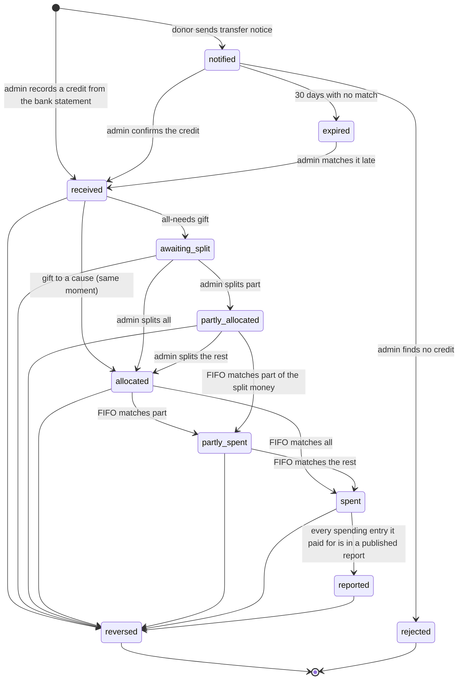
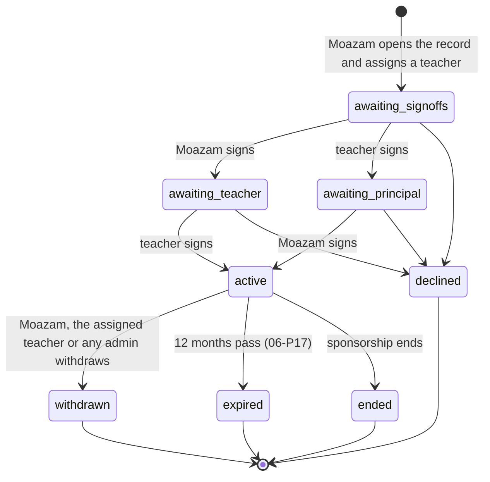

# 06 Donations and trail

**Status:** planning · **Last updated:** 2026-11-07 · **Owner document for:** P1-E2, P1-E3, P1-E4, P2-E1 to P2-E6, P4-E1 to P4-E3, P5-E4 to P5-E6

Read [00-MASTER-PLAN.md](00-MASTER-PLAN.md) first. It overrides this document. Words in *italics* such as *cause*, *all needs*, *allocation*, *spending entry* and *trail* have the meanings in the [glossary (00 §8)](00-MASTER-PLAN.md#8-glossary).

## 1. Purpose

This document explains how money moves through Tazkiyah, from the moment a donor sends a bank transfer to the moment they can see which purchase their money paid for. It covers:

- how a donation is recorded, assigned to a cause, spent and reported;
- how Zakat is kept apart from other money;
- how first-in-first-out (FIFO) matching decides whose money paid for what;
- what donors, the public and staff can each see, and how anonymity is protected;
- orphan sponsorship, recurring pledges, receipts, reconciliation and reversals;
- what is still open for online payments in P5.

A developer or agent working on any task in the **Tasks** section should be able to build it from this document, plus the tables in [04](04-database.md) and the screens in [05](05-public-pages-roles-admin.md).

## 2. Scope and out of scope

**In scope**

- Manual recording of bank-transfer donations by the admin or finance officer ([D-008](08-decision-log.md#d-008), [D-025](08-decision-log.md#d-025)).
- A public "I have sent a transfer" notice form, so the donor can choose the cause, type and name or anonymous setting themselves.
- Causes of three types, Zakat eligibility per cause, and the all-needs split.
- The trail: received, allocated, spent and reported events, reversal events, and FIFO matching.
- Spending entries, daily or weekly reports, and public cause figures.
- Donor identity, the donor wall, guest donors and claiming guest donations into an account.
- Orphan sponsorship: matching, progress updates, consent for a full profile, and messages through the madrasa.
- Recurring pledges paid by the donor's own bank transfer or standing order, and opt-in monthly reminders.
- Receipts, bank reconciliation, reversals and refunds.
- The open questions and constraints for P5 online payments.

**Out of scope**

- Choosing a payment gateway, card or wallet integration. These are open until P5 ([§16](#16-online-payments-open), [D-025](08-decision-log.md#d-025)).
- Cash donations, such as Friday collections. They are not in the checklist. See **Proposed requirements**.
- Clinic patient records of any kind. The clinic is only a cause ([D-021](08-decision-log.md#d-021)).
- Bookkeeping beyond donations: salaries owed, supplier accounts, budgets and balance sheets. Tazkiyah records what donations paid for, not the madrasa's full accounts.
- The central platform fund ([D-024](08-decision-log.md#d-024)). Only the allocation design is kept ready for it ([§8](#8-trail-event-model-and-fifo)).
- Table columns, indexes and row-level security policies. These belong to [04 §8 and §9](04-database.md).
- Page layouts and admin screen design. These belong to [02 §12](02-design-ui-ux.md) and [05 §5 and §8](05-public-pages-roles-admin.md).
- Email sending, job scheduling and media storage plumbing. These belong to [03 §8 to §10](03-architecture.md).

## 3. Decisions

### Decisions already logged

| ID | Decision | Reason, as it applies here |
| --- | --- | --- |
| [D-004](08-decision-log.md#d-004) | Spending is matched to donations first in, first out. | Each donor sees the exact purchase their money paid for. §8 defines the rule precisely. |
| [D-008](08-decision-log.md#d-008) | Donations are recorded manually from bank transfers until online payments arrive. | Registration is pending. §4 is built around manual recording. |
| [D-009](08-decision-log.md#d-009) | Guest donations with only an email, a private trail link and a later claim. | Fewer barriers for overseas and phone donors. See §11. |
| [D-010](08-decision-log.md#d-010) | Amounts are always public on the donor wall; the name is the donor's choice. | Transparency without forcing identity. See §10. |
| [D-011](08-decision-log.md#d-011) | The admin sets which causes accept Zakat, with an optional approving scholar's name. | The principal runs the madrasa day to day. See §6 and Q-04. |
| [D-012](08-decision-log.md#d-012) | The admin decides how all-needs money is split. | Needs change through the year. See §7. |
| [D-013](08-decision-log.md#d-013) | The principal records spending in daily or weekly batches. | Fits how the madrasa works. See §9. |
| [D-017](08-decision-log.md#d-017) | Orphan sponsorship: persona by default, full profile only with consent and two sign-offs, no direct contact. | Protects the children. See §12. |
| [D-021](08-decision-log.md#d-021) | The clinic is only a cause. | Patient data needs its own design. See §5. |
| [D-024](08-decision-log.md#d-024) | The trail is designed now for a future platform fund. | Avoids rework. See §8. |
| [D-025](08-decision-log.md#d-025) | Online payments come last and stay open. | Sami will discuss gateways later. See §16. |

### Decisions proposed by this document

These are new choices this document needs. They are written here as proposals, numbered `06-P01` and so on. The consistency check (step 4) should log each one in [08](08-decision-log.md) as a `D-` entry, or send it back.

| ID | Proposed decision | Options considered | Reason |
| --- | --- | --- | --- |
| 06-P01 | Until P5, the donor tells the madrasa about a transfer through a public **transfer notice** form. This creates a donation in the state *notified*. It gets no trail event, receipt or donor-wall entry until the admin confirms it against the bank. | Admin records everything from the bank alone; donor notice first. | The cause, Zakat choice and name or anonymous setting must come from the donor, not from a guess. A bank statement shows only a name and an amount. |
| 06-P02 | FIFO orders money in a cause by the date it **entered that cause**: the donation date for a gift to a cause, and the split date for an all-needs piece. Ties go to the lower receipt number. | Order by original donation date; order by entry date. | "Oldest unspent donations in its cause" (REQ-TRL-004) means oldest in the cause. Split money was not in the cause before the split. |
| 06-P03 | A match is final. FIFO never moves an existing match. A correction is always a reversal plus new matching. | Re-run FIFO from scratch after every change; final matches. | The trail is append-only (REQ-TRL-002). A donor's history must not change under them. |
| 06-P04 | A spending entry may be larger than the cause's unspent money. The uncovered part is a **shortfall**. The next money to enter the cause fills the oldest shortfall first. | Block the entry; mark the rest "paid by the madrasa" forever; shortfall filled by later money. | Wheat is bought in bulk at harvest, often before donations arrive. Later donors really are repaying that purchase. See REQ-TRL-016 (proposed). |
| 06-P05 | A cause's Zakat flag cannot be switched off while the cause holds unspent Zakat. The admin must first move that Zakat to another Zakat-eligible cause, with a reason the donor sees. | Allow switching off; block; block with a move. | Prevents Zakat being spent on a cause just declared ineligible (risk R-05). |
| 06-P06 | The donation type (Zakat, Sadaqah or general) is never shown on public pages: not on the donor wall, a public trail, or a public profile. Only the donor and finance staff see it. | Show type publicly; hide it. | Whether someone pays Zakat says something about their wealth. Privacy wins (00 §4 rule 8). The donor wall still shows amounts (D-010). |
| 06-P07 | If the donor has not chosen, a donation is anonymous. This covers donations recorded straight from the bank with no notice. | Default named; default anonymous. | Privacy wins. A bank statement name is not consent to publish it. |
| 06-P08 | For an anonymous donation, only the donor, the admin and the finance officer can see who gave it. The bank reference is treated as part of the name, because Pakistani bank references often contain the sender's name. | Hide from all staff; hide from all but finance roles. | Finance roles need the identity to send receipts and reconcile the bank. Nobody else does. |
| 06-P09 | A donor's public profile counts and lists only their named donations. | Count all; count named only. | Totals that include anonymous gifts let a visitor work out the anonymous amounts by subtraction. |
| 06-P10 | One private trail link per guest donor, covering all their donations. It has no expiry, is stored only as a hash, and the admin can revoke it. | One link per donation; expiring links; one revocable link per donor. | Simple for donors with many gifts. Revocation covers leaks (REQ-SEC-004). |
| 06-P11 | A spending entry has three states: *draft* (editable, not matched), *recorded* (final, matched by FIFO, visible in donors' private trails) and *reported* (in a published report, visible publicly). Public figures count only reported entries. | One state; two states; three states. | The principal can fix typos before anything is final, and the public sees only what he has signed off in a report. |
| 06-P12 | Receipt numbers look like `MAA-2026-00042`: a prefix from institute settings, the year of recording, and a 5-digit sequence per institute per year. Numbers are never reused, and a reversed donation keeps its number marked *cancelled*. | Random IDs; one global sequence; per-institute yearly sequence. | Readable on the phone, sortable, and ready for more institutes. |
| 06-P13 | Every receipt shows both Urdu and English on one page. A receipt for an anonymous donation shows "Anonymous donor" instead of a name. | One language per receipt; both on one page. | A bilingual receipt works for local and overseas donors and avoids keeping two versions. The anonymous rule has no exceptions (REQ-DPR-009). |
| 06-P14 | Sponsorship donations go to one shared cause, **Orphan sponsorship**. FIFO works across that cause as for any other cause. The sponsor's link to their child is through updates, not through a separate pot of money. | One cause per child; one shared cause. | Five children, one guardian, shared needs (food, clothes, books). A cause per child would show each child's spending publicly. Sponsors are told this plainly when matched. |
| 06-P15 | An orphan has at most one active sponsor in this version. Extra sponsors are offered the Orphan sponsorship cause without a match. | One sponsor; several sponsors. | Simpler consent and simpler updates. The admin can revisit this later. |
| 06-P16 | A sponsor must have a donor account. Guest trail links never show sponsorship pages. | Allow guest links; require an account. | A bearer link to a child's profile is too easy to forward. |
| 06-P17 | Full-profile consent is per sponsorship and lasts 12 months, after which it expires unless both sign-offs are given again. | No expiry; yearly renewal. | Children's circumstances change. A yearly check is light. See REQ-ORP-010 (proposed). |
| 06-P18 | Progress updates written by a teacher need the admin's approval before the sponsor sees them. Updates written by the admin publish directly. | All updates direct; teacher updates reviewed. | Child safety wins over publishing speed (00 §4 rule 9). |
| 06-P19 | A recurring pledge is a promise, not a payment. It becomes *lapsed* after 3 periods in a row with no payment. It stays visible to the donor and can be restarted. | Never lapse; lapse after 1, 3 or 6 periods. | Keeps the admin's "expected this month" list honest without nagging donors. |
| 06-P20 | Each cause has a setting "receipt photos public by default". It is on for wheat, gas, electricity and similar purchases, and off for teacher salaries, orphan sponsorship, the clinic and the pharmacy. Each spending entry can override it. | All public; all private; per-cause default. | Salary slips, medicine bills and children's purchases can carry personal details. |

## 4. Donation lifecycle

### 4.1 Who does what until P5

Until online payments arrive (REQ-PAY-001), money reaches the madrasa only by bank transfer to the account shown on the donate page (REQ-PUB-008, from institute settings). Three people act on a donation:

| Actor | What they do |
| --- | --- |
| Donor (guest or account) | Sends a bank transfer. Optionally fills in the transfer notice form (06-P01). |
| Admin or finance officer | Confirms notices against the bank statement, or records transfers that came without a notice. Splits all-needs money (admin only). Reverses mistakes. Who may do what is set in [05 §7](05-public-pages-roles-admin.md). Who holds the finance officer role is open (Q-03). |
| System | Writes trail events, gives receipt numbers, runs FIFO, and sends emails. |

### 4.2 The transfer notice form

In the database a *notified* donation is a row in `transfer_notices`, and it becomes a row in `donations` only when the admin confirms it ([04 §8.7](04-database.md)). Pledges are stored in `recurring_pledges` ([04 §8.8](04-database.md)).

The public form on the donate page asks for:

- email address (required; it is the only thing a guest donor must give, REQ-DPR-001);
- amount in rupees and the date of the transfer;
- a cause or *all needs* (REQ-DON-001, REQ-DON-002);
- type: Zakat, Sadaqah or general (REQ-DON-004). Choosing Zakat narrows the cause list to Zakat-eligible causes (§6);
- frequency: one-off, monthly or yearly (REQ-DON-003). Monthly or yearly creates a pledge (§13);
- name shown or anonymous for this donation (REQ-DPR-006), and the display name if shown;
- the bank reference or the sender's account title, so the admin can find the credit;
- language for emails (Urdu or English, defaulting to the page language);
- an optional tick box for the monthly reminder email (REQ-PAY-007).

The form never asks for a phone number, address or national ID number. Personal data never goes into the URL (REQ-SEC-005).

### 4.3 Recording without a notice

Many donors will send money and tell nobody. When the admin finds a credit on the statement with no notice, he records it directly with the same fields. If the donor is not known, he records it with no donor ("unknown donor"). It is then anonymous (06-P07), gets no email, and can be attached to a donor later if they get in touch. See REQ-DON-017 (proposed).

### 4.4 States

A donation's state is worked out from its trail events and allocations. It is not typed in by staff. [04 §9](04-database.md) decides whether the state is also stored as a cached field.

| State | Meaning | Trail events so far | Receipt | Donor wall | Donor sees |
| --- | --- | --- | --- | --- | --- |
| notified | The donor says they sent money. Not yet confirmed. | none | no | no | "Waiting for the madrasa to confirm your transfer" |
| rejected | No matching credit found. | none | no | no | "We could not find this transfer. Please reply to the email with details." |
| expired | No match after 30 days. The admin can still confirm it. | none | no | no | as rejected |
| received | Confirmed. For a gift to a cause this state passes straight to *allocated* in the same step. | received | yes | yes | "Received" |
| awaiting_split | An all-needs gift not yet split. | received | yes | yes, as "All needs" | "Received. Waiting to be assigned to a cause." |
| partly_allocated | Part of an all-needs gift is split. | received, allocated | yes | yes | "Rs 25,000 assigned to Wheat stock. Rs 15,000 waiting." |
| allocated | All of it sits in one or more causes, unspent. | + allocated | yes | yes | "Assigned to Wheat stock" |
| partly_spent | FIFO has used part of it. | + spent | yes | yes | "Rs 5,000 of Rs 25,000 spent" |
| spent | FIFO has used all of it. | + spent | yes | yes | "Fully spent" |
| reported | All of it is spent and every purchase it paid for is in a published report. | + reported | yes | yes | "Fully spent and reported" |
| reversed | Cancelled with a reason (§15). Final. | + reversal events | marked *cancelled* | removed | "Reversed: recorded twice by mistake" (the reason category) |

A donation's money can be at several stages at once. For example, an all-needs gift can have Rs 25,000 split and partly spent while Rs 15,000 still waits in the pool. The state shown is the earliest stage that any of its money is still at, so that gift shows *partly_allocated*. The trail itself always shows every piece. A partial reversal, such as a refund of the unspent part (§15.4), leaves the donation in its current state with a smaller amount; only a full reversal moves it to *reversed*.

**What happens in one step when a donation is received.** These all happen in one database transaction, or none of them do:

1. The donation is saved with its amount, date, donor (or unknown), cause or all needs, type, frequency, bank reference and name or anonymous choice (REQ-DON-008).
2. A receipt number is taken (§14).
3. A *received* event is written (REQ-TRL-001).
4. For a gift to a cause, an allocation to that cause and an *allocated* event are written.
5. FIFO runs for that cause, because new money may fill a shortfall (§8.5).
6. An entry is added to the audit log, with IDs only and no name (REQ-ROL-008, [05 §9](05-public-pages-roles-admin.md)).
7. After the transaction commits, the email to the donor is queued ([03 §9](03-architecture.md)): the private link for a new guest donor (§11) and the receipt (§14).

### 4.5 Recording rules

| Rule | Detail |
| --- | --- |
| Amount | Whole rupees, at least Rs 1. The rupee amount actually credited by the bank is the official amount. Above Rs 1,000,000 the form asks the admin to confirm. |
| Dates | The donation date is the bank credit date, in Pakistan time (Asia/Karachi). The time of recording is kept separately. |
| Duplicate warning | The same amount, date and bank reference as an existing donation shows a warning. The admin can still save. |
| Closed causes | A campaign can be chosen only if the donation date is on or before its end date (§5.3). Archived causes can never be chosen. |
| Zakat | A Zakat donation can be recorded only to a Zakat-eligible cause or to all needs (§6). |
| Overseas transfers | The original currency and amount, if the donor gave them, are kept as a note for the donor only. FIFO, figures and receipts use rupees. |
| Who is recorded | An existing donor (picked by email), a new guest donor (email only), or unknown. |

## 5. Cause types

### 5.1 The three types

Every cause has exactly one type (REQ-DON-005). Every cause can have a target amount (REQ-DON-007). What the target means depends on the type.

| Type | Target means | Ends | Progress shown as | Example |
| --- | --- | --- | --- | --- |
| **Campaign** | One total for the whole campaign. | On its end date. After that it accepts no new donations (REQ-DON-006). | "Rs 180,000 raised of Rs 250,000 · 12 days left" | New water cooler for the prayer hall |
| **Ongoing** | An amount per month or per year, chosen by the admin. | Never, until the admin closes it. | "This month: Rs 18,000 of Rs 30,000" | Kitchen gas |
| **Yearly stock** | An amount per stock year. The admin sets the month the stock year starts. | Never. The progress resets at the start of each stock year. | "Stock year Mar 2026 to Feb 2027: Rs 220,000 of Rs 500,000" | Wheat stock |

Unspent money never resets. Only the progress figure for the period starts again. Unspent money stays in the cause for the next spending entry.

### 5.2 Cause states

| State | Accepts new donations | Accepts spending entries | Public | Who moves it there |
| --- | --- | --- | --- | --- |
| draft | no | no | no | Admin creates it |
| active | yes | yes | yes | Admin publishes it |
| closed | no | yes, until unspent money is used | yes, marked "closed" | Admin, or automatically at the end of a campaign's end date |
| archived | no | no | listed under past causes | Admin, only when unspent money and shortfall are both zero |

The admin can create, edit, close and archive causes in Urdu and English (REQ-DON-009; screens in [05 §8](05-public-pages-roles-admin.md)). A missing translation falls back to the other language with a notice (REQ-LNG-009). Future tech costs and new projects are created the same way (REQ-DON-013, [05 §10](05-public-pages-roles-admin.md)).

If a closed cause has unspent money that it can no longer use, the admin can move it to another cause. This is a reversal of the allocation plus a new allocation, with a reason every affected donor sees in their trail. Zakat may move only to another Zakat-eligible cause.

### 5.3 Campaign end date rules

- A campaign closes automatically at 23:59 Pakistan time on its end date.
- A transfer dated on or before the end date can still be recorded to the campaign afterwards, because recording often lags by days.
- A transfer dated after the end date cannot be recorded to the campaign. The admin records it to all needs, or to another cause if the donor agrees.
- Reaching the target does not close a campaign. The page shows "Target reached" and the admin can close it early.

### 5.4 Starting causes for Markaz Al Azeem

These are drafts for Moazam to check. **All amounts are illustrative**. Moazam sets the real targets. The Zakat column is left for Moazam to decide (D-011). This document makes no ruling on which causes are Zakat-eligible.

| Cause (English / Urdu) | Type | Illustrative target | Zakat eligible | Receipt photos public by default (06-P20) | Notes |
| --- | --- | --- | --- | --- | --- |
| Wheat stock / گندم کا ذخیرہ | Yearly stock, starts March | Rs 500,000 per year | Moazam decides | yes | Bought in bulk around harvest. The FIFO example in §8 uses it. |
| Kitchen gas / باورچی خانے کی گیس | Ongoing, monthly | Rs 30,000 per month | Moazam decides | yes | Daily free lunch for 100 people and the residential students. |
| Electricity / بجلی | Ongoing, monthly | Rs 40,000 per month | Moazam decides | yes | The monthly bill is the receipt. |
| Teacher salaries / اساتذہ کی تنخواہیں | Ongoing, monthly | Rs 250,000 per month | Moazam decides | **no** | Spending entries say "March salaries, 8 staff", never one person's salary. |
| Pharmacy (medicines) / دواخانہ | Ongoing, monthly | Rs 50,000 per month | Moazam decides | **no** | Medicines for the clinic. No patient names on entries. |
| Clinic / کلینک | Ongoing, monthly | set by Moazam | Moazam decides | **no** | A cause only. No patient data is ever stored: no names, conditions or visit records (REQ-DON-014, D-021). Entries describe costs, such as "Doctor's fee, March" or "Blood pressure monitor". |
| Orphan sponsorship / یتیم بچوں کی کفالت | Ongoing, monthly | Rs 8,000 per child per month | Moazam decides | **no** | All sponsorship money goes here (06-P14). Entries never name or describe a single child. |
| All needs / تمام ضروریات | — | — | — | — | Not a cause. It is the choice not to pick one (§7). |

## 6. Donation types and Zakat

### 6.1 The three types

Every donation records one type: **Zakat**, **Sadaqah** or **general** (REQ-DON-004). The type is copied onto every allocation and every match that comes from the donation. It is never lost when money is split or spent.

| Type | Can go to | Notes |
| --- | --- | --- |
| Zakat | Only causes the admin has marked as accepting Zakat (REQ-TRL-006). | Ring-fenced (§6.3). |
| Sadaqah | Any cause. | Kept as its own type in every total. No extra spending rule in this version. |
| General | Any cause. | The default if the donor does not say. |

If Moazam or the approving scholar later wants a spending rule for Sadaqah too, that is a new requirement. It is not assumed here.

### 6.2 Zakat eligibility per cause

- Each cause has a yes or no **accepts Zakat** setting, set by the admin (REQ-ROL-005, D-011). It starts as *no*.
- Each cause can also show an **approving scholar's name**, such as "Zakat eligibility approved by Mufti …". It is optional and shown only when filled in. Whose name to show is open question Q-04, owned by Moazam and due in P2.
- When a donor picks Zakat on the transfer notice form, only Zakat-eligible causes and all needs are offered (REQ-TRL-006). Each eligible cause shows the scholar's name if one is set.
- If no cause accepts Zakat, the Zakat option is hidden and the form explains that the madrasa is not taking Zakat right now.

### 6.3 Ring-fencing rules

The ring-fence is enforced at the data level, not only in forms (risk R-05). [04 §9](04-database.md) defines the constraint. The rules are:

1. **Recording.** A Zakat donation can be allocated only to a Zakat-eligible cause, or held as all needs.
2. **Splitting.** All-needs Zakat sits in its own **Zakat all-needs pool** and can be split only into Zakat-eligible causes (§7).
3. **Matching.** FIFO works inside one cause. Zakat only ever enters eligible causes, so it can only pay for spending in eligible causes. As a second check, the matching step refuses to link a Zakat allocation to a spending entry in a cause that does not accept Zakat at that moment, and alerts the admin.
4. **Switching the flag off.** This is blocked while the cause holds unspent Zakat (06-P05). The admin screen shows "Rs 12,000 of Zakat is still unspent in this cause". The admin first moves that Zakat to another eligible cause. This is a reversal of the allocation plus a new allocation, with a reason the Zakat donors see in their trails. Then the flag can be switched off.
5. **Switching the flag on** takes effect at once for new donations and splits. Money already in the cause is not relabelled. A general gift stays general.
6. **Correcting the type.** If a donor says a recorded gift was really Zakat, the admin reverses it and records it again with the right type (§15). The new record must also obey rule 1.

### 6.4 Who sees the type

- The donor sees the type of each of their own donations, in their trail and on their receipt.
- The admin and finance officer see totals per type per cause (for example, Wheat stock: Zakat Rs 50,000, Sadaqah Rs 50,000, general Rs 120,000).
- The public never sees the type of a single donation (06-P06). Public cause pages may show the cause's Zakat eligibility and scholar's name, but not per-type totals.

## 7. All-needs split

A donor can give to *all needs* instead of choosing a cause (REQ-DON-002). The admin decides how that money is split (REQ-ROL-006, D-012).

### 7.1 Pools

All-needs money waits in two pools, so Zakat never mixes with other money:

| Pool | Holds | Can be split into |
| --- | --- | --- |
| Zakat all-needs pool | All-needs donations of type Zakat | Zakat-eligible causes only |
| General all-needs pool | All-needs donations of type Sadaqah or general | Any active or closed cause |

Money in a pool is received but not yet in any cause. It cannot be spent. The admin dashboard shows each pool's balance and the age of its oldest unsplit gift, for example "General all-needs: Rs 64,000 · oldest waiting 23 days".

### 7.2 How a split works

1. The admin opens a pool and types an amount next to each cause, for example Wheat stock Rs 25,000 and Kitchen gas Rs 15,000. Each amount is a whole number of rupees.
2. The form checks that:
   - the total is not more than the pool balance;
   - every cause is active or closed, never draft or archived;
   - in the Zakat pool, every cause accepts Zakat.
3. The system takes money from the pool **oldest donation first**, by donation date and then by receipt number. When one donation is not enough, it moves to the next. When a donation is more than needed, only part of it is used.
4. For each piece of a donation that moves, it writes an allocation (donation, cause, amount) and an *allocated* event in that donor's trail. The piece's date for FIFO in the cause is the split date (06-P02).
5. FIFO then runs for each cause that received money (§8.5).
6. A partial split is allowed. Whatever is not split stays in the pool.

A split is final. If the admin made a mistake, he reverses the allocation (§15). If none of the money has been spent yet, it simply returns to the pool. If some has been spent, see §15.3.

### 7.3 Example

The general all-needs pool holds two gifts: Farah, 5 Mar, Rs 40,000, and Kamran, 8 Mar, Rs 10,000. On 20 Mar the admin splits Rs 45,000: Wheat stock Rs 25,000 and Kitchen gas Rs 20,000.

| Step | From | To | Amount | Farah left | Kamran left |
| --- | --- | --- | --- | --- | --- |
| 1 | Farah (oldest) | Wheat stock | 25,000 | 15,000 | 10,000 |
| 2 | Farah | Kitchen gas | 15,000 | 0 | 10,000 |
| 3 | Kamran | Kitchen gas | 5,000 | 0 | 5,000 |

Kamran's remaining Rs 5,000 stays in the pool. Causes are filled in the order the admin listed them.

## 8. Trail event model and FIFO

### 8.1 Event kinds

The trail is an append-only list of events for each donation (REQ-TRL-001, REQ-TRL-002). Events are stored in `trail_events`. Money links are stored in `allocations`. Columns are in [04 §9](04-database.md).

| Event | Written when | Amount | Points to | Donor sees | Public sees (only if the donor made this donation's trail public) |
| --- | --- | --- | --- | --- | --- |
| **received** | The donation is confirmed (§4.4) | Full donation amount | donation | yes | yes, with name or "Anonymous" |
| **allocated** | Money enters a cause: at recording for a gift to a cause, or at a split for all needs | The piece that entered | donation, allocation (to cause), cause | yes | yes |
| **spent** | FIFO matches part of the donation to a spending entry | The matched piece | donation, allocation (to spending entry), spending entry | yes, with description, date, the donor's share and the receipt photo if public | yes, without the receipt photo if it is private |
| **reported** | A spending entry that this donation paid for appears in a published report (§9). If the entry was already reported when the match was made, *spent* and *reported* are written together. | This donation's total matched to the report's entries, one event per donation and report ([D-126](08-decision-log.md#d-126)). A match made after publishing gets its own event for its piece | spending entry, report | yes | yes |
| **reversal** | Any event above is corrected (§15) | Minus the corrected amount | the event it reverses, plus a reason | yes, with the reason category | yes, with the reason category |

The glossary lists four event kinds. The reversal event is the correction required by REQ-TRL-003. The consistency check may add it to the glossary.

### 8.2 Allocations

An allocation always moves an amount of money from a **source** to a **target**:

| Source | Target | Made by |
| --- | --- | --- |
| A donation | A cause | Recording a gift to a cause, or an all-needs split |
| A donation's allocation in a cause | A spending entry | FIFO matching |
| *(later)* A platform fund donation | An institute | The future central fund (D-024, REQ-TRL-014) |

Keeping the source and target general is what lets the platform fund fit later without a schema change ([04 §9](04-database.md)).

### 8.3 Money rules that must always hold

These are tested automatically after every change (task P2-E2-T04):

1. For each donation: the total allocated to causes, after reversals, is not more than the amount received.
2. For each allocation into a cause: the total matched to spending entries, after reversals, is not more than the allocated amount.
3. For each spending entry: the total matched, after reversals, is not more than its amount. The difference is its **shortfall**.
4. For each cause: unspent = (all money allocated in) − (all money matched out). It is never negative.
5. No match links Zakat money to a spending entry in a cause that did not accept Zakat when the match was made.
6. No event is ever updated or deleted.

### 8.4 First in, first out

For one cause, FIFO keeps two queues:

- **Money queue:** every allocation into the cause with money left unspent. It is ordered by the date the money entered the cause (06-P02), then receipt number, then the order it was recorded.
- **Need queue:** every *recorded* or *reported* spending entry in the cause with a shortfall. It is ordered by the entry's date, then the order it was recorded. Draft entries are not in the queue.

Matching repeats these steps until one queue is empty:

1. Take the first money item and the first need.
2. The match amount is the smaller of the money's unspent amount and the need's shortfall.
3. Write an allocation from that money to that spending entry for the match amount, and a *spent* event in the donor's trail. If the entry is already reported, also write a *reported* event.
4. Reduce both. Remove whichever reached zero from its queue.

This means one spending entry can draw on several donations, and one donation can be split across several spending entries (REQ-TRL-005).

**When FIFO runs.** It runs for one cause each time any of these happens in that cause:

- money enters it, by recording or by a split;
- a spending entry becomes recorded;
- a donation, allocation or spending entry is reversed.

Only one FIFO run per cause can happen at a time. The run takes a lock on the cause and finishes in one transaction, so two admins saving at once cannot double-spend money.

**Matches are final** (06-P03). A run only adds new matches. It never moves old ones. A donation recorded late with an old date joins the money queue in date order, but matches already made stay where they are.

### 8.5 Shortfalls

A spending entry can be larger than the money in its cause (06-P04, REQ-TRL-016 proposed). For example, the wheat is bought on credit at harvest. The uncovered part is the entry's shortfall. The admin sees it. The public cause page shows it as "Rs 70,000 still to be covered by donations". Because the need queue is ordered by date, the next money into the cause fills the oldest shortfall first. The donor's trail then says their gift "paid towards" that earlier purchase.

### 8.6 Worked example: Wheat stock, March to May 2026

All names and figures are invented for illustration. Assume Moazam has marked Wheat stock as accepting Zakat; this is an assumption for the example only, not a ruling. Wheat stock is a yearly stock cause with a stock year starting in March and a target of Rs 500,000.

**Money coming in**

| Ref | Receipt | Donor | Identity chosen | Type | Date | Amount | Given to |
| --- | --- | --- | --- | --- | --- | --- | --- |
| D1 | MAA-2026-00101 | Ayesha Rahman (account donor) | Named | Sadaqah | 3 Mar | 20,000 | Wheat stock |
| D2 | MAA-2026-00102 | Farah S. (account donor) | Named | General | 5 Mar | 40,000 | All needs |
| D3 | MAA-2026-00103 | Donor B (account donor) | **Anonymous** | **Zakat** | 10 Mar | 50,000 | Wheat stock |
| D4 | MAA-2026-00104 | Usman (guest donor, email only) | Named "Usman" | General | 18 Mar | 15,000 | Wheat stock |
| — | — | Admin splits D2 | — | — | 20 Mar | 25,000 to Wheat stock, 15,000 to Kitchen gas | — |
| D5 | MAA-2026-00105 | Hamza (guest donor) | Named | Sadaqah | 25 Mar | 30,000 | Wheat stock |

**Wheat stock money queue on 1 April** (ordered by the date money entered the cause)

| Position | Money | Entered cause | Unspent |
| --- | --- | --- | --- |
| 1 | D1 Ayesha | 3 Mar | 20,000 |
| 2 | D3 Donor B (Zakat) | 10 Mar | 50,000 |
| 3 | D4 Usman | 18 Mar | 15,000 |
| 4 | D2w Farah's wheat piece | 20 Mar (split date, not 5 Mar) | 25,000 |
| 5 | D5 Hamza | 25 Mar | 30,000 |
| | **Total** | | **140,000** |

Farah gave on 5 Mar, before Donor B, but her money entered Wheat stock only on 20 Mar. So she is fourth in the queue, not second (06-P02).

**Spending**

| Ref | Date | Description | Amount | Receipt photo |
| --- | --- | --- | --- | --- |
| S1 | 2 Apr | Wheat, 25 maunds, grain market Sahiwal | 90,000 | yes, public |
| S2 | 9 Apr | Milling and transport of the wheat | 12,000 | yes, public |
| — | 12 Apr | Weekly report "6 to 12 April" published, containing S1 and S2 | — | — |
| S3 | 2 May | Wheat, 30 maunds, bought on credit | 108,000 | yes, public |
| — | 3 May | Weekly report "27 April to 3 May" published, containing S3 | — | — |
| D6 | 10 May | Zainab (account donor, named, general) gives to Wheat stock, receipt MAA-2026-00131 | 80,000 | — |

**Matches made by FIFO**

| When | Spending entry | Drawn from | Amount | Money left after | Shortfall left after |
| --- | --- | --- | --- | --- | --- |
| 2 Apr | S1 (90,000) | D1 Ayesha | 20,000 | D1: 0 | 70,000 |
| 2 Apr | S1 | D3 Donor B | 50,000 | D3: 0 | 20,000 |
| 2 Apr | S1 | D4 Usman | 15,000 | D4: 0 | 5,000 |
| 2 Apr | S1 | D2w Farah | 5,000 (**partial**) | D2w: 20,000 | 0 |
| 9 Apr | S2 (12,000) | D2w Farah | 12,000 | D2w: 8,000 | 0 |
| 2 May | S3 (108,000) | D2w Farah | 8,000 | D2w: 0 | 100,000 |
| 2 May | S3 | D5 Hamza | 30,000 | D5: 0 | **70,000 shortfall** |
| 10 May | S3 | D6 Zainab | 70,000 | D6: 10,000 | 0 |

Checks: S1 = 20,000 + 50,000 + 15,000 + 5,000 = 90,000. S2 = 12,000. S3 = 8,000 + 30,000 + 70,000 = 108,000. Money into Wheat stock = 140,000 + 80,000 = 220,000. Spent = 90,000 + 12,000 + 108,000 = 210,000. Unspent = 10,000, all of it Zainab's.

Donor B's Zakat paid only for S1, in a Zakat-eligible cause. If D2 had been Zakat, it would have sat in the Zakat all-needs pool, and the admin could not have split Rs 15,000 of it to Kitchen gas unless Kitchen gas accepted Zakat.

**What each donor sees in their private trail**

| Donor | Trail |
| --- | --- |
| Ayesha | 3 Mar *received* Rs 20,000, Sadaqah, Wheat stock · 3 Mar *allocated* to Wheat stock · 2 Apr *spent* Rs 20,000 on "Wheat, 25 maunds" (22% of this Rs 90,000 purchase), receipt photo · 12 Apr *reported* in "6 to 12 April". Status: fully spent and reported. |
| Farah | 5 Mar *received* Rs 40,000, general, all needs · 20 Mar *allocated* Rs 25,000 to Wheat stock and Rs 15,000 to Kitchen gas · 2 Apr *spent* Rs 5,000 on "Wheat, 25 maunds" (6%) · 9 Apr *spent* Rs 12,000 on "Milling and transport" (100%) · 12 Apr *reported* (both) · 2 May *spent* Rs 8,000 on "Wheat, 30 maunds" (7%) · 3 May *reported*. The Kitchen gas part follows that cause's spending. Status: wheat part fully spent and reported. |
| Donor B | Same shape as Ayesha: Rs 50,000, **Zakat**, 56% of S1. Their name appears nowhere public. Their receipt and emails say "Anonymous donor" (06-P13). |
| Usman | Opens the private link from his email. 18 Mar *received* Rs 15,000 · *allocated* to Wheat stock · 2 Apr *spent* Rs 15,000 on S1 (17%) · 12 Apr *reported*. |
| Hamza | 25 Mar *received* Rs 30,000, Sadaqah · *allocated* to Wheat stock · 2 May *spent* Rs 30,000 on "Wheat, 30 maunds" (28%) · 3 May *reported* in "27 April to 3 May". Status: fully spent and reported. |
| Zainab | 10 May *received* Rs 80,000 · *allocated* to Wheat stock · 10 May *spent* Rs 70,000 "towards" "Wheat, 30 maunds, bought on credit on 2 May" (65%), and *reported* at the same moment, because S3 was already in the 3 May report · Rs 10,000 unspent. Status: partly spent. |

Shares are rounded to whole percent for display only. Amounts are always exact rupees.

**What the public sees**

- *Donor wall:* 10 May Zainab Rs 80,000 Wheat stock · 25 Mar Hamza Rs 30,000 Wheat stock · 18 Mar Usman Rs 15,000 Wheat stock · 10 Mar **Anonymous** Rs 50,000 Wheat stock · 5 Mar Farah S. Rs 40,000 All needs · 3 Mar Ayesha Rahman Rs 20,000 Wheat stock. No types are shown.
- *Wheat stock cause page:* stock year March 2026 to February 2027 · raised Rs 220,000 of Rs 500,000 · spent Rs 210,000 · S1, S2 and S3 with dates, descriptions and receipt photos. No donor names at all (REQ-TRL-010). Between 3 May and 10 May, S3 showed "Rs 70,000 still to be covered by donations".

## 9. Spending entries and reports

### 9.1 A spending entry

A spending entry records one use of money from one cause (REQ-TRL-011, REQ-ROL-007). It is stored in `spending_entries`. Receipt photos are stored in `media_assets` ([04 §9](04-database.md), [03 §8](03-architecture.md)).

| Field | Required | Notes |
| --- | --- | --- |
| Cause | yes | Active or closed causes only. |
| Amount | yes | Whole rupees. |
| Date | yes | The date of the purchase or payment, in Pakistan time. It can be in the past. |
| Description | yes, in at least one language | Urdu or English, with the other language optional. A missing language falls back with a notice (REQ-LNG-009). Quantities go in the description, for example "Wheat, 25 maunds". |
| Receipt or photo | no | One image for now, compressed on upload ([03 §8](03-architecture.md)). More than one waits for Sami ([D-124](08-decision-log.md#d-124)). |
| Receipt public | yes | Defaults to the cause's setting (06-P20). Can be changed per entry. |

**Privacy check on the form.** The form shows a short reminder: "Do not write names of patients, children, or individual staff salaries." Descriptions are aggregated where they concern people, for example "March salaries, 8 staff".

### 9.2 Batches and states

Moazam records spending in daily or weekly batches, whichever he prefers (D-013, risk R-03). The form is made for a phone: one entry per screen, a camera button for the receipt, and "save and add another".

| State | Editable | In FIFO | In donors' private trails | On public pages | Moved here by |
| --- | --- | --- | --- | --- | --- |
| draft | yes | no | no | no | Saving the form |
| recorded | no (reverse instead) | yes | yes, as *spent* | no | "Record batch" |
| reported | no | yes | yes, as *reported* | yes | "Publish report" |
| reversed | no | its matches are released | shown as reversed | shown as corrected in the next report | Reversal with a reason (§15) |

He can press **Record and publish** to do both steps at once. This is the normal path for a principal working alone. If the finance officer records entries, the admin can review and publish (who may publish is set in [05 §7](05-public-pages-roles-admin.md)).

### 9.3 Reports

A report groups recorded spending entries for one period, either a day or a week (REQ-TRL-012).

- **Title:** made from the period, such as "Week of 6 to 12 April 2026" or "Report for 9 April 2026", in both languages.
- **Content:** each entry with its cause, date, description, amount and public receipt photo; a total per cause; and an optional short note from Moazam in Urdu or English.
- **Corrections:** any entry reversed since the last report is listed under "Corrections", with the reason category.
- Publishing writes one *reported* event for each donation whose money the report's entries used, for its total in the report ([D-126](08-decision-log.md#d-126)).
- A published report is never edited. Mistakes are fixed by reversal and appear in the next report.
- Reports appear on each cause page and on a reports list. The pages are specified in [05 §5](05-public-pages-roles-admin.md).

Reports are stored in `spending_reports`, and an entry joins one through `spending_entries.report_id` ([04 §9.7](04-database.md#97-spending_entries-and-spending_reports)). *Reported* is not stored on the entry: a recorded entry is reported once its report is published ([D-124](08-decision-log.md#d-124)).

### 9.4 Figures for the admin and the public

| Figure | Admin sees | Public sees on the cause page |
| --- | --- | --- |
| Raised | All money allocated into the cause, for the current period and in total | Same |
| Spent | Recorded and reported entries | Reported entries only (06-P11) |
| Unspent balance (REQ-TRL-013) | Raised minus recorded spending, split by type (Zakat, Sadaqah, general) | Not shown as a separate figure |
| Shortfall | Per entry and in total | "Still to be covered by donations" on reported entries |
| All-needs pools | Balance and oldest waiting gift | Not shown |

Public figures never include donor identity (REQ-TRL-010). The page itself is specified in [05 §5](05-public-pages-roles-admin.md) (REQ-PUB-003).

## 10. Donor identity and donor wall

### 10.1 Profile and per-donation choice

There are two separate settings:

| Setting | Lives on | Choices | Default |
| --- | --- | --- | --- |
| **Profile** | The donor (account donors only) | *Anonymous* (no public page) or *public* (display name, photo, up to 3 links to profiles elsewhere) (REQ-DPR-005) | Anonymous |
| **Name on this donation** | Each donation | *Show my name* or *anonymous* (REQ-DPR-006) | Anonymous if the donor did not choose (06-P07) |

They are independent. A donor with a public profile can still give one donation anonymously. A guest donor has no profile but can still show a name on a donation.

- A donor can change any of their donations from named to anonymous at any time. It takes effect on every page at once, and the cached public pages are purged.
- They can change anonymous to named at any time too.
- A public profile lists only the donor's named donations and their total (06-P09). Links are shown as plain links that search engines do not follow. The admin can hide a profile that breaks the rules ([05 §8](05-public-pages-roles-admin.md)).

### 10.2 Donor wall

The donor wall lists every donation in the state *received* or later, except reversed ones, newest first and paged.

| Shown | Not shown |
| --- | --- |
| Amount in rupees, always (REQ-DPR-007, D-010) | Donation type (06-P06) |
| Cause name, or "All needs" | Email, bank reference, any contact detail |
| Date | How the money was split or spent (that is the trail) |
| Display name if the donor chose it, otherwise "Anonymous" (REQ-DPR-008) | Pledge or frequency |
| A link to the donor's public profile, only if named and the profile is public | |
| A link to the public trail, only if the donor made it public | |

### 10.3 Trail visibility

- A donation's trail is **private by default** (REQ-TRL-008). Only the donor (by account or private link) and finance staff can see it.
- The donor can make the trail of one donation public (REQ-TRL-009), and make it private again. A public trail has its own address made from a random public ID. It is never the guest token.
- A public trail shows the name or "Anonymous" exactly as that donation is set. Making a trail public never reveals the name of an anonymous donation.
- Private trail pages are never indexed by search engines and are never cached publicly.

### 10.4 The anonymity rule

**An anonymous donation never reveals the donor's name anywhere** (REQ-DPR-009, 00 §4 rule 8). "Name" here includes the display name, account name, email address, profile photo, profile links and bank reference (06-P08).

| Place | What is shown for an anonymous donation |
| --- | --- |
| Donor wall, cause pages, reports, public trail | "Anonymous" |
| The donor's own public profile | The donation is not listed and not counted (06-P09) |
| The donor's own private trail and account | Everything, since they are the donor |
| Admin and finance officer screens | The donor, because they need it for receipts and reconciliation. The screen shows an "anonymous" badge as a reminder. |
| Teachers, editors and any other staff role | "Anonymous", and no access to the donor record |
| Exports (CSV and other downloads) | "Anonymous" in every export, except the finance reconciliation export, which only admin and finance officer can download |
| API responses | Name fields are left out entirely, not blanked, for anyone except the donor and finance roles |
| Application logs, error reports, analytics | Never any name, email or bank reference for any donation. IDs only (REQ-SEC-008, [03 §13](03-architecture.md)) |
| Audit log | Donation ID and amount only, never the name ([05 §9](05-public-pages-roles-admin.md)) |
| Emails to the donor | A plain greeting with no name, and "Anonymous donor" on the receipt (06-P13) |
| Emails and notifications to staff | Donation ID, amount and cause only |
| Sponsorship pages | Not applicable: sponsors are named to the madrasa, never to the child (§12) |

[04 §6 and §8](04-database.md) enforce this at the data level, so that reads by roles other than finance roles cannot return the name columns of an anonymous donation. A leak test (task P2-E5-T07) seeds an anonymous donation with a unique test name and searches every page, export, API response, log line and email for it.

### 10.5 The donor's own view

A donor sees all their past donations, each with its state, trail and receipt (REQ-DPR-010). An account donor sees them under "My donations". A guest donor sees them through their private link (§11).

## 11. Guest donors

### 11.1 Giving as a guest

A guest donor gives with only an email address (REQ-DPR-001, D-009). They are stored in `donors` with their email and no linked user.

- The first time a donation from a new guest donor is **received** (not merely notified), the system creates their private trail link and emails it in their chosen language (REQ-DPR-002). This is the P1 phase test.
- Later donations with the same email join the same donor and the same link (06-P10).
- The link opens a page showing all of that donor's donations and trails. It does not need a login.

### 11.2 The private link

| Property | Rule |
| --- | --- |
| Token | Random and unguessable, at least 128 bits. Only a hash is stored (REQ-SEC-004, [04 §8](04-database.md)). |
| Address | `/{lang}/trail#{token}`. The browser sends the token in a same-origin POST and removes the fragment from the displayed address. No email or name appears in the address (REQ-SEC-005). |
| Lifetime | No expiry (06-P10). |
| Revoking | The admin can revoke it, which creates a new link and emails it to the donor. The old link then shows "This link is no longer valid". |
| Lost link | "Send me my link again": the donor types their email, and the page always says "If we have donations for this address, we have emailed the link", whether or not the email is known. This stops anyone checking who has given. |
| Page safety | No search engine indexing, no public caching, and no referrer sent to outside links. |
| Sponsorship | Never shows sponsorship pages (06-P16). |

During the first release, a two-factor verified administrator issues or revokes the guest link from a receipt number. Issuance also requires the matching verified email. The administrator shares the link privately. Automated delivery and resend still need an email service.

### 11.3 Claiming into an account

A guest donor can create an account later and claim their past donations (REQ-DPR-003).

1. The donor signs up with email ([03 §6](03-architecture.md), REQ-DPR-004) and confirms the address.
2. Under **My donations**, the donor chooses **Claim donations made with my email**. Every guest donation whose donor email exactly matches the confirmed email is linked to the new account. Case is ignored and spaces are trimmed.
3. The private link is revoked automatically. The account replaces it.
4. Every per-donation name or anonymous choice stays as it was.

If the admin typed the email wrongly when recording, he corrects the donor's email first (logged in the audit log). Merging two guest donors with different emails is not offered in this version. The admin can move a donation to the right donor instead, as a recorded and logged correction.

## 12. Orphan sponsorship

There are five orphans at Markaz Al Azeem. Moazam is their guardian and also the principal and admin (00 §1). Everything here follows D-017.

### 12.1 Matching

- The admin matches a sponsor to one orphan (REQ-ORP-001), creating a row in `sponsorships`.
- The sponsor must be an account donor (06-P16).
- Each orphan has at most one active sponsor (06-P15).
- Sponsorship states are *active*, *paused* and *ended*. Ending happens when the sponsor stops, or when the admin ends it, for example because the child has left. Ending a sponsorship ends any full-profile consent at once (§12.3).
- Sponsorship money is ordinary donations to the **Orphan sponsorship** cause, with the sponsorship noted on the donation. They follow every trail rule in §4 to §10 (REQ-ORP-009). FIFO runs across the whole cause (06-P14). On matching, the sponsor is told: "Your gifts go to the orphan care fund, which pays for all the children's food, clothes, books and medical needs. Your updates are about the child you sponsor."
- Spending entries in the Orphan sponsorship cause never name a child, give a persona name or describe a single child. Their receipt photos are private by default (06-P20).
- A sponsor typically pledges monthly (§13). The admin records each transfer as a donation to the Orphan sponsorship cause, linked to the sponsorship.

### 12.2 What the sponsor sees by default

On their private sponsorship page, visible only to them after logging in (REQ-ORP-002, REQ-ORP-005):

- the child's **persona name** (from `personas`, [07 §4](07-content-hub-student-teacher.md));
- **age in years**, never a date of birth;
- **progress updates**, newest first.

They never see the real name, a face, the class, family details or any contact detail. The page does not link to the persona's posts in the content hub, and never says publicly that a persona belongs to an orphan.

### 12.3 Progress updates

Updates are stored in `sponsorship_updates` (REQ-ORP-008).

| Rule | Detail |
| --- | --- |
| Who writes | The admin, or a teacher of the child. |
| Approval | A teacher's update waits for the admin's approval (06-P18). The admin's own updates publish directly. |
| Content | Text in Urdu or English, with optional photos. |
| Photos | No faces and no identifying details while only the default view is allowed (REQ-CHS-001). Good examples are a page of handwriting, a certificate with the name covered, or a Quran progress chart. Faces are allowed only while full-profile consent is active, and are then shown only on the full-profile view. |
| Screening | Text is checked for phone numbers, email addresses and street addresses, and flagged for the admin, using the same check as [07 §12](07-content-hub-student-teacher.md) (REQ-CHS-002). |
| Suggested rhythm | One update a month per child. A missed month is shown on the admin dashboard, not to the sponsor. |

### 12.4 Full profile and consent

A sponsor sees the child's full profile only with guardian consent and two sign-offs (REQ-ORP-003). The consent is a row in `consent_records` linked to the sponsorship ([04 §10](04-database.md)).

**Full profile means:** real first and last name, photos with face, a short life story written by the madrasa, and class and study progress. It never includes a home address, relatives' names or contacts, phone numbers or the national ID number.

**Sign-offs:**

1. Moazam, as guardian and principal, opens a consent record for one sponsorship. He ticks what will be shown and assigns the second sign-off to any teacher (REQ-ORP-004). The second person must be a different user who holds the teacher role.
2. Moazam signs. The assigned teacher signs, in either order.
3. Either one can decline. The record is then *declined* and nothing is shown.

| Rule | Detail |
| --- | --- |
| Who sees it | Only the matched sponsor, only while consent is *active*, and only after logging in. Never on public pages (REQ-ORP-005). |
| Media | Full-profile photos are served through private, signed addresses that expire within 5 minutes, and are never cached publicly ([03 §8](03-architecture.md)). There is no download button. The page asks the sponsor not to share it. |
| Withdrawal | Takes effect at once (REQ-ORP-006). The next page load shows only the default view, and old image addresses stop working within 5 minutes. The sponsor sees "The full profile is no longer available", with no reason given. |
| Expiry | 12 months after the second sign-off (06-P17, REQ-ORP-010 proposed). Moazam gets a reminder 30 days before. Renewing means two new sign-offs. |
| Record | Every sign-off, decline, withdrawal and expiry is written to the audit log. |

### 12.5 Messages through the madrasa

There is no direct contact between sponsor and child (REQ-ORP-007, D-017). Messages are stored in `sponsor_messages`.

- The sponsor writes to the madrasa about the child from their sponsorship page.
- The admin, and any teacher he chooses, read the message and reply from an inbox. The sponsor sees the replies on the same page.
- The child has no screen for sponsor messages. Staff may pass on kind words in person. A thank-you from the child reaches the sponsor as a progress update, which follows §12.3.
- Messages in both directions are screened for phone numbers, email addresses, street addresses and social media handles. A staff reply that contains one is blocked before sending.
- Sponsor gifts, visits and calls are arranged outside the platform, by the madrasa, if at all.

## 13. Recurring giving and reminders

### 13.1 Pledges until P5

Automatic recurring payments are by card only and come in P5 (D-008, [§16](#16-online-payments-open)). Until then, a donor who chooses monthly or yearly (REQ-DON-003) makes a **pledge**: a promise to send a set amount each month or year, usually through a standing order with their own bank.

| Pledge field | Notes |
| --- | --- |
| Donor | Guest or account donor |
| Amount | Whole rupees |
| Frequency | Monthly or yearly |
| Cause or all needs, and type | As for any donation |
| Name or anonymous | Copied onto each payment's donation |
| Start date | The first expected payment |
| State | *active*, *lapsed* or *cancelled* |

- Each payment the admin records is an ordinary donation linked to the pledge, with its own receipt and trail.
- The admin sees an **"Expected this month"** list: active pledges with no linked payment yet for the current period. When he records a matching transfer, the form suggests linking it.
- After 3 periods in a row with no payment, the pledge becomes *lapsed* (06-P19). It drops off the expected list and is not treated as a debt. The donor can restart it or cancel it from their trail page or account.
- The table list has no home for pledges yet. [04](04-database.md) needs to add one. This is noted in the final report to the main agent.

### 13.2 Monthly reminder email

- Any donor can opt in to a monthly email (REQ-PAY-007), on the transfer notice form or in their account. It starts *off*. The opt-in and its date are kept on the donor record ([04 §8](04-database.md)).
- **Contents:** a greeting with no name, then progress on active causes, new projects ([05 §10](05-public-pages-roles-admin.md)), the latest published report, the bank details for a transfer, and, for a donor with an active pledge, "Your monthly pledge of Rs 5,000 to Kitchen gas".
- **Sending:** once a month on a day set in institute settings, in the donor's chosen language, through the jobs and email service in [03 §9 and §10](03-architecture.md). Every email has a one-click unsubscribe link that works without logging in.
- This email is part of epic P4-E5 (owner 03). The content rules here belong to this document.

## 14. Receipts

### 14.1 Numbering

- Every donation that reaches *received* gets one receipt number (REQ-DON-010). A *notified* donation never gets one.
- Format: `{prefix}-{year}-{sequence}`, for example `MAA-2026-00042` (06-P12). The prefix is stored in institute settings (`MAA` for Markaz Al Azeem). The year is the year of recording. The sequence runs per institute per year and is 5 digits, extending past 99,999 if needed.
- Numbers are given out in one transaction with the *received* event. Each number is on one receipt only. A transaction that fails gives its number back, so the sequence has no gaps ([D-122](08-decision-log.md#d-122)).
- A reversed donation keeps its number, marked **cancelled**. A re-recorded donation gets a new number, and its receipt says "Replaces receipt MAA-2026-00042".
- Finance staff enter the cancelled receipt number in the recording form. A donor can see the old number when both receipts belong to their own trail. A correction that changes the donor shows a replacement notice with no number.

### 14.2 Content

One receipt page holds both Urdu and English (06-P13), with the donor's chosen language shown first.

| Item | Shown |
| --- | --- |
| Institute name, logo, address | From institute settings |
| Receipt number and date of issue | Always |
| Donor | Display name or account name; "Anonymous donor" for an anonymous donation |
| Amount | In figures and in words, in rupees |
| Date of transfer | Always |
| Cause or "All needs" | Always |
| Type | Zakat, Sadaqah or general. Only the donor sees the receipt. |
| Bank reference | Last 4 characters only |
| Link to the trail | The donor's own trail (account or private link) |
| Notice | "This receipt confirms your donation. It is not a tax-deductible receipt." Shown until P5-E6. |
| Status | "Cancelled" stamp if reversed |

The receipt is a printable page reached from the donor's trail (REQ-DPR-010). A PDF version can come later if it fits the free tier.

### 14.3 Emailed receipts

When a donation is recorded, the donor gets an email in their chosen language with the receipt number, amount, cause and a link to the receipt and trail (REQ-DON-011, REQ-LNG-011). Sending belongs to P2-E7 (owner 03). The content rules here belong to this document (task P2-E7-T60). The first email to a new guest donor also carries their private link (§11). That email is needed in P1.

### 14.4 Tax receipts

Tax-deductible receipts are issued only after legal registration completes (REQ-PAY-008, risk R-01). What they must show is open question Q-02, owned by Moazam and due before P5. They will probably need the donor's real name even for anonymous public donations. That conflict with the anonymity rule must be settled as part of P5-E6, by showing the name only on the tax receipt sent to the donor and nowhere else.

## 15. Reconciliation, reversals and refunds

### 15.1 Bank reconciliation

The admin or finance officer checks recorded donations against the bank statement, weekly or monthly.

1. Choose a statement period, for example 1 to 31 March.
2. The screen lists every donation dated in that period: date, amount, the last 4 characters of the bank reference, and the receipt number.
3. Tick each one found on the statement. It is marked *reconciled* with the period.
4. For each credit on the statement that is not in the list: record it now (§4.3), or mark it "not a donation" with a note, for example a supplier refund. This mark is kept in the audit log only.
5. Donations left unticked are flagged "not found on statement". The usual fixes are a wrong date (reverse and re-record) or a duplicate (reverse).
6. Closing the period writes one audit log entry: the period, the number of donations ticked, their total, and the number flagged.

No separate table is needed. The reconciled mark lives on the donation ([04 §8](04-database.md)). A CSV import of statements can come later.

### 15.2 Reversal reasons

A donation, allocation or spending entry is never edited or deleted after it is recorded. It is reversed (REQ-DON-012, REQ-TRL-003). Every reversal has a reason category and an optional note. The donor sees the category, never the note.

| Category | Typical case |
| --- | --- |
| Recorded twice | A duplicate entry |
| Wrong amount, date or cause | A typing mistake. Followed by re-recording. |
| Wrong type | Zakat recorded as general, or the other way round. Followed by re-recording. |
| Wrong donor | Attached to the wrong person. Followed by re-recording. |
| Transfer returned | The bank sent the money back |
| Refund to donor | §15.4 |
| Money moved to another cause | Closing a cause, or switching off the Zakat flag (§5.2, §6.3) |
| Other | A note is required |

### 15.3 What a reversal does

| Reversing | Effect |
| --- | --- |
| A donation with no spending yet | Reversal events for its *received* and *allocated* events. Its money leaves the cause or pool. The receipt is marked cancelled. It is removed from the donor wall. |
| A donation already partly or fully spent | As above, plus reversal events for each *spent* and *reported* event. The spending entries it paid for now have shortfalls. FIFO runs at once, and any other unspent money in the cause fills those shortfalls, oldest first. Other donors whose money moves get new *spent* events. Their old matches are untouched. |
| An all-needs split | Reversal events for that allocation's events. Unspent money returns to the pool. If some was spent, the spent part is handled as in the row above. |
| A spending entry | Reversal events for every match to it. The money is unspent again and FIFO runs, so it may go to the next oldest shortfall. The next report lists the entry under "Corrections". |

The original records always stay. The admin screen shows the original and the reversal side by side.

### 15.4 Refunds

Until P5, a refund is a bank transfer made by the madrasa outside the platform. The platform records it as a reversal with the category "Refund to donor".

- Only the **unspent** part of a donation can be refunded. This is a partial reversal of the donation's unspent allocation.
- Money already spent cannot be taken back from the trail. If Moazam chooses to repay a donor from other funds, that is outside Tazkiyah's records.
- A Zakat refund leaves the Zakat ring-fence, and nothing else changes.

### 15.5 Gateway payments later

When P5 arrives, a confirmed gateway payment creates its *received* event without manual entry (REQ-PAY-006), followed by the same steps as §4.4 from step 2 onwards. A failed or reversed payment, a gateway refund or a chargeback becomes a reversal with its own reason category. Details are open in §16.

## 16. Online payments (open)

Online payments are the last phase and are planned in detail only when the project reaches them (D-025). This section lists only what is open and what any choice must keep. It does not choose a gateway.

### 16.1 Open questions

| # | Question | Owner | Links |
| --- | --- | --- | --- |
| 1 | Which gateway handles international cards for one-off and automatic monthly or yearly donations (REQ-PAY-003)? | Sami | Q-01, P5-E1, [03 §11](03-architecture.md) |
| 2 | Which providers handle JazzCash and Easypaisa one-off donations, and what merchant registration do they need (REQ-PAY-004)? | Sami, Moazam | Q-01, Q-02, P5-E3 |
| 3 | When will legal registration complete, and is it a condition for each provider? | Moazam | Q-02, R-01 |
| 4 | Is the amount entering FIFO the gross amount or the amount after gateway fees? Who bears the fees? Should donors be offered to cover them? | Sami, Moazam | P5-E5 |
| 5 | Can gateway fees be taken from Zakat money, or must Zakat arrive in full? This needs the approving scholar's view. | Moazam | Q-04, §6 |
| 6 | For multi-currency display (REQ-PAY-005): which rate source, how often it is refreshed, how amounts are rounded, and how "about $35" is worded. Display only: rupees stay the official amount. | Sami | P5-E4, [02 §8](02-design-ui-ux.md) |
| 7 | For card recurring donations: how many retries after a failed charge, what emails the donor gets, and when a card plan becomes *lapsed* like a pledge (§13). | Sami | P5-E2 |
| 8 | Do existing manual pledges move to card plans, and how is the donor asked? | Sami | P5-E2 |
| 9 | When the gateway pays out to the bank, how are payouts reconciled against gateway donations (§15.1)? | Sami | P5-E5 |
| 10 | What must a tax-deductible receipt show, and for which donors? | Moazam | Q-02, P5-E6, §14.4 |

### 16.2 Constraints any choice must keep

- **Same trail.** A gateway donation joins the lifecycle at *received* and follows §4 to §15 unchanged. The transfer notice and manual recording stay available for bank transfers.
- ***Received* only on settled money.** A pending or authorised payment is not *received*. Only a confirmed payment creates the event (REQ-PAY-006).
- **Each confirmation counts once.** The same gateway confirmation, if sent twice, must not create two donations.
- **Confirmations are verified.** A confirmation is accepted only if its signature from the gateway checks out.
- **No card data is stored.** Card entry happens on the gateway's own hosted page. Tazkiyah keeps only the gateway's reference.
- **Anonymity holds.** Gateway names and emails follow §10.4. Gateway messages are never logged with donor details.
- **Rupees are the official amount.** Foreign-currency amounts are display only.
- **Zakat stays ring-fenced.** The Zakat choice and cause rules in §6 apply before payment.
- **Settings as data.** Gateway keys and merchant accounts live in institute settings, encrypted, so each future institute uses its own accounts ([04 §5](04-database.md), REQ-MIR-001).
- **Free tier.** Background jobs for recurring charges must fit the limits in [03 §14](03-architecture.md).

## Requirements covered

**Owned here (checklist points to 06):**

- Donations: REQ-DON-001, REQ-DON-002, REQ-DON-003, REQ-DON-004, REQ-DON-005, REQ-DON-006, REQ-DON-007, REQ-DON-008, REQ-DON-010, REQ-DON-011, REQ-DON-012, REQ-DON-014
- Trail: REQ-TRL-001, REQ-TRL-004, REQ-TRL-005, REQ-TRL-006, REQ-TRL-007, REQ-TRL-008, REQ-TRL-009, REQ-TRL-011, REQ-TRL-012, REQ-TRL-013
- Donor profiles: REQ-DPR-001, REQ-DPR-002, REQ-DPR-003, REQ-DPR-005, REQ-DPR-006, REQ-DPR-007, REQ-DPR-008, REQ-DPR-009, REQ-DPR-010
- Orphan sponsorship: REQ-ORP-001 to REQ-ORP-009
- Roles and admin: REQ-ROL-005, REQ-ROL-006, REQ-ROL-007
- Payments: REQ-PAY-001, REQ-PAY-003, REQ-PAY-004, REQ-PAY-005, REQ-PAY-006, REQ-PAY-007, REQ-PAY-008

**Supported here (owned by another document):**

- REQ-DON-009, REQ-DON-013 (05): cause states and rules in §5; P4-E4-T60
- REQ-TRL-002, REQ-TRL-003, REQ-TRL-014 (04): event rules in §8 and §15
- REQ-TRL-010, REQ-PUB-002, REQ-PUB-003, REQ-PUB-008 (05): figures in §5 and §9.4
- REQ-DPR-004 (03): claiming in §11.3
- REQ-SEC-004, REQ-SEC-005, REQ-SEC-008 (04, 03): §10.4 and §11.2
- REQ-CHS-001, REQ-CHS-002 (07): sponsorship updates and messages in §12
- REQ-ROL-008 (05): audit entries without names in §4.4 and §10.4
- REQ-LNG-009, REQ-LNG-011, REQ-LNG-012 (03, 02): bilingual causes, emails and receipts
- REQ-PAY-002 (03): §16.1
- REQ-MIR-001 (04): receipt prefix and gateway settings as institute settings

## Tasks

All tasks start as `todo`. A dependency written as an epic, such as `P0-E2`, means "the relevant task in that epic, owned by another document". The consistency check (step 4) replaces it with the exact task ID. Tasks marked *(needs approval)* rely on a proposed requirement and must not start until it is approved (00 §4 rule 4).

### P1-E2 Causes and cause management

| Task | Title | Status | Depends on | Requirements |
| --- | --- | --- | --- | --- |
| P1-E2-T01 | Cause rules: three types, four states, targets and periods (§5.1, §5.2) | todo | P0-E2 | REQ-DON-005, REQ-DON-007, REQ-DON-014 |
| P1-E2-T02 | Bilingual admin form to create, edit, close and archive a cause, with type-specific fields | in progress | P1-E2-T01, P1-E5, P0-E3 | REQ-DON-009, REQ-DON-013, REQ-LNG-009 |
| P1-E2-T03 | Zakat flag, approving scholar's name and receipt-photo default on each cause | done | P1-E2-T02 | REQ-ROL-005 |
| P1-E2-T04 | Campaign auto-close at end date, late-recording rule, and archive guard (§5.3) | in progress | P1-E2-T01 | REQ-DON-006 |
| P1-E2-T05 | Cause progress figures (raised, spent, target, period) for public pages and the home page | in progress | P1-E2-T01, P1-E3-T01 | REQ-PUB-002, REQ-PUB-003, REQ-TRL-010 |
| P1-E2-T06 | Seed Markaz Al Azeem's starting causes as drafts (§5.4) | done | P1-E2-T03 | REQ-DON-014 |

The bilingual admin cause form saves the optional scholar name and the spending receipt-photo default through [migration 0055](../db/drizzle/0055_cause_donation_settings.sql). New spending entries inherit the default and accept an explicit visibility choice. The [institute seed](../db/seed/markaz_al_azeem.sql) adds all seven starter causes as drafts with Zakat eligibility off pending Moazam's review. The illustrative sponsorship target is Rs 40,000 per month for five children at Rs 8,000 each.

### P1-E3 Manual donation recording and guest donors

| Task | Title | Status | Depends on | Requirements |
| --- | --- | --- | --- | --- |
| P1-E3-T01 | Recording rules: save donation, *received* and *allocated* events in one transaction (§4.4, §4.5), including unknown donor | in progress | P1-E2-T03, P0-E2 | REQ-DON-001, REQ-DON-002, REQ-DON-004, REQ-DON-008, REQ-TRL-001, REQ-TRL-002, REQ-DON-017 (proposed, needs approval for unknown donor only) |
| P1-E3-T02 | Phone-friendly admin form to record a bank transfer, with duplicate warning and large-amount confirmation | done | P1-E3-T01, P1-E5, P0-E5 | REQ-DON-008, REQ-PAY-001 |
| P1-E3-T03 | Receipt numbering per institute per year (§14.1) | done | P1-E3-T01 | REQ-DON-010 |
| P1-E3-T04 | Guest donors and private trail-link tokens: create, hash, revoke (§11.2) | done | P1-E3-T01 | REQ-DPR-001, REQ-DPR-002, REQ-SEC-004 |
| P1-E3-T05 | Email the private link to a new guest donor when their first donation is received | todo | P1-E3-T04, P1-E3-T30 | REQ-DPR-002, REQ-LNG-011 |
| P1-E3-T06 | Anonymity read layer: name fields hidden for anonymous donations outside donor and finance roles (§10.4) | todo | P1-E3-T01 | REQ-DPR-006, REQ-DPR-009, REQ-SEC-008 |
| P1-E3-T07 | Public transfer notice form creating *notified* donations (§4.2) | todo | P1-E3-T01, P1-E1-T08 | REQ-DON-001, REQ-DON-002, REQ-DON-003, REQ-DON-004, REQ-DPR-001, REQ-DPR-006 |
| P1-E3-T08 | Admin queue to confirm, reject or expire transfer notices | todo | P1-E3-T07, P1-E3-T02 | REQ-DON-008, REQ-PAY-001 |
| P1-E3-T09 | Reverse a donation before any spending, with a reason; receipt marked cancelled (§15.2, §15.3) | done | P1-E3-T01, P1-E3-T03 | REQ-DON-012, REQ-TRL-003 |
| P1-E3-T10 | Recurring pledges: create from the notice form or by admin, and link recorded payments (§13.1) | todo | P1-E3-T02, P1-E3-T07 | REQ-DON-003 |
| P1-E3-T11 | "Expected this month" list and pledge lapsing after 3 missed periods | todo | P1-E3-T10 | REQ-DON-003 |
| P1-E3-T12 | Bank statement reconciliation screen (§15.1) | done | P1-E3-T02, P1-E3-T09 | REQ-DON-008, REQ-DON-012, REQ-PAY-001 |

P1-E3-T09 uses [migration 0056](../db/drizzle/0056_manual_donation_reversal.sql) and the bilingual staff donations screen. Administrators and finance officers with two-factor verification find the original bank transfer by receipt number. The reversal preserves that receipt number and original cause, and the guest trail shows the cancellation and reason category. The staff note is kept in the audit record. Reversing an already-spent donation from the staff screen remains P2-E2-T03.

P1-E3-T12 adds bilingual bank reconciliation. The screen shows recorded totals per day and masks references to their last four characters. Closing a review records one audit summary and updates all matched and missing transfers in the same transaction. If a transfer was added, reversed, or reconciled since the review was loaded, staff reload before closing. Non-donation credits go only to the audit log. See [migration 0057](../db/drizzle/0057_bank_statement_reconciliation.sql).

### P1-E4 Donor's own trail view (received and allocated)

| Task | Title | Status | Depends on | Requirements |
| --- | --- | --- | --- | --- |
| P1-E4-T01 | Donor trail page by private link or account: donations with *received* and *allocated* events, in Urdu and English | done | P1-E3-T04, P1-E3-T06, P0-E3 | REQ-TRL-001, REQ-TRL-007, REQ-DPR-002, REQ-LNG-012 |
| P1-E4-T02 | Donation state worked out from events and shown in donor words (§4.4 table) | done | P1-E4-T01 | REQ-TRL-001 |
| P1-E4-T03 | Bilingual printable receipt page reached from the trail (§14.2) | in progress | P1-E3-T03, P1-E4-T01 | REQ-DON-010, REQ-DPR-010, REQ-PAY-008 |
| P1-E4-T04 | "Send me my link again" without revealing whether the email is known | todo | P1-E3-T05 | REQ-DPR-002, REQ-SEC-004 |
| P1-E4-T05 | Private by default: no indexing, no public caching, no referrer on trail pages | done | P1-E4-T01 | REQ-TRL-008, REQ-SEC-005 |

2026-11-10 · P1-E4-T02: [`donation-state.ts`](../apps/web/src/app/[locale]/trail/donation-state.ts) works out each donation's §4.4 state from its standing events: the earliest stage any of its money is still at (awaiting split, partly allocated, allocated, partly spent, spent, reported), or *reversed* with its reason category. The trail page shows it under each receipt number in donor words, in Urdu and English, with amounts and cause titles kept in their own direction inside the sentence. `identity.read_guest_trail` now also returns a reversed donation's category ([`0032_guest_trail_reversal.sql`](../db/drizzle/0032_guest_trail_reversal.sql)), never the staff note. The *notified*, *rejected* and *expired* states belong to transfer notices (blocked, P1-E3-T46). Spent and reported states show once the trail returns those events (P2-E2-T05). The Urdu wording awaits review (Q-20). Tests: [`donation-state.test.ts`](../apps/web/src/app/[locale]/trail/donation-state.test.ts) and [`db/test/reverse_donation.sql`](../db/test/reverse_donation.sql).

### P2-E1 Spending entries with receipts

| Task | Title | Status | Depends on | Requirements |
| --- | --- | --- | --- | --- |
| P2-E1-T01 | Phone-friendly spending entry form saving drafts in a daily or weekly batch (§9.1, §9.2) | todo | P1-E2-T01, P1-E5 | REQ-TRL-011, REQ-ROL-007 |
| P2-E1-T02 | Receipt photo on a spending entry, with public or private setting from the cause default | todo | P2-E1-T01, P1-E2-T03, P2-E1-T30 | REQ-TRL-011, REQ-ROL-007, REQ-PRF-002 |
| P2-E1-T03 | "Record batch": drafts become final and FIFO runs | todo | P2-E1-T01, P2-E2-T01 | REQ-TRL-004, REQ-TRL-011 |
| P2-E1-T04 | Reverse a spending entry with a reason, releasing its matches | todo | P2-E1-T03, P2-E2-T03 | REQ-TRL-003 |
| P2-E1-T05 | Admin view of unspent balance per cause by type, shortfalls and all-needs pools (§9.4) | todo | P2-E2-T01 | REQ-TRL-013 |

### P2-E2 First-in-first-out matching

| Task | Title | Status | Depends on | Requirements |
| --- | --- | --- | --- | --- |
| P2-E2-T01 | FIFO matching for one cause with a per-cause lock, writing spend allocations and *spent* events (§8.4) | todo | P1-E3-T01, P2-E1-T01 | REQ-TRL-001, REQ-TRL-004, REQ-TRL-005 |
| P2-E2-T02 | Shortfalls: entries larger than unspent money, filled by the next money in (§8.5) *(needs approval)* | todo | P2-E2-T01 | REQ-TRL-004, REQ-TRL-016 (proposed) |
| P2-E2-T03 | Reversals after spending: release matches and re-run FIFO (§15.3) | todo | P2-E2-T01, P1-E3-T09 | REQ-DON-012, REQ-TRL-003 |
| P2-E2-T04 | Automated tests: the §8.6 worked example as a fixture, plus the six money rules in §8.3 | todo | P2-E2-T02, P2-E2-T03 | REQ-TRL-004, REQ-TRL-005, REQ-TRL-006, REQ-TRL-007 |
| P2-E2-T05 | Donor trail shows *spent* and *reported* events, with description, share and public receipt photo | todo | P2-E2-T01, P1-E4-T01 | REQ-TRL-007, REQ-ORP-009 |

### P2-E3 Zakat, Sadaqah and general ring-fencing

| Task | Title | Status | Depends on | Requirements |
| --- | --- | --- | --- | --- |
| P2-E3-T01 | Data-level ring-fence for Zakat on recording, splitting and matching (§6.3 rules 1 to 3) | todo | P1-E3-T01, P2-E2-T01, P0-E2 | REQ-TRL-006, REQ-DON-004 |
| P2-E3-T02 | Block switching off the Zakat flag while unspent Zakat remains; move it with a reason (§6.3 rule 4) | todo | P2-E3-T01 | REQ-ROL-005, REQ-TRL-006 |
| P2-E3-T03 | Zakat choice offers only eligible causes; scholar's name shown on causes and the notice form | todo | P1-E3-T07, P1-E2-T03 | REQ-ROL-005, REQ-TRL-006 |
| P2-E3-T04 | Totals per type per cause for admin, kept off public pages (§6.4) | todo | P2-E3-T01 | REQ-DON-004 |

### P2-E4 All-needs split

| Task | Title | Status | Depends on | Requirements |
| --- | --- | --- | --- | --- |
| P2-E4-T01 | Zakat and general all-needs pools with balances and oldest waiting gift (§7.1) | todo | P1-E3-T01 | REQ-DON-002, REQ-ROL-006 |
| P2-E4-T02 | Split form: amounts per cause, checks, oldest donation first, partial split (§7.2) | todo | P2-E4-T01, P2-E3-T01, P2-E2-T01 | REQ-DON-002, REQ-ROL-006, REQ-TRL-005 |
| P2-E4-T03 | Correct a split by reversal, returning unspent money to the pool | todo | P2-E4-T02, P2-E2-T03 | REQ-ROL-006, REQ-TRL-003 |

### P2-E5 Donor accounts, profiles and donor wall

| Task | Title | Status | Depends on | Requirements |
| --- | --- | --- | --- | --- |
| P2-E5-T01 | Donor account sign-up and claiming guest donations by confirmed email (§11.3) | done | P0-E5, P1-E3-T04 | REQ-DPR-003, REQ-DPR-004, REQ-DPR-010 |
| P2-E5-T02 | Public donor profile: display name, photo, up to 3 links, named donations only (§10.1) | todo | P2-E5-T01 | REQ-DPR-005 |
| P2-E5-T03 | Donor can switch each donation between named and anonymous, with cache purge | todo | P2-E5-T01, P1-E3-T06 | REQ-DPR-006, REQ-DPR-008 |
| P2-E5-T04 | Donor wall data: amount, cause, date, name or "Anonymous", paged, no type (§10.2) | todo | P1-E3-T06 | REQ-DPR-007, REQ-DPR-008, REQ-DPR-009 |
| P2-E5-T05 | Public trail toggle per donation and the public trail page (§10.3) | todo | P2-E2-T05 | REQ-TRL-008, REQ-TRL-009, REQ-DPR-009 |
| P2-E5-T06 | "My donations" list with states and receipts for account donors | in progress | P2-E5-T01, P1-E4-T03 | REQ-DPR-010 |
| P2-E5-T07 | Anonymity leak test across pages, exports, API, logs, audit log and emails (§10.4) | todo | P2-E5-T04, P2-E5-T05, P2-E7-T60 | REQ-DPR-009, REQ-SEC-008 |

[Migration 0058](../db/drizzle/0058_account_donation_trails.sql) connects the verified-email claim to **My donations**. It revokes existing guest access and prevents both manual issuance and receipt jobs from creating a new guest link for a claimed donor. Signed-in donors can page through their own donations and open an individual trail. [Migration 0059](../db/drizzle/0059_printable_donation_receipts.sql) adds the institute branding and replacement information to both kinds of private trail. The printable receipt spells out the amount in both languages and includes the donor's own trail link. Named receipts still depend on the donor's name choice (P2-E5-T03). Spending events remain in P2-E2-T05.

### P2-E6 Spending reports and public cause transparency

| Task | Title | Status | Depends on | Requirements |
| --- | --- | --- | --- | --- |
| P2-E6-T01 | Daily or weekly report: group recorded entries, "Record and publish", write *reported* events (§9.3) | todo | P2-E1-T03 | REQ-TRL-001, REQ-TRL-012 |
| P2-E6-T02 | Public cause figures and entry list from reported entries only, with shortfalls and no donor identity (§9.4) | todo | P2-E6-T01, P1-E2-T05 | REQ-TRL-010, REQ-PUB-003 |
| P2-E6-T03 | "Corrections" section in the next report for reversed entries | todo | P2-E6-T01, P2-E1-T04 | REQ-TRL-003, REQ-TRL-012 |

### P4-E1 Orphan sponsorship matching and progress updates

| Task | Title | Status | Depends on | Requirements |
| --- | --- | --- | --- | --- |
| P4-E1-T01 | Match an account donor to one orphan; link sponsorship donations to the Orphan sponsorship cause (§12.1) | todo | P3-E1, P2-E5-T01 | REQ-ORP-001, REQ-ORP-009 |
| P4-E1-T02 | Sponsor's private page with persona name, age and updates only (§12.2) | todo | P4-E1-T01 | REQ-ORP-002, REQ-ORP-005 |
| P4-E1-T03 | Progress updates by admin or teacher, admin approval for teachers, photo and contact checks (§12.3) | todo | P4-E1-T01, P3-E4 | REQ-ORP-008, REQ-CHS-001, REQ-CHS-002 |
| P4-E1-T04 | Pause and end a sponsorship, ending any consent at once | todo | P4-E1-T01, P4-E2-T03 | REQ-ORP-006 |

### P4-E2 Sponsorship consent with an assignable second sign-off

| Task | Title | Status | Depends on | Requirements |
| --- | --- | --- | --- | --- |
| P4-E2-T01 | Full-profile consent record: Moazam opens it, assigns any teacher, two sign-offs in either order (§12.4) | todo | P4-E1-T01, P3-E2 | REQ-ORP-003, REQ-ORP-004 |
| P4-E2-T02 | Full-profile view for the matched sponsor only, with private, short-lived image addresses | todo | P4-E2-T01 | REQ-ORP-003, REQ-ORP-005 |
| P4-E2-T03 | Withdrawal at once, and 12-month expiry with a 30-day reminder *(needs approval for expiry)* | todo | P4-E2-T02 | REQ-ORP-006, REQ-ORP-010 (proposed) |

### P4-E3 Sponsor messages through the madrasa

| Task | Title | Status | Depends on | Requirements |
| --- | --- | --- | --- | --- |
| P4-E3-T01 | Sponsor message form and staff inbox with replies (§12.5) | todo | P4-E1-T02 | REQ-ORP-007 |
| P4-E3-T02 | Contact-detail screening on messages and no screen for the child | todo | P4-E3-T01 | REQ-ORP-007, REQ-CHS-002 |

### P5-E4, P5-E5 and P5-E6 (to be detailed later)

| Task | Title | Status | Depends on | Requirements |
| --- | --- | --- | --- | --- |
| P5-E4-T01 | Multi-currency display for overseas donors (to be detailed later, §16.1 item 6) | todo | P5-E1 | REQ-PAY-005 |
| P5-E5-T01 | Confirmed gateway payments create *received* events automatically (to be detailed later) | todo | P5-E1, P5-E2, P5-E3 | REQ-PAY-003, REQ-PAY-004, REQ-PAY-006 |
| P5-E5-T02 | Gateway failures, refunds and chargebacks as reversals (to be detailed later) | todo | P5-E5-T01 | REQ-DON-012, REQ-TRL-003 |
| P5-E6-T01 | Tax-deductible receipts after registration (to be detailed later, Q-02) | todo | P5-E1 | REQ-PAY-008 |

### Donation tasks inside epics owned by other documents

| Task | Title | Status | Depends on | Requirements |
| --- | --- | --- | --- | --- |
| P2-E7-T60 | Donation email content: receipt email, notice rejected, link resent; anonymous-safe greetings (§14.3, §10.4) | todo | P1-E3-T03, P1-E3-T06 | REQ-DON-011, REQ-LNG-011, REQ-DPR-009 |
| P4-E5-T60 | Monthly reminder opt-in on the notice form and in the account, with one-click unsubscribe (§13.2) | todo | P1-E3-T07, P2-E5-T01 | REQ-PAY-007 |
| P4-E5-T61 | Monthly reminder content: cause progress, new projects, latest report, pledge due | todo | P4-E5-T60, P1-E3-T10 | REQ-PAY-007, REQ-DON-003 |
| P4-E4-T60 | A new project is published as a cause with the same trail rules | todo | P1-E2-T02 | REQ-DON-013 |

## Acceptance criteria

**P1: manual donations**

- [ ] The admin creates "Wheat stock" in Urdu and English as a yearly stock cause with a target. It shows on the public causes list in both languages.
- [ ] The admin records a Rs 15,000 bank transfer from a new guest email to Wheat stock. In one step: the receipt number `MAA-2026-#####` is issued, *received* and *allocated* events are written, and the public cause page total rises by Rs 15,000.
- [ ] The guest donor receives one email in their chosen language with a private link. Opening it shows both events without logging in.
- [ ] The private link's address contains no email or name. A revoked link shows "no longer valid".
- [ ] A campaign whose end date has passed cannot be chosen for a transfer dated after that date.
- [ ] A Zakat donation cannot be recorded to a cause whose Zakat flag is off.
- [ ] Reversing a donation leaves the original record, adds reversal events, marks the receipt cancelled and removes it from the donor wall.
- [ ] A transfer notice stays *notified* with no receipt and no trail event until the admin confirms it.

**P2: transparency**

- [ ] Loading the §8.6 example as test data gives exactly the matches in the "Matches made by FIFO" table, and every rule in §8.3 holds.
- [ ] Recording a wheat purchase with a receipt photo marks the oldest unspent Wheat stock money as spent, and each donor's trail shows their share of that purchase.
- [ ] After publishing a report, the entries appear on the public cause page and every matched donor has a *reported* event.
- [ ] No match ever links Zakat money to a cause that does not accept Zakat. Switching off a cause's Zakat flag is refused while it holds unspent Zakat.
- [ ] The admin splits Rs 45,000 of all-needs money as in §7.3, and the oldest gift is used first. A Zakat all-needs split offers only Zakat-eligible causes.
- [ ] The donor wall shows the amount of every donation, the name for named ones and "Anonymous" for anonymous ones, and never the type.
- [ ] The leak test finds an anonymous donor's test name in none of: public pages, non-finance exports, API responses to other roles, logs, the audit log, or emails.
- [ ] A guest donor creates an account with the same email, and all their past donations appear under "My donations" with receipts.
- [ ] A donor makes one donation's trail public. The public trail shows "Anonymous" if that donation is anonymous.
- [ ] The admin sees the unspent balance of each cause, split by type.

**P4: sponsorship and reminders**

- [ ] A sponsor matched to an orphan sees only the persona name, age in years and approved updates.
- [ ] After Moazam and the teacher he assigned both sign off, the sponsor sees the full profile. No other user and no public page can see it.
- [ ] After either signer withdraws consent, the next page load shows only the default view, and old image addresses stop working within 5 minutes.
- [ ] A sponsor's message reaches the staff inbox only. A staff reply containing a phone number is blocked.
- [ ] A donor who opted in receives the monthly email with an unsubscribe link that works without logging in.
- [ ] A monthly pledge appears on the admin's "Expected this month" list until a payment is linked, and becomes *lapsed* after 3 missed months.

**P5 (to be confirmed when detailed)**

- [ ] A test card donation and a test wallet donation each create a *received* event without manual entry, and a repeated gateway confirmation does not create a second donation.

### Proposed requirements

These are not approved. Nothing may be built on them until they are (00 §4 rule 4). Each needs an open question in [00 §6](00-MASTER-PLAN.md#open-questions).

- [ ] REQ-DON-016 (proposed) Admin can record a cash donation, such as a Friday collection, with the same fields as a bank transfer and the method set to cash. SHOULD → 06 §4
- [ ] REQ-DON-017 (proposed) Admin can record a donation with no known donor, which is shown as anonymous and can later be attached to a donor. SHOULD → 06 §4
- [ ] REQ-TRL-016 (proposed) A spending entry larger than its cause's unspent money is recorded with a shortfall, and the next money into the cause fills the oldest shortfall first. MUST → 06 §8
- [ ] REQ-ORP-010 (proposed) Full-profile consent for a sponsor expires 12 months after its second sign-off unless both sign-offs are given again. SHOULD → 06 §12
