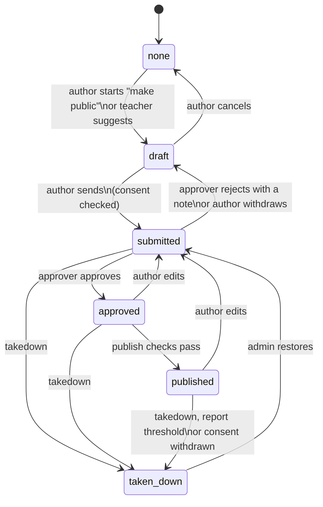

# 07 Content hub: students and teachers

**Status:** planning · **Last updated:** 2026-11-07 · **Owner:** Sami · **Reads first:** [00-MASTER-PLAN.md](00-MASTER-PLAN.md)

## 1. Purpose

This document explains how the content hub works at Markaz Al Azeem. It covers who has an account, how students appear under personas, how parent consent is recorded and checked, what students and teachers can post, who can see each post, how posts are moderated and made public, how a teacher turns a thread into a verified article, and the child-safety rules that apply everywhere.

All students are under 18. When a rule here trades publishing speed against child safety, child safety wins ([00 §4](00-MASTER-PLAN.md#4-agent-rules), rule 9).

The database document owns the tables and columns ([04 §7](04-database.md) for users, roles and personas, [04 §10](04-database.md) for consent records, [04 §11](04-database.md) for content). This document owns the behaviour and the rules. Where it names a table, it uses the shared table names from the master plan brief.

## 2. Scope and out of scope

**In scope**

- Student accounts created by staff, first-login persona setup, and personas that stay live after a student leaves.
- Classes and class membership.
- The light, staff-entered parent consent record, and when it is checked.
- Threads and the nine post types: message, question, answer, poll, article, video, vlog, audio and slides.
- Sharing scopes: class, madrasa and public. Community is reserved.
- Moderation: hiding, removing, reporting, the public approval track and takedown.
- Verified articles made from threads.
- The teacher hub.
- Media rules per post type (the numbers live in [03 §8](03-architecture.md)).
- Child-safety rules for the hub.

**Out of scope**

- Visual design, screens and the walkthrough itself: [02 §12](02-design-ui-ux.md) and [02 §13](02-design-ui-ux.md).
- Login, passwords and sessions: [03 §6](03-architecture.md).
- Upload caps, storage, compression and cache purging: [03 §8](03-architecture.md) and [03 §9](03-architecture.md).
- Table and column definitions and row-level security: [04 §6](04-database.md), [04 §7](04-database.md), [04 §10](04-database.md), [04 §11](04-database.md).
- The role list and the full permission matrix: [05 §6](05-public-pages-roles-admin.md) and [05 §7](05-public-pages-roles-admin.md). Section 4.6 below lists the hub rows that 05 §7 carries.
- The public student work and teacher work pages: [05 §5](05-public-pages-roles-admin.md).
- Orphan sponsorship and sponsor consent: [06 §12](06-donations-and-trail.md). Section 5.4 explains how the hub reuses the same two-sign-off rule.
- The cross-institute community, online classes, attendance and admissions ([00 §1](00-MASTER-PLAN.md#1-summary-goals-and-non-goals)).
- Private messages of any kind. There are none in this version (see section 12.6 and Q-07-01).

## 3. Decisions

### Decisions already in the log

| Decision | What it means here |
| --- | --- |
| [D-014](08-decision-log.md#d-014) | A teacher or admin creates every student account. The student personalises it, guided by a walkthrough. |
| [D-015](08-decision-log.md#d-015) | Every student has a persona. Admins and the student's teachers can always trace it. |
| [D-016](08-decision-log.md#d-016) | Parent consent is a light form entered by staff. No guardian logins, no consent steps for students. |
| [D-017](08-decision-log.md#d-017) | Orphan consent needs two sign-offs: the principal and a teacher he assigns. The glossary applies this to every consent record for an orphan, so it applies to hub consent too. |
| [D-018](08-decision-log.md#d-018) | The hub is a community of threads, and teachers can turn a thread into a verified article. |
| [D-019](08-decision-log.md#d-019) | Class and madrasa posts appear at once. Going public needs approval from the class teacher or the principal. |
| [D-020](08-decision-log.md#d-020) | Uploads are capped, and video is a YouTube link or embed by default. |
| [D-027](08-decision-log.md#d-027) | Proposed target: a taken-down post leaves public pages within one minute (awaiting Sami, Q-07 in 00 §6). |
| [D-028](08-decision-log.md#d-028) | A student's account and persona stay active after they leave. |
| [D-007](08-decision-log.md#d-007) | Urdu and English everywhere. Each post records the language its author chose. |
| [D-001](08-decision-log.md#d-001) | One madrasa now, ready for more. The scope list keeps a reserved community value. |

### Proposed decisions (to be added to 08 at the consistency check)

These are this document's own design choices. Each one needs a `D-` entry in [08](08-decision-log.md). Until then they are marked PD-07-NN.

| ID | Decision | Reason |
| --- | --- | --- |
| PD-07-01 | Approving a post for public view is done by the class teacher of the post's class or by the principal (REQ-MOD-003). Widening a post's scope inside the madrasa, from class to madrasa (and later to community), is done only by an admin or a teacher the admin chose (REQ-MOD-007). Going public is approval, not widening. | Sami's answer: a post goes public through the teacher or the principal. Settled in the consistency check (D-029). |
| PD-07-02 | A post has two separate states: an inside state (`visible`, `hidden`, `removed`) and a public state (`none`, `draft`, `submitted`, `approved`, `published`, `taken_down`). | Class and madrasa posts never need approval, while the public path does. Keeping them apart stops one from blocking the other. |
| PD-07-03 | Phone numbers, email addresses and contact links are blocked when a student posts. Text that looks like a street address is posted but flagged for a teacher. | Phones and emails are easy to detect reliably. Addresses are not, and blocking on a guess would break REQ-MOD-001 for innocent posts. |
| PD-07-04 | Student avatars come only from a preset set of illustrations with no human faces. Students cannot upload a photo as an avatar. | Removes the most common way a child's face would appear. |
| PD-07-05 | Media in a student's post (an upload or a YouTube link) is shown to other students only after a teacher checks it. The post's text appears at once. | The text still appears immediately (REQ-MOD-001), but faces and contact details in images and video cannot be scanned automatically. Awaiting Q-07-02. |
| PD-07-06 | Editing a post that is `submitted`, `approved` or `published` sends it back to `submitted`, and it leaves public pages until approved again. | An approver approved specific content. A changed post needs a fresh look. |
| PD-07-07 | A verified article goes public only after review by an editor or an admin, and only if every student it quotes has active consent. | It is teacher work (REQ-TCH-004) that contains student work (REQ-CHS-005). Awaiting Q-07-07. |
| PD-07-08 | Lessons and resources in the teacher hub are labels on existing post types, not new post types. | Keeps the glossary's nine post types. Awaiting Q-07-04. |
| PD-07-09 | The two-sign-off support for an orphan's consent record is built in P3-E2, and P4-E2 reuses it. | The glossary requires two sign-offs for orphans' consent, and the hub needs consent in P3, before P4 starts. |
| PD-07-10 | When a student reveals their real name, it shows as their first name and the first letter of their family name (for example "Ahmed R."), as entered by staff. | Gives the student recognition with less risk than a full name. |
| PD-07-11 | Replies in a thread are flat (one level), with an optional "replying to" link. | Easier to read and moderate on small phones. |
| PD-07-12 | When a student leaves, an admin moves them into an "Alumni" class owned by an admin. | Keeps a teacher watching their posts, so D-015 and REQ-CHS-003 still hold after D-028. |
| PD-07-13 | Report thresholds: three reports from different users hide a class or madrasa post until a teacher reviews it. One report with the reason "personal details", or two reports of any kind, take a published post down until it is reviewed. | Safety first. A wrong automatic hide costs a little time, and staff can restore the post. |

## 4. Accounts, classes and personas

### 4.1 Student accounts

Students cannot sign up (REQ-STU-001, [D-014](08-decision-log.md#d-014)). A teacher or an admin creates the account from the user screen ([05 §8](05-public-pages-roles-admin.md)).

| Field the staff member enters | Rule |
| --- | --- |
| Real full name | Required. Stored on `users`. Never shown to other students or the public by default. |
| Public name | Optional. First name and family initial, for example "Ahmed R." Used only if the student later reveals their name (section 5.3, PD-07-10). |
| Class or classes | At least one. Creates rows in `class_members`. |
| Orphan flag | Marks that consent needs two sign-offs (section 5.4). |
| Starting password | Set by staff and given to the student in person. Changed at first login ([03 §6](03-architecture.md)). |

The system then:

1. Generates a username, for example `maa-2026-0142`. Students have no email or phone on file, so the username is the login ([03 §6](03-architecture.md)).
2. Gives the account the `student` role in `user_roles`.
3. Creates a persona in `personas` with a generated display name (for example "Sitara 114") and a default avatar.
4. Sets the account status to `active` and marks the first login as not done.
5. Writes an `audit_log` entry: who created the account and when (REQ-ROL-008).

A student never needs an email address, a phone number or any consent step to log in or post ([D-016](08-decision-log.md#d-016)).

**Account statuses**

| Status | Can log in | Can post | Set by |
| --- | --- | --- | --- |
| `active` | Yes | Yes | System on creation |
| `left` | Yes | Yes, in the Alumni class and the madrasa scope | Admin, when the student leaves (D-028) |
| `suspended` | No | No | Admin, for a safety reason, with a note in `audit_log` |

A suspended student's posts stay as they are. Staff can hide them separately.

### 4.2 First login and persona setup

On first login the student must:

1. Set a new password.
2. Follow the guided walkthrough. Its screens, wording and steps are designed in [02 §13](02-design-ui-ux.md). Its content tasks are P3-E7-T70 below.
3. Set up the persona.

| Persona field | Rule |
| --- | --- |
| Display name | 3 to 24 characters. Urdu or Latin letters, digits, spaces and hyphens. Unique in the institute, ignoring case. Must not match any part of any user's real name in the institute. Must pass the contact-detail scan (section 12.2) and a word block list. The generated name is offered and can be kept. |
| Avatar | Chosen from the preset set of about 24 illustrations (calligraphy, patterns, nature, objects). No human faces, no photo uploads (PD-07-04). |
| Short bio | Optional. Up to 160 characters. Passes the contact-detail scan. Must not contain a real name. |

The student can skip the bio and keep the generated name and default avatar. The walkthrough can be replayed later from the help menu (REQ-STU-010, [02 §13](02-design-ui-ux.md)).

**Later changes**

- A student can change their display name once every 30 days, and their avatar and bio at any time.
- Every past display name is kept with its dates, so staff can trace old posts and old reports ([04 §7](04-database.md)).
- A teacher of the student, or an admin, can reset a display name or bio that looks like a real name, is unkind, or gives contact details. The student sees a short note and picks a new name. The reset is written to `audit_log`.

### 4.3 How personas are shown

| Viewer | Sees for a student's post |
| --- | --- |
| Other students | Persona display name and avatar only |
| Visitors on public pages | Persona display name and avatar only |
| The student's teachers | Persona, plus a "who is this?" control that shows the real name |
| Admins | Persona, plus the same control for every student |
| Editors and finance officers | Persona only |

Rules:

- A real name is never sent to a browser that is not allowed to see it. Hiding it with styling is not enough. The rule applies to pages, API responses, exports, emails, logs and error reports (REQ-SEC-007, REQ-SEC-008, [00 §4](00-MASTER-PLAN.md#4-agent-rules) rule 8).
- URLs use the persona's ID or display name, never the real name or username (REQ-SEC-005).
- Every use of the "who is this?" control writes an `audit_log` entry: who looked up which persona, and when.
- "The student's teachers" means teachers of a class the student is in now. For a student who has left, it means the teachers of the Alumni class and of the student's last classes (PD-07-12).
- If the student reveals their real name (section 5.3), the public name shows next to the persona.

The same persona is the name a sponsor sees for an orphan ([06 §12](06-donations-and-trail.md), REQ-ORP-002).

### 4.4 Teacher accounts and profiles

The admin creates teacher accounts (REQ-ROL-004). Teachers post under their real name with a "Teacher" badge, never under a persona.

| Profile field | Rule |
| --- | --- |
| Name | Real name as shown publicly |
| Subject or role | Short text, for example "Hifz teacher" |
| Short profile | Up to 300 characters, in Urdu and English if the teacher wants both |
| Photo | Optional. Adult staff only. |

The profile shows on every teacher post and in the teacher hub (REQ-TCH-001).

### 4.5 Classes and class membership

- A teacher or an admin can create a class (REQ-TCH-005). A class has a name in Urdu and English, an optional description, and one or more class teachers.
- Teachers can add students to their own classes, remove them, or move them to another class they teach. Admins can do this for any class.
- A student can be in several classes, for example "Hifz group A" and "Urdu writing".
- Membership history is kept with start and end dates in `class_members`. Ending a membership does not delete the student's past posts in that class. They stay visible to that class's teachers.
- A class can be archived. Its threads become read-only and stay visible to its members and teachers.
- The admin owns one special class called "Alumni". Students who leave are moved there (section 4.7).

"The class teacher" in any rule means a teacher who is a teacher member of the class in question.

### 4.6 Hub rows for the permission matrix

[05 §7](05-public-pages-roles-admin.md) is the one permission matrix (REQ-ROL-002). These are the content hub rows it should carry. "Own classes" means classes where the person is a class teacher.

| Action | Student | Teacher | Editor | Admin |
| --- | --- | --- | --- | --- |
| Create a student account | No | Yes | No | Yes |
| Create a class, add students | No | Own classes | No | All |
| See the real name behind a persona | No | Own classes | No | All |
| Post and reply in class or madrasa scope | Yes | Yes | No | Yes |
| Create a poll | Yes | Yes | No | Yes |
| Vote in a poll | Yes | Yes | No | Yes |
| Hide or remove a post | No | Any class or madrasa post (REQ-MOD-002, D-031) | No | All |
| Take down a post | No | Own classes and madrasa scope | No | All |
| Widen a post's scope | No | Only if chosen by admin | No | Yes |
| Approve a student post for public view | No | Own classes (PD-07-01) | No | Yes |
| Turn a thread into a verified article | No | Threads they can see | No | Yes |
| Review teacher work for public view | No | No | Yes | Yes |
| Record a consent record | No | Yes (first sign-off for non-orphans) | No | Yes |
| Report a post | Yes | Yes | Yes | Yes |

Visitors can only read published posts and report them (section 8.5).

### 4.7 Students who leave

The account and persona stay live ([D-028](08-decision-log.md#d-028), REQ-STU-009).

1. An admin marks the student as `left`.
2. The system ends their current class memberships (with dates) and adds them to the Alumni class (PD-07-12).
3. The student keeps logging in with the same persona. They can post in the Alumni class and in the madrasa scope.
4. Their past posts, published work and verified-article quotes stay as they are.
5. All child-safety rules still apply. Whether they change when an alumnus turns 18 is open (Q-07-05).

## 5. Consent

### 5.1 The consent record

Consent is a light form that staff fill in. There are no guardian logins (REQ-ROL-003) and the student never sees a consent step (REQ-CHS-006, [D-016](08-decision-log.md#d-016)). Records live in `consent_records` ([04 §10](04-database.md)).

| Field | Example |
| --- | --- |
| Student | The real student account (shown to staff only) |
| Guardian name | "Muhammad Aslam" |
| Relationship | Father, mother, other guardian, or principal as guardian for orphans |
| How it was given | In person, by phone, or on a paper form |
| Date given | 2026-11-12 |
| What it covers | One or more of: `public_work` (work may be public under the persona), `real_name` (the public name may be shown), `face` (the student's face may appear in media) |
| Recorded by | The staff member, filled in automatically |
| Second sign-off | Needed for orphans only (section 5.4) |
| Notes | Optional, staff only |
| Withdrawn on | Empty until consent is withdrawn |

Each item in "what it covers" is a separate yes or no. A guardian can agree to public work under the persona without agreeing to the real name.

### 5.2 When consent is checked

Consent is checked by the system, not remembered by people.

| Moment | Check | If it fails |
| --- | --- | --- |
| A student submits a post for public view (`draft` → `submitted`) | Active consent covering `public_work` | The request is not sent. The student sees "Your teacher needs to add your parent's permission first." A "consent needed" item goes to the student's class teachers. |
| An approver approves (`submitted` → `approved` → `published`) | Checked again at the moment of publishing | The post stays `approved` and is not published. The approver sees why. |
| A student turns on "show my real name" | Active consent covering `real_name` | The setting stays off. A "consent needed" item goes to staff. |
| A teacher clears media showing the student's face for public view | Active consent covering `face`, and the student chose to show it | The media cannot go public. |
| A verified article quoting the student goes public | Active consent covering `public_work` for every quoted student | The article cannot go public until the quote is removed or consent is recorded (section 9.3). |

Consent is not checked for class or madrasa posts. They appear at once (REQ-MOD-001).

REQ-CHS-005 is met because no path to `published` skips the check.

### 5.3 Real-name reveal

A student's real name shows only when the student chooses it and consent is on record (REQ-STU-004).

- The student turns on "Show my name with my persona" in their settings. This is the student's choice, not a consent step.
- When consent covering `real_name` is active, the public name (for example "Ahmed R.") appears next to the persona on every post, inside the madrasa and on public pages (PD-07-10).
- The student can turn it off at any time. Public pages stop showing the name within one minute ([D-027](08-decision-log.md#d-027)).
- Showing a face follows the same rule, with `face` consent and the student's choice per media item.

### 5.4 Orphans: two sign-offs

The glossary says an orphan's consent record needs two sign-offs: the principal, as guardian, and a teacher he assigns ([D-017](08-decision-log.md#d-017)).

1. The principal records the consent and signs off first.
2. He assigns the second sign-off to any teacher.
3. That teacher sees the record in their queue and signs off or declines with a note.
4. The record becomes active only when both have signed off.

This is built in P3-E2 so that hub consent works in P3. Sponsorship consent in P4-E2 ([06 §12](06-donations-and-trail.md)) reuses it (PD-07-09). Sponsorship consent and hub consent are separate records with separate "covers" items: agreeing to one does not grant the other.

### 5.5 Withdrawal

Staff record a withdrawal with its date. Within one minute ([D-027](08-decision-log.md#d-027)):

- every `published` post by that student that relied on the withdrawn item moves to `taken_down`, with the reason "consent withdrawn";
- any `submitted` or `approved` request goes back to `draft`;
- the real name or face stops showing if that item was withdrawn;
- quotes of the student in public verified articles are replaced by "[quote removed]", and the article's reviewer is told.

Class and madrasa posts are not affected. The withdrawal is written to `audit_log`. If consent is later given again, taken-down posts need fresh approval.

## 6. Threads and post types

### 6.1 Threads

A thread is a first post and its replies ([00 §8](00-MASTER-PLAN.md#8-glossary)). Threads live in `threads`, posts in `posts` ([04 §11](04-database.md)).

| Thread property | Rule |
| --- | --- |
| Scope | Class (with one class) or madrasa. Set by the first post. |
| First post | Any post type except answer |
| Title | Taken from the first post's title, or its first 80 characters |
| Pinned | Teachers and admins can pin up to 3 threads per class |
| Locked | Teachers and admins can lock a thread. No new replies, existing posts stay. |
| Source of | If a verified article was made from it, the thread shows a banner linking to the article |

Who can start a thread: students, teachers and admins. Replies are flat with an optional "replying to" link (PD-07-11). Replies always have the thread's scope and can never be wider (section 7).

### 6.2 Fields on every post

| Field | Rule |
| --- | --- |
| Type | One of the nine types below |
| Author | The user. Shown as the persona for students, the real name for teachers. |
| Thread | The thread it belongs to |
| Scope | Class, madrasa or public (section 7) |
| Language | `ur` or `en`. The author picks it. It defaults to the interface language. It sets text direction (right to left for Urdu) and the `lang` attribute (REQ-LNG-010, [02 §8](02-design-ui-ux.md)). There is no automatic translation. |
| Inside state | `visible`, `hidden` or `removed` (section 8) |
| Public state | `none`, `draft`, `submitted`, `approved`, `published` or `taken_down` (section 8) |
| Media | Zero or more `media_assets`, as the type allows (section 11) |
| Created, edited | Timestamps. Every edit keeps the earlier version for staff ([04 §11](04-database.md)). |

All text fields pass the contact-detail scan (section 12.2).

### 6.3 Post types

Students can create every type (REQ-STU-005). Lengths are starting values and can be changed in institute settings.

| Type | Fields | Where it can be | Rules |
| --- | --- | --- | --- |
| Message | Text up to 1,000 characters, optional 1 image | First post or reply | For short notes and concerns. The walkthrough tells students to take a serious personal concern to a teacher in person (see Q-07-01). |
| Question | Title up to 150 characters, text up to 2,000, optional 1 image | First post only | Shows "unanswered" until an answer is accepted. |
| Answer | Text up to 3,000 characters, optional 1 image | Reply to a question only | The asker, a class teacher or an admin can mark one answer as accepted. A teacher's answer shows a "Teacher answer" badge. |
| Poll | Question up to 200 characters, 2 to 6 options of up to 80 characters each, single or multiple choice, closing date | First post or reply | See section 6.4. |
| Article | Title up to 150 characters, summary up to 300, text up to 20,000 with simple formatting (headings, bold, lists, quotes, links), optional cover image | First post only | Links pass the contact-link check (section 12.2). |
| Video | Title, description up to 1,000 characters, a YouTube link or one upload | First post or reply | YouTube is the default (section 11). |
| Vlog | Same as video | First post only | A personal video by its author. For students: no face unless allowed (section 12.1). |
| Audio | Title, description up to 1,000 characters, one audio upload | First post or reply | For recitation, nasheeds and spoken answers. |
| Slides | Title, description up to 1,000 characters, one slides file or a set of images | First post only | For presentations and class notes. |

Allowed file kinds and caps per type are in section 11 and [03 §8](03-architecture.md).

### 6.4 Polls

Students and teachers can create polls, and students can vote (REQ-STU-007).

| Rule | Value |
| --- | --- |
| Who can create | Students, teachers and admins, in any thread they can post in |
| Options | 2 to 6, stored in `poll_options`. Options cannot change after the first vote. |
| Choice type | Single choice, or multiple choice with a maximum the creator sets |
| Closing | The creator sets a closing date, from 1 hour to 30 days. The default is 7 days. A teacher or admin can close a poll early. |
| Who can vote | Students, teachers and admins who can see the poll. One set of votes per user per poll, stored in `poll_votes`. |
| Changing a vote | Allowed until the poll closes |
| Results | Counts and percentages. The creator chooses "show after voting" or "show after closing". |
| Who voted | Hidden from students. Visible to the voters' teachers and admins, so they can trace misuse. |
| Public polls | A published poll shows final counts only. Visitors cannot vote. |

### 6.5 Editing and deleting

- An author can edit their own post. A post in class or madrasa scope stays `visible` after an edit. A post in the public track goes back to `submitted` (PD-07-06).
- An author can delete their own post. It moves to `removed`, with the reason "deleted by author". Other students no longer see it. The class's teachers and admins still do, with its history (REQ-CHS-003).
- Teachers and admins can edit only their own posts. They hide or remove other posts instead of changing them.

## 7. Sharing scopes

A post's scope decides who can see it ([00 §8](00-MASTER-PLAN.md#8-glossary)).

| Scope | Who can see it | How a post gets it |
| --- | --- | --- |
| `class` | Members of one class (students and teachers) and admins | Chosen at creation |
| `madrasa` | Every logged-in user of the institute, and admins | Chosen at creation, or widened from class |
| `public` | Anyone, on the public student work or teacher work page ([05 §5](05-public-pages-roles-admin.md)) | Only through the public track (section 8.3) |
| `community` | Reserved for the future multi-institute hub. Not offered or accepted in this version. | None |

Rules:

1. Every post has a scope of class or madrasa when it is created (REQ-STU-008). Public is never chosen at creation.
2. The scope field can hold `community` later without a schema change (REQ-MIR-004, [04 §11](04-database.md)). Today the system rejects it.
3. A reply has its thread's scope. A thread's scope covers all its replies.
4. **Widening** (class → madrasa, or entering the public track) is done only by an admin or by a teacher the admin has chosen (REQ-MOD-007). The admin keeps the list of chosen teachers on the user screen ([05 §8](05-public-pages-roles-admin.md)). It starts empty: until the admin picks teachers, only the admin can widen.
5. A student can ask for wider sharing with "Share with the whole madrasa" or "Ask to make public". The request goes to the moderation queue. It does not change anything by itself.
6. **Narrowing** (madrasa → class) can be done by the author, any teacher who can see the post, or an admin.
7. Widening a thread widens its first post and all its replies. Each reply's author is shown the change.
8. Every change of scope is written to `audit_log`.

## 8. Moderation

### 8.1 Two states per post

Each post has an inside state and a public state (PD-07-02). The database document stores both ([04 §11](04-database.md)).

**Inside state** (class and madrasa)

| State | Who sees the post | Reached by |
| --- | --- | --- |
| `visible` | Everyone in its scope | Creation. Posts appear at once (REQ-MOD-001). |
| `hidden` | The author (with "Hidden by your teacher"), the class's teachers, admins | A teacher or admin hides it (REQ-MOD-002), a takedown, or the report threshold |
| `removed` | The class's teachers and admins only | A teacher or admin removes it, or the author deletes it |

| From | To | Who |
| --- | --- | --- |
| `visible` | `hidden` | Class teacher (own classes), any teacher (madrasa scope), admin, or the system (report threshold) |
| `hidden` | `visible` | Class teacher or admin |
| `visible` or `hidden` | `removed` | Class teacher or admin, or the author for their own post |
| `removed` | `hidden` | Admin only |

### 8.2 Public state machine

A post going public moves through `draft`, `submitted`, `approved`, `published` and `taken_down` (REQ-MOD-004). `none` means the post has never been asked to go public.

| From | To | Who or what | Conditions |
| --- | --- | --- | --- |
| `none` | `draft` | The author. Or a teacher suggests it, and the author accepts. | Post is `visible` |
| `draft` | `none` | The author | |
| `draft` | `submitted` | The author | Consent covering `public_work` is active (section 5.2). Contact-detail scan passes. |
| `submitted` | `draft` | An approver (reject with a note), or the author (withdraw) | |
| `submitted` | `approved` | An approver: the principal, or a class teacher of the post's class (PD-07-01). For a madrasa-scope post, the class teacher of any class the author is in. Nobody approves their own post. | The approver has seen the post and its media |
| `approved` | `published` | The system, at once | Consent still active. Inside state is `visible`. No open report. Student media cleared (PD-07-05). |
| `approved` or `published` | `submitted` | The author edits the post | PD-07-06 |
| `submitted`, `approved` or `published` | `taken_down` | A teacher (own classes and madrasa scope), an admin, the report threshold, or consent withdrawal | Always allowed. Needs a reason. |
| `taken_down` | `submitted` | Admin only | Needs fresh approval. Never straight back to `published`. |

Teacher hub items and verified articles use the same public states, but their approver is an editor or admin (sections 9 and 10).

The approval queue shows each request with its content, media, scope, the persona and, for staff allowed to see it, the real name and consent status.

### 8.3 Making a post public, step by step

Example: the student "Sitara 114" asked a question in "Hifz group A", and a teacher answered.

1. Sitara taps "Ask to make public" on her question. The public state becomes `draft`. She sees a preview of how it will look on the student work page, under her persona.
2. She taps "Send". Consent is checked and passes. The public state becomes `submitted`.
3. Ustad Bilal, a class teacher of Hifz group A whom the admin chose, opens the queue, reads the thread and approves it. It becomes `approved`, and the system publishes it at once (`published`).
4. The thread appears on the student work page under "Sitara 114" (REQ-PUB-004). Each reply in it shows publicly only if its own author's consent is active. Other replies are left out with no placeholder. Teacher replies are always included.
5. New replies to the thread inside the madrasa do not appear publicly unless they go through the same track.

### 8.4 Takedown

- An admin can take down any post at once (REQ-CHS-004). A teacher can take down any post in their classes or in the madrasa scope.
- A takedown sets the inside state to `hidden`. If the public state was `submitted`, `approved` or `published`, it becomes `taken_down`.
- Target: a taken-down post disappears from public pages within one minute (REQ-MOD-006, [D-027](08-decision-log.md#d-027), proposed). The architecture purges cached pages and media on takedown ([03 §8](03-architecture.md), [03 §9](03-architecture.md)).
- The reason is required: personal details, face shown, unkind or bullying, wrong religious information, consent withdrawn, or other with a note.
- Takedowns are written to `audit_log` and shown in the post's history.

### 8.5 Reports and the moderation queue

Every post has a report button (REQ-STU-011). Reports are stored in `post_reports` ([04 §11](04-database.md)).

| Who can report | Where |
| --- | --- |
| Students, teachers, editors and admins | Every post they can see |
| Visitors | Published posts on public pages, with no login and a limit of 5 reports per hour per device (proposed REQ-MOD-008) |

Report reasons: personal details, face or real name shown, unkind or bullying, wrong religious information, other (with up to 300 characters). The reporter's identity is visible only to staff. The reported student never learns who reported them.

Report thresholds (PD-07-13):

- A class or madrasa post with reports from 3 different users is hidden until a teacher reviews it.
- A published post with one report for "personal details", or 2 reports of any kind, is taken down until reviewed.

**The moderation queue** (REQ-MOD-005) gathers, in this order:

1. Reports with the reason "personal details" or "face or real name shown"
2. Posts flagged by the address check (section 12.2)
3. Other reports
4. Student media waiting for a check (PD-07-05)
5. Public requests (`submitted`)
6. Requests to widen to madrasa scope
7. Consent needed and second sign-off requests (section 5)

A teacher sees items from their own classes and the madrasa scope. An admin sees everything. An editor sees only teacher-work reviews. Each item can be closed as "no action", "hidden", "removed" or "taken down", with a note. Closing writes to `audit_log`. The admin screen for the queue is in [05 §8](05-public-pages-roles-admin.md).

## 9. Verified articles

### 9.1 Making one

A teacher can turn a thread into a verified article (REQ-TCH-002, [D-018](08-decision-log.md#d-018)).

1. A teacher who can see the thread taps "Make verified article". Any teacher of the thread's class can do it, or any teacher for a madrasa-scope thread.
2. An editor opens with the thread's title and posts beside it. The teacher writes the article in their own words. They can quote chosen posts. Quotes keep the author's persona (and public name only if revealed).
3. The teacher fills in: title, summary, language, body, and optional references (for example a Quran verse or a book).
4. On saving, the system creates a new post of type `article` with the verified flag on, linked to the source thread ([04 §11](04-database.md)). Its author is the verifying teacher.
5. It appears at once in the source thread's scope, like any class or madrasa post. The source thread shows a banner: "This discussion became a verified article."

### 9.2 What it shows

- A verified mark and the line "Verified by Ustad Bilal Ahmad", with a link to the teacher's profile (REQ-TCH-003).
- The date of verification.
- Quoted posts under their personas.

Only the verifying teacher and admins can edit a verified article. An admin, or the verifying teacher, can remove the verified mark with a note. This is written to `audit_log`.

### 9.3 Going public

A verified article is teacher work that contains student work. It goes public only when (PD-07-07):

1. the verifying teacher submits it (`draft` → `submitted`);
2. every student it quotes has active consent covering `public_work`, otherwise the teacher must remove that quote first;
3. an editor or an admin approves it (REQ-TCH-004). The verifying teacher can never approve their own article.

Once published, it appears on the teacher work page with its mark (REQ-PUB-005, [05 §5](05-public-pages-roles-admin.md)). Takedown works as in section 8.4. Whether the class teacher or principal approval rule (REQ-MOD-003) should apply instead is open (Q-07-07).

## 10. Teacher hub

The teacher hub is a module the admin can switch on or off (REQ-ROL-010). When it is off, its pages and menu items are hidden and its data is kept. The student hub module works the same way.

### 10.1 What teachers publish

Teachers publish under their real name with their short profile (section 4.4, REQ-TCH-001). The hub uses the existing post types, with a hub label (PD-07-08):

| Hub item | Post type | Notes |
| --- | --- | --- |
| Article | `article` | |
| Lesson | `article`, `video`, `audio` or `slides`, labelled "Lesson" | Optional subject and level, for example "Tajweed, beginners" |
| Audio | `audio` | Recitations, talks |
| Video | `video` | YouTube link by default, ideally from the madrasa's own channel |
| Resource | `article` with attached files, or `slides`, labelled "Resource" | Worksheets, reading lists. Allowed file kinds are in [03 §8](03-architecture.md). |

### 10.2 Review before public

- A teacher hub item first appears in the madrasa scope, at once, like any madrasa post.
- To go public, it goes through the public states (section 8.2). The approver is an editor or an admin (REQ-TCH-004). A teacher cannot approve their own work.
- Who holds the editor role is open ([00 §6](00-MASTER-PLAN.md#open-questions), Q-03). Until an editor exists, the admin reviews.
- The admin's own hub items are published by the admin directly, and the publish is written to `audit_log`.
- Published items appear on the teacher work page (REQ-PUB-005).

## 11. Media rules

Caps per media type, accepted file formats, compression, storage and delivery are owned by [03 §8](03-architecture.md) (REQ-PRF-002, REQ-PRF-003). This section sets which media each post type allows and the safety rules.

### 11.1 Media per post type

| Post type | Allowed media |
| --- | --- |
| Message, question, answer | Up to 1 image |
| Poll | None |
| Article | 1 cover image and up to 5 images in the body. Teacher resources can also attach files. |
| Video, vlog | 1 YouTube link (default) or 1 video upload within the cap |
| Audio | 1 audio upload within the cap |
| Slides | 1 slides file, or up to 20 images |

Rules:

1. **YouTube first.** A video is added as a YouTube link or embed by default (REQ-PRF-004, [D-020](08-decision-log.md#d-020)). The upload option is shown second, with the cap stated. Embeds use YouTube's privacy-enhanced mode and load only when tapped, to save data on slow connections ([02 §9](02-design-ui-ux.md)).
2. Every upload has its location and camera details removed before it is stored (proposed REQ-CHS-007).
3. Every image needs alt text in the post's language (REQ-ACC-003). The upload form asks for it.
4. Media files are stored in `media_assets` and belong to the post's institute ([04 §11](04-database.md)).
5. When a post is hidden, removed or taken down, its media stops being served to anyone but staff, and public copies are purged within one minute ([D-027](08-decision-log.md#d-027)).

### 11.2 Student media check

Faces and contact details in images, audio and video cannot be scanned reliably. So (PD-07-05, awaiting Q-07-02):

- a student's post appears at once with its text, and its media shows "Waiting for your teacher" to other students;
- the post's author, its class teachers and admins see the media at once;
- a class teacher (or any teacher for madrasa scope) checks it: no face (section 12.1), no contact details, no name tags or school ID cards, then clears or rejects it;
- a YouTube link counts as media and is checked too, because a student's own channel can reveal who they are.

## 12. Child safety

Everything in this section applies across the hub. The aim is to limit risk R-04 ([00 §6](00-MASTER-PLAN.md#risks)).

### 12.1 Names and faces hidden by default

- Students appear under personas everywhere (REQ-CHS-001, REQ-STU-003). Real names show only through the rules in section 5.3.
- Avatars are preset illustrations with no faces (PD-07-04).
- Student media must not show a face unless the student chose to show it and consent covering `face` is on record. The upload screen reminds students to film hands, a notebook, a board or nature, or to use voice only. A teacher's media check enforces this (section 11.2). Whether faces may show inside the class without consent is open (Q-07-03).
- Group photos of students taken by staff for public pages follow the same rule ([05 §5](05-public-pages-roles-admin.md)).

### 12.2 Contact details blocked or flagged

Every student text field is scanned on create and edit: posts, titles, poll options, captions, persona display name and bio (REQ-CHS-002, PD-07-03).

| Pattern | Examples | Action |
| --- | --- | --- |
| Phone numbers | `0300 1234567`, `+92 300 1234567`, `0092...`, any run of 10 or more digits with spaces or dashes, in Latin, Urdu (`۰۳۰۰`) or Arabic-Indic digits | **Blocked.** The post is not saved. |
| Email addresses | `name@gmail.com`, "name at gmail dot com", "ایٹ" spellings | **Blocked** |
| Contact links | `wa.me`, `chat.whatsapp.com`, `t.me`, links to Facebook, Instagram, TikTok or Snapchat profiles | **Blocked** |
| Street-address words with a number | "house no 12", "gali 4", "mohalla", "chak 92", "مکان نمبر", "گلی", "محلہ" | **Flagged.** The post appears and goes to the top of the moderation queue. |

When a post is blocked, the student sees a friendly message in their language: "Please don't share phone numbers, emails or contact links here. Ask your teacher if you need to contact someone." The blocked text is not stored. The attempt is recorded with only the pattern type. After 3 blocked attempts in 7 days, the student's class teachers are told, so they can check in with the child.

Teachers' and admins' posts get a warning but are not blocked, because staff may need to post the madrasa's own contact details.

### 12.3 Teachers see everything in their classes

- A class teacher sees every post and reply in their classes, including hidden posts, removed posts, posts deleted by their authors, and earlier versions of edited posts (REQ-CHS-003).
- Every teacher and admin sees every madrasa-scope post.
- A teacher has a class feed showing all student activity in their classes, newest first.
- There is no space in the hub where students can talk without a teacher able to see it.

### 12.4 Fast takedown

Takedown is described in section 8.4. Target: one minute from takedown to removal from public pages ([D-027](08-decision-log.md#d-027), proposed). The report thresholds in section 8.5 act before a teacher reaches the queue.

### 12.5 No outside contact

- Visitors cannot comment, reply or vote. They can only read and report.
- Sponsors never contact a child directly ([06 §12](06-donations-and-trail.md)).
- Students cannot follow each other, add friends, or see who is online.
- Students have no email or phone on file, so the hub sends them no email or SMS.

### 12.6 No private messages

The master plan does not include private messages, so there are none: no messages between students, and no private channel between a student and anyone else. All conversation happens in threads that teachers can see.

This leaves a gap. A child with a serious personal worry (for example, being hurt or bullied) has no private way to tell a trusted adult through the hub. This is raised as Q-07-01 with a proposed requirement, not decided here. Until it is answered, the walkthrough tells students to speak to a teacher or the principal in person about anything private.

### 12.7 When a post suggests a child is at risk

If a report or a post suggests a child may be at risk, the teacher hides the post (never deletes it), marks the queue item "safeguarding", and tells the principal in person the same day. The platform keeps the post and its history for staff. What happens next is the madrasa's own safeguarding process, outside this platform.

### 12.8 Privacy in logs and exports

Real names of students never appear in logs, error reports, analytics or exports, except staff exports that admins run on purpose, which are themselves written to `audit_log` (REQ-SEC-008, [03 §13](03-architecture.md)).

## Requirements covered

**Owned by this document (checklist points to 07)**

| Area | Requirement IDs | Section |
| --- | --- | --- |
| Student hub | REQ-STU-001, REQ-STU-002, REQ-STU-003, REQ-STU-009 | §4 |
| Student hub | REQ-STU-004 | §5.3 |
| Student hub | REQ-STU-005, REQ-STU-006, REQ-STU-007 | §6 |
| Student hub | REQ-STU-008 | §7 |
| Student hub | REQ-STU-011 | §8.5 |
| Teacher hub | REQ-TCH-005, REQ-TCH-006 | §4 |
| Teacher hub | REQ-TCH-002, REQ-TCH-003 | §9 |
| Teacher hub | REQ-TCH-001, REQ-TCH-004 | §10 |
| Child safety | REQ-CHS-005, REQ-CHS-006 | §5 |
| Child safety | REQ-CHS-004 | §8.4 |
| Child safety | REQ-CHS-001, REQ-CHS-002, REQ-CHS-003 | §12 |
| Moderation | REQ-MOD-001, REQ-MOD-002, REQ-MOD-003, REQ-MOD-004, REQ-MOD-005, REQ-MOD-006 | §8 |
| Moderation | REQ-MOD-007 | §7 |
| Language | REQ-LNG-010 | §6.2 |
| Performance | REQ-PRF-004 | §11 |

**Supported here, owned elsewhere**

REQ-STU-010 (02 §13, §4.2 here), REQ-PUB-004 and REQ-PUB-005 (05 §5, §8.3 and §9.3 here), REQ-SEC-005 (03 §12, §4.3 here), REQ-SEC-007 (04 §7, §4.3 here), REQ-SEC-008 (03 §13, §12.8 here), REQ-ROL-002 (05 §7, §4.6 here), REQ-ROL-003 (05 §6, §5.1 here), REQ-ROL-004 (05 §8, §4.4 here), REQ-ROL-008 (05 §9, throughout), REQ-ROL-010 (05 §8, §10 here), REQ-MIR-004 (04 §11, §7 here), REQ-PRF-002 and REQ-PRF-003 (03 §8, §11 here), REQ-ACC-003 (02 §10, §11.1 here), REQ-LNG-007 (02 §8, §6.2 here), REQ-ORP-002 and REQ-ORP-004 (06 §12, §4.3 and §5.4 here).

### Proposed requirements

Not in the checklist yet. Do not build on them until they are approved ([00 §4](00-MASTER-PLAN.md#4-agent-rules), rule 4).

- [ ] REQ-CHS-007 (proposed) Every uploaded image, audio or video file has its location and camera details removed before it is stored. MUST → 07 §11
- [ ] REQ-CHS-008 (proposed) Withdrawing parent consent takes all of that student's public posts down, and hides their real name and face, within one minute. MUST → 07 §5
- [ ] REQ-CHS-009 (proposed) A student can raise a private concern that only their teachers and admins can see (depends on Q-07-01). SHOULD → 07 §12
- [ ] REQ-MOD-008 (proposed) Visitors can report a published post on a public page without logging in. SHOULD → 07 §8
- [ ] REQ-MOD-009 (proposed) Media in a student's post is shown to other students only after a teacher checks it (depends on Q-07-02). MUST → 07 §11

### Open questions raised by this document

To be moved into [00 §6](00-MASTER-PLAN.md#open-questions) at the consistency check.

| ID | Question | Proposed default | Owner | Due |
| --- | --- | --- | --- | --- |
| Q-07-01 | Should a student be able to send a private concern to their teachers or the principal? The master plan has no private messages, and threads are not a safe place for a serious personal worry. | No private messages until decided. The walkthrough points students to a teacher in person. | Moazam, Sami | Before P3-E3 |
| Q-07-02 | Should student media wait for a teacher's check before other students see it (PD-07-05)? | Yes | Moazam | Before P3-E4 |
| Q-07-03 | Inside a class or the madrasa, may a student's face appear in media without a consent record? | No: faces need the student's choice and `face` consent everywhere. | Moazam | Before P3-E4 |
| Q-07-04 | Are "lesson" and "resource" labels on existing post types enough, or do they need their own post types? | Labels (PD-07-08) | Sami | Before P3-E6 |
| Q-07-05 | Do any rules change when an alumnus turns 18? | No change in this version | Moazam | Before P3-E1 ends |
| Q-07-06 | Which teachers should the admin choose to widen scopes and approve public posts? | Admin chooses at setup. The list starts empty. | Moazam | Before P3-E5 |
| Q-07-07 | Who approves a verified article for public view: an editor or admin (REQ-TCH-004), or the class teacher or principal (REQ-MOD-003)? | Editor or admin, plus consent for every quoted student (PD-07-07) | Sami, Moazam | Before P3-E6 |

## Tasks

Status is `todo` for every task. Where a dependency is another document's epic (for example `P0-E5`), the task waits until that epic is done. The consistency check may narrow it to a single task ID. A task that depends on an open question must not start until the question is answered.

### P3-E1 Student and teacher accounts, classes and personas

| Task | Title | Status | Depends on | Requirements |
| --- | --- | --- | --- | --- |
| P3-E1-T01 | Staff form to create a student account with generated username and starting password, with no self sign-up | todo | P0-E5 | REQ-STU-001, REQ-ROL-003, REQ-ROL-008 |
| P3-E1-T02 | Create a persona with a generated display name and default avatar when a student account is created | todo | P3-E1-T01 | REQ-STU-003, REQ-SEC-007 |
| P3-E1-T03 | Preset avatar set and persona rules (name length, uniqueness, real-name match, block list, bio length) | todo | P3-E1-T02, P0-E4 | REQ-STU-002, REQ-CHS-001 |
| P3-E1-T04 | First-login screen: new password, then persona display name, avatar and bio | todo | P3-E1-T03 | REQ-STU-002, REQ-STU-010 |
| P3-E1-T05 | Show personas instead of real names in every page, API response, export and email, by role | todo | P3-E1-T02 | REQ-STU-003, REQ-CHS-001, REQ-SEC-005, REQ-SEC-007, REQ-SEC-008 |
| P3-E1-T06 | Create, edit and archive classes with Urdu and English names and class teachers | todo | P0-E5 | REQ-TCH-005 |
| P3-E1-T07 | Add, remove and move students between classes, keeping membership history | todo | P3-E1-T06, P3-E1-T01 | REQ-TCH-005 |
| P3-E1-T08 | "Who is this?" persona trace for the student's teachers and admins, logged in the audit log | todo | P3-E1-T05, P3-E1-T07 | REQ-TCH-006, REQ-SEC-007, REQ-ROL-008 |
| P3-E1-T09 | Persona name history, 30-day change limit, and staff reset of an unsuitable name or bio | todo | P3-E1-T03, P3-E1-T08 | REQ-STU-002, REQ-CHS-001, REQ-ROL-008 |
| P3-E1-T10 | Leaver flow: mark a student as left, move them to the Alumni class, keep account and persona live | todo | P3-E1-T07 | REQ-STU-009 |
| P3-E1-T11 | Admin suspends and restores a student account with a reason | todo | P3-E1-T01 | REQ-ROL-008 |
| P3-E1-T12 | Teacher profile: real name, subject, short profile, optional photo | todo | P0-E5 | REQ-TCH-001 |
| P3-E1-T13 | Student setting to show their public name with the persona, gated on consent | todo | P3-E1-T05, P3-E2-T03 | REQ-STU-004 |

### P3-E2 Parent consent records

| Task | Title | Status | Depends on | Requirements |
| --- | --- | --- | --- | --- |
| P3-E2-T01 | Light staff form to record a consent record with guardian, method, date and covered items | todo | P0-E5, P3-E1-T01 | REQ-CHS-006, REQ-ROL-003, REQ-ROL-008 |
| P3-E2-T02 | Two sign-offs for an orphan's consent record: principal first, then a teacher he assigns | todo | P3-E2-T01 | REQ-CHS-005, REQ-CHS-006, REQ-ORP-004 |
| P3-E2-T03 | Consent check used at submit, publish, real-name reveal, face clearance and verified-article publish | todo | P3-E2-T01, P3-E2-T02 | REQ-CHS-005, REQ-STU-004 |
| P3-E2-T04 | Record a consent withdrawal and automatically take down affected public posts, names and quotes | todo | P3-E2-T03, P3-E5-T06 | REQ-CHS-005, REQ-STU-004, REQ-MOD-006 |
| P3-E2-T05 | Staff consent overview: students with no consent, a pending second sign-off, or withdrawn consent | todo | P3-E2-T01 | REQ-CHS-005 |

### P3-E3 Threads and post types

| Task | Title | Status | Depends on | Requirements |
| --- | --- | --- | --- | --- |
| P3-E3-T01 | Start a thread in a class or the madrasa scope; list threads per scope; posts appear at once | todo | P3-E1-T05, P3-E1-T07 | REQ-STU-005, REQ-STU-008, REQ-MOD-001 |
| P3-E3-T02 | Flat replies with "replying to", plus pin and lock by teachers | todo | P3-E3-T01 | REQ-STU-006 |
| P3-E3-T03 | Post language picker (Urdu or English, default the interface language), setting direction and `lang` | todo | P3-E3-T01, P0-E3 | REQ-LNG-010, REQ-LNG-007 |
| P3-E3-T04 | Message and question post types, with the unanswered and answered marker | todo | P3-E3-T01 | REQ-STU-005 |
| P3-E3-T05 | Answer post type, accepted answer and "Teacher answer" badge | todo | P3-E3-T04 | REQ-STU-005 |
| P3-E3-T06 | Poll creation by students and teachers: options, choice type and closing date | todo | P3-E3-T01 | REQ-STU-007 |
| P3-E3-T07 | Poll voting, changing a vote, results display and the staff-only voter list | todo | P3-E3-T06 | REQ-STU-007 |
| P3-E3-T08 | Article post type with simple formatting, summary and cover image | todo | P3-E3-T01 | REQ-STU-005 |
| P3-E3-T09 | Video and vlog post types with a YouTube link first and upload second | todo | P3-E3-T01, P3-E4 | REQ-STU-005, REQ-PRF-004 |
| P3-E3-T10 | Audio and slides post types | todo | P3-E3-T01, P3-E4 | REQ-STU-005 |
| P3-E3-T11 | Edit and delete own post, keeping earlier versions and deleted posts visible to staff | todo | P3-E3-T02 | REQ-CHS-003, REQ-ROL-008 |
| P3-E3-T12 | Contact-detail scan on every student text field: block phones, emails and contact links, flag addresses | todo | P3-E3-T01 | REQ-CHS-002 |
| P3-E3-T13 | Teacher class feed showing all student posts and replies, including hidden, removed and deleted | todo | P3-E3-T02, P3-E3-T11 | REQ-CHS-003 |
| P3-E3-T14 | Tell class teachers after 3 blocked contact-detail attempts by one student in 7 days | todo | P3-E3-T12 | REQ-CHS-002 |

### P3-E5 Sharing scopes, moderation and reports

| Task | Title | Status | Depends on | Requirements |
| --- | --- | --- | --- | --- |
| P3-E5-T01 | Scope rules: class or madrasa at creation, replies inherit, `community` reserved and rejected | todo | P3-E3-T01 | REQ-STU-008, REQ-MIR-004 |
| P3-E5-T02 | Admin list of teachers who may widen scopes; widen and narrow actions with audit entries | todo | P3-E5-T01 | REQ-MOD-007, REQ-ROL-008 |
| P3-E5-T03 | Hide, unhide and remove class and madrasa posts (inside state) | todo | P3-E3-T13 | REQ-MOD-002 |
| P3-E5-T04 | Report button with reasons for logged-in users and rate-limited visitors | todo | P3-E3-T01 | REQ-STU-011, REQ-MOD-005 |
| P3-E5-T05 | Moderation queue with priority order, filtered by role and class | todo | P3-E5-T04, P3-E3-T12 | REQ-MOD-005, REQ-CHS-002 |
| P3-E5-T06 | Take down any post with a reason and remove it from public pages within one minute | todo | P3-E5-T03, P0-E1 | REQ-CHS-004, REQ-MOD-006 |
| P3-E5-T07 | Public request: draft, preview and submit by the author, or a teacher suggestion the author accepts | todo | P3-E5-T01, P3-E2-T03 | REQ-MOD-003, REQ-MOD-004 |
| P3-E5-T08 | Approve, reject and automatic publish with approver rules (PD-07-01) and publish checks | todo | P3-E5-T07, P3-E5-T02 | REQ-MOD-003, REQ-MOD-004, REQ-CHS-005 |
| P3-E5-T09 | Edits to public-track posts return to submitted; admin restores from taken down to submitted | todo | P3-E5-T08, P3-E5-T06 | REQ-MOD-004 |
| P3-E5-T10 | Report thresholds that hide or take down posts automatically until reviewed | todo | P3-E5-T05, P3-E5-T06 | REQ-MOD-005, REQ-CHS-004 |
| P3-E5-T11 | Post moderation history and audit entries for every moderation action | todo | P3-E5-T03, P3-E5-T06, P3-E5-T08 | REQ-ROL-008 |

### P3-E6 Teacher hub and verified articles

| Task | Title | Status | Depends on | Requirements |
| --- | --- | --- | --- | --- |
| P3-E6-T01 | Respect the student hub and teacher hub module switches in hub pages and menus | todo | P0-E2, P3-E3-T01 | REQ-ROL-010 |
| P3-E6-T02 | Teacher hub items with labels: article, lesson, audio, video and resource | todo | P3-E3-T08, P3-E3-T09, P3-E3-T10, P3-E1-T12 | REQ-TCH-001 |
| P3-E6-T03 | Editor or admin review of teacher work before it goes public, with no self-approval | todo | P3-E6-T02, P3-E5-T08 | REQ-TCH-004 |
| P3-E6-T04 | "Make verified article" from a thread: editor beside the thread with quoted posts | todo | P3-E3-T05, P3-E3-T08 | REQ-TCH-002 |
| P3-E6-T05 | Verified mark, "Verified by" teacher name, source thread banner, and removing the mark | todo | P3-E6-T04 | REQ-TCH-003 |
| P3-E6-T06 | Verified article public path: consent check for every quoted student, then editor or admin review (waits for Q-07-07) | todo | P3-E6-T04, P3-E6-T03, P3-E2-T03 | REQ-TCH-002, REQ-TCH-004, REQ-CHS-005 |

### Content tasks in epics owned by other documents

| Task | Title | Status | Depends on | Requirements |
| --- | --- | --- | --- | --- |
| P3-E4-T70 | Apply the allowed-media table per post type in upload forms (section 11.1) | todo | P3-E3-T01 | REQ-PRF-003, REQ-PRF-004 |
| P3-E4-T71 | Remove location and camera details from every upload before storage | todo | P3-E4-T70 | REQ-CHS-001 |
| P3-E4-T72 | Student media check: media waits for a teacher before other students see it (waits for Q-07-02) | todo | P3-E5-T05 | REQ-CHS-001, REQ-CHS-002 |
| P3-E4-T73 | Stop serving and purge media of hidden, removed and taken-down posts | todo | P3-E5-T06 | REQ-MOD-006, REQ-CHS-004 |
| P3-E7-T70 | Walkthrough content in Urdu and English: persona setup, posting, scopes, reporting, "no contact details", "speak to a teacher" | todo | P3-E1-T04 | REQ-STU-010, REQ-STU-002, REQ-LNG-001 |
| P3-E8-T70 | Student work page rules: only published posts, personas, replies only from authors with consent | todo | P3-E5-T08 | REQ-PUB-004, REQ-CHS-001, REQ-CHS-005 |
| P3-E8-T71 | Teacher work page rules: published teacher items and verified articles with the mark and teacher name | todo | P3-E6-T03, P3-E6-T05 | REQ-PUB-005, REQ-TCH-003 |
| P3-E8-T72 | Report link on public posts for visitors | todo | P3-E5-T04 | REQ-MOD-005 |

## Acceptance criteria

Each one can be tested by hand on a test copy with the test institute.

1. **Phase P3 test.** A teacher creates a student account. The student logs in, changes the password, follows the walkthrough and sets a persona. The student posts a question to their class, and it appears at once for classmates under the persona. A teacher answers it and turns the thread into a verified article showing the verified mark and the teacher's name. The student asks to make the question thread public. It waits in the queue until a chosen class teacher or the principal approves it, then appears on the student work page under the persona ([00 §5](00-MASTER-PLAN.md#5-roadmap)).
2. There is no sign-up form for students. A student account can be created only by a teacher or admin, and the creation is in the audit log.
3. Logged in as a student, no page, API response or export shows another student's real name. Logged in as that student's teacher, "who is this?" shows it and writes an audit entry. Logged in as an editor, it is not available.
4. A persona display name that matches part of any user's real name, or contains `0300 1234567`, is refused.
5. A student marked as `left` can still log in and post in the Alumni class under the same persona, and their old posts are unchanged.
6. A student with no consent record taps "Send" on a public request. The request is not sent, and a "consent needed" item appears for their class teachers.
7. An orphan's consent record signed only by the principal does not allow public posts. After the assigned teacher signs off, it does.
8. Withdrawing consent takes the student's published posts off the public page within one minute, and their class posts stay.
9. A post saved in Urdu shows right to left with `lang="ur"`, and a post saved in English shows left to right, on the same page.
10. A student creates a poll with 3 options. Classmates vote and change their votes before closing. Students see counts only. Their teacher sees who voted.
11. A post containing `+92 300 1234567`, `name@gmail.com` or a `wa.me` link cannot be saved by a student. A post with "gali 4, house no 12" is saved and appears at the top of the teacher's queue.
12. A class teacher sees every student post in their class, including one the author deleted and the earlier version of an edited post.
13. A teacher not on the admin's chosen list cannot widen a post to the madrasa or approve it for public view. After the admin adds them, they can, for their own classes only.
14. Selecting `community` as a scope is rejected.
15. A published post is taken down by an admin and is gone from the public page, including its images, within one minute.
16. A published post that receives one visitor report with the reason "personal details" is taken down until a teacher reviews it.
17. Editing a published post removes it from the public page until it is approved again.
18. A teacher's lesson appears in the madrasa scope at once. It reaches the teacher work page only after an editor or admin approves it. The teacher cannot approve it themselves.
19. A verified article quoting a student without consent cannot be submitted for public view until the quote is removed.
20. Adding a video offers a YouTube link first. A YouTube embed on a public page loads only when tapped.
21. An uploaded photo taken with location turned on has no location data when downloaded from the site.
22. A student cannot find any way to send a private message to another student.
